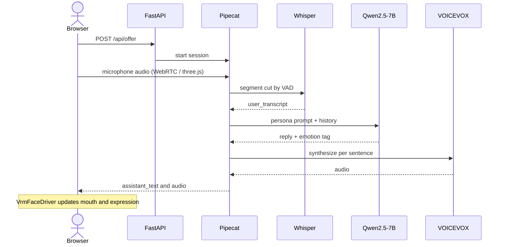

## From one image to a character that moves and talks

Put in a single reference image and a 3D character comes out that moves, speaks, and can be viewed in stereo. **3D Chatting** is a personal web app that keeps that whole flow on one Mac.

The backend is Python 3.13 with FastAPI. The frontend is Vite and TypeScript, with no React or other framework — the UI is built with the DOM API. Rendering uses three 0.184 with `@pixiv/three-vrm` 3.5.5, voice runs through Pipecat, authentication is passkeys only, and character production is handled by an MCP server that drives VRoid Studio (`tools/vroid-macos-mcp`).

This post walks through how those four layers connect, using excerpts from the repository. The refinement loop itself is in [the companion post on the process side](/en/post/202611153d-chatting-solution/).

## Architecture

One conversational turn moves data in this order.



Figure 1: The order data moves in one conversational turn

Responsibilities are split as follows.

- **Display and input**: the three.js scene, VRM expressions, lip sync, and the stereo outputs
- **Conversation**: FastAPI handles the WebRTC offer; Pipecat runs STT → LLM → TTS
- **Storage**: characters in `character.json`, authentication in SQLite (`auth.db`)
- **Production**: VRoid Studio lives outside the app; the app only imports the exported VRM

## Technology choices

| Question | Chosen | Alternative | Why |
|---|---|---|---|
| Rendering | three 0.184 + three-vrm 3.5.5 | WebGPU / Babylon.js | `@lookingglass/webxr` has no WebGPU support; 0.184 is the version Liteforms uses |
| UI | Vite + TypeScript + DOM API | React | The mutable state lives in the three.js scene and WebRTC; a few dozen panels gain little from diffing |
| API | FastAPI + uvicorn | Flask | Awaiting a WebRTC offer and generation jobs fits the async model directly |
| Voice | Pipecat + SmallWebRTC | A hand-written WebSocket | Interruption and echo cancellation come for free |
| Auth | WebAuthn (`webauthn` / `@simplewebauthn/browser`) | Password + JWT | No verification secret stored in a local app |

## Core implementation

### 1. Put rejection in the outer middleware

`backend/app/main.py` relies on middlewares running in the reverse of the order they were added, so the rejection layers sit outside.

```python
# backend/app/main.py
app = FastAPI(title="3D Chatting")
# Added first, so it runs last of the three: LocalOnly > CORS (answers preflights) > Auth > routes.
app.add_middleware(AuthMiddleware)
app.add_middleware(
    AppCORSMiddleware,
    allow_methods=["*"],
    allow_headers=["*"],
)
# Added last, so it runs first: nothing behind it sees a rejected request.
app.add_middleware(LocalOnlyMiddleware)
```

`LocalOnlyMiddleware` returns 403 `forbidden_host` when `Host` is anything but `localhost` or `127.0.0.1`. For methods other than GET, HEAD, and OPTIONS it also checks `Origin` and `Sec-Fetch-Site`. CORS alone is not enough: a multipart POST is a "simple request", so the handler runs before the browser decides whether the page may read the response.

`AuthMiddleware`, inside it, denies by default. Only six exact paths are listed in `PUBLIC_ROUTES`, so any new route is protected without anyone remembering to do it. WebSockets have no method, so they count as state-changing and are closed with 1008.

### 2. Require a resident key and user verification

Authentication lives in `backend/app/auth/router.py`. There is no password; the server stores public keys only.

```python
# backend/app/auth/router.py (_registration_options)
options = generate_registration_options(
    rp_id=settings.webauthn_rp_id,
    rp_name=RP_NAME,
    user_id=user_id.encode(),
    user_name=username,
    timeout=CEREMONY_TIMEOUT_MS,
    attestation=AttestationConveyancePreference.NONE,
    authenticator_selection=AuthenticatorSelectionCriteria(
        resident_key=ResidentKeyRequirement.REQUIRED,
        user_verification=UserVerificationRequirement.REQUIRED,
    ),
    exclude_credentials=_descriptors(store.list_credentials(user_id)),
)
ceremony_id = store.create_challenge(
    ceremony,
    options.challenge,
    CHALLENGE_TTL_SECS,
    user_id=user_id,
    username=username,
    recovery_hash=recovery_hash,
)
```

With `resident_key=REQUIRED`, "sign in with a passkey" works without typing a username first. The login side also sets `user_verification=REQUIRED` and checks that the `userHandle` matches the stored `user_id`. Challenges live 180 seconds and are single-use; the six authentication endpoints are rate limited per IP. Failure messages are identical per kind, so an attacker cannot tell an unknown user from a bad signature.

### 3. Treat bones as roles, not names

VRM fixes bone names and expression names in the specification. `frontend/src/viewer/vrm.ts` translates the app's role names into humanoid bone names.

```ts
// frontend/src/viewer/vrm.ts
const ROLE_TO_VRM: Partial<Record<BoneRole, string>> = {
  hips: 'hips',
  spine: 'spine',
  chest: 'chest',
  neck: 'neck',
  head: 'head',
};
for (const side of ['left', 'right'] as const) {
  ROLE_TO_VRM[`${side}UpperArm`] = `${side}UpperArm`;
  ROLE_TO_VRM[`${side}ForeArm`] = `${side}LowerArm`;
  ROLE_TO_VRM[`${side}Hand`] = `${side}Hand`;
  ROLE_TO_VRM[`${side}UpperLeg`] = `${side}UpperLeg`;
  ROLE_TO_VRM[`${side}LowerLeg`] = `${side}LowerLeg`;
  ROLE_TO_VRM[`${side}Foot`] = `${side}Foot`;
}
```

Roles the model lacks stay `null`; nothing is invented. Only the forearm is renamed, because VRM calls it `LowerArm`.

VRM exports in a T pose, so `frontend/src/viewer/characterLoader.ts` lowers the arms by `VRM_ARMS_DOWN_DEG = 70` degrees and uses that as the rest pose. Expressions are handled by `frontend/src/face/VrmFaceDriver.ts`, which writes weights to VRM preset names (`aa` / `ih` / `ou` / `ee` / `oh`, `blink`, `happy`, and so on) and never touches meshes.

### 4. Make VRoid Studio a tool you look at and click

VRoid Studio has no public API for external editing. So `tools/vroid-macos-mcp` exists: a Python FastMCP server over stdio, with capture, OCR, and clicking delegated to three Swift helpers (`CGWindowList`, Vision OCR, `CGEvent`).

```python
# tools/vroid-macos-mcp/src/vroid_macos_mcp/server.py
mcp = FastMCP("vroid-macos", instructions=INSTRUCTIONS)
_LAST: dict[str, Any] = {}


@mcp.tool()
def vroid_status() -> dict[str, Any]:
    """Check VRoid, permissions, helper binaries and the frontmost app."""
    return macos.status()
```

There are 33 tools. `vroid_find_text` returns OCR hits in **screen points**, so `centerX` / `centerY` go straight into `vroid_click`. Colour, sliders, and VRM export are covered too, but because it never calls an internal API, it depends on what the screen looks like.

## Quality and performance

Rendering runs at about 100 fps on an M4 Pro in the real window (unchanged for idle, dance, and SBS; draw calls are 2 and 4). The 24–66 viewpoint load and a physical Looking Glass are not measured yet.

Latency comes from an end-to-end test that feeds synthesized Japanese into the microphone. Three turns plus a voice interruption passed 27/27; steady-state numbers:

| Segment | Measured |
|---|---|
| End of speech → first sound (backchannel) | 0.79–0.97 s |
| End of speech → reply text | 1.1–1.3 s |
| End of speech → reply audio | 1.5–2.3 s |
| Voice interruption → stop | 0.6–0.8 s |

Reply audio has not reached the P50 target of 1.5 seconds. Streaming STT or starting TTS mid-sentence would be needed.

Tests: the backend passes 1122 pytest cases with 1 skip and 1 known failure; the frontend has 390; E2E runs are 66/66 and 130/130.

## Pitfalls

- **Passkeys do not work on an IP address**: opening the app at `127.0.0.1` cannot register. The frontend listens on `127.0.0.1` but moves the page to `localhost`. Changing the RP ID forces re-registration, so `WEBAUTHN_RP_ID` is an environment variable.
- **CORS does not apply to WebSockets**: browsers never apply CORS to a WebSocket, so the app checks `Origin` itself and closes with 1008.

## Takeaways

The design comes down to three things.

- Riding the VRM specification means a new model needs no new app code
- Authentication and origin checks belong in middleware with default deny, not in each route
- An app with no API belongs outside, as an MCP server that reads the screen; the app only receives the artifact

## Related posts

- [Turning one image into a moving 3D character: making the process repeatable](/en/post/202611153d-chatting-solution/)

---

**Working on a 3D or VRM viewer, or a local-only web app?**

I take on technical consulting and development support.

[Hire me on Coconala](https://coconala.com/users/1117897)
