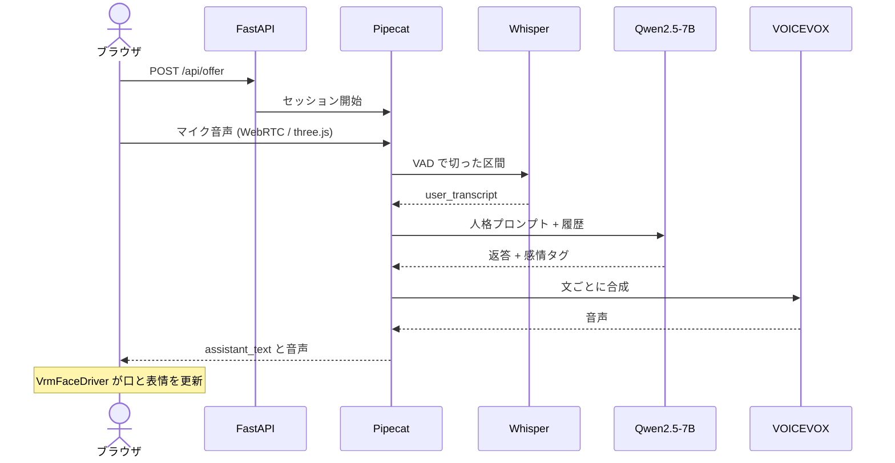

## 画像1枚から、動いて話す3Dキャラクターまで

参照画像を1枚入れたら、動いて話して立体視できる3Dキャラクターが出てくる。**3D Chatting** は、その流れをローカルのMacで完結させる個人用のWebアプリです。

バックエンドは Python 3.13 + FastAPI、フロントエンドは Vite + TypeScript で、React などのフレームワークは入れず DOM API で画面を組み立てています。描画は three 0.184 と `@pixiv/three-vrm` 3.5.5、音声は Pipecat、認証はパスキーだけ、制作は VRoid Studio を操作する MCP（`tools/vroid-macos-mcp`）が担当します。

4層がどこで繋がるかを実装の抜粋で整理します。作り込みの反復手順は[課題解決側の記事](/post/202611153d-chatting-solution/)に分けました。

## 全体構成

1ターンの会話でデータが流れる順序は次のとおりです。



図1: 1ターンの会話でデータが流れる順序

責務は次のように割り切っています。

- **表示と入力**: three.js のシーン、VRM の表情、口パク、立体視の出力
- **会話**: FastAPI が WebRTC の offer を捌き、Pipecat が STT → LLM → TTS を回す
- **保存**: キャラクターは `character.json`、認証は SQLite の `auth.db`
- **制作**: VRoid Studio の操作はアプリの外。アプリは書き出された VRM を取り込むだけ

## 技術選定

| 論点 | 採用 | 代替案 | 採用理由 |
|---|---|---|---|
| 描画 | three 0.184 + three-vrm 3.5.5 | WebGPU / Babylon.js | `@lookingglass/webxr` が WebGPU に未対応。0.184 は Liteforms と同じ版 |
| 画面 | Vite + TypeScript + DOM API | React | 状態は three のシーンと WebRTC が持つ。UI は数十個のパネルで差分更新が効きにくい |
| API | FastAPI + uvicorn | Flask | offer と生成ジョブを非同期で待つ処理をそのまま書ける |
| 音声 | Pipecat + SmallWebRTC | 自前の WebSocket | 割り込みとエコー除去を自作せずに済む |
| 認証 | WebAuthn（`webauthn` / `@simplewebauthn/browser`） | パスワード + JWT | ローカルアプリに照合の秘密を持たせない |

## 実装の核

### 1. ミドルウェアは「拒否」を外側に置く

`backend/app/main.py` は、3つのミドルウェアを**追加した順と逆に実行される**性質を使って、拒否の層を外側に置いています。

```python
# backend/app/main.py
app = FastAPI(title="3D Chatting")
# Added first, so it runs last of the three: LocalOnly > CORS (answers preflights) > Auth > routes.
app.add_middleware(AuthMiddleware)
app.add_middleware(
    AppCORSMiddleware,
    allow_methods=["*"],
    allow_headers=["*"],
)
# Added last, so it runs first: nothing behind it sees a rejected request.
app.add_middleware(LocalOnlyMiddleware)
```

`LocalOnlyMiddleware` は `Host` が `localhost` / `127.0.0.1` 以外なら 403 `forbidden_host` を返します。GET / HEAD / OPTIONS 以外は `Origin` と `Sec-Fetch-Site` も見ます。multipart の POST は「単純リクエスト」で、ブラウザの可否判断より先にハンドラが走るため、CORS だけでは足りません。

内側の `AuthMiddleware` は既定で拒否です。セッションなしで通る6つのパスだけを `PUBLIC_ROUTES` に列挙しているので、新しいルートも自動で保護されます。WebSocket はメソッドを持たないため状態変更とみなし、1008 で閉じます。

### 2. パスキーは居住鍵と本人確認を必須にする

認証は `backend/app/auth/router.py` にまとまっています。パスワードは持たず、サーバーが保存するのは公開鍵だけです。

```python
# backend/app/auth/router.py (_registration_options)
options = generate_registration_options(
    rp_id=settings.webauthn_rp_id,
    rp_name=RP_NAME,
    user_id=user_id.encode(),
    user_name=username,
    timeout=CEREMONY_TIMEOUT_MS,
    attestation=AttestationConveyancePreference.NONE,
    authenticator_selection=AuthenticatorSelectionCriteria(
        resident_key=ResidentKeyRequirement.REQUIRED,
        user_verification=UserVerificationRequirement.REQUIRED,
    ),
    exclude_credentials=_descriptors(store.list_credentials(user_id)),
)
ceremony_id = store.create_challenge(
    ceremony,
    options.challenge,
    CHALLENGE_TTL_SECS,
    user_id=user_id,
    username=username,
    recovery_hash=recovery_hash,
)
```

`resident_key=REQUIRED` なので、ユーザー名を先に入れずに「パスキーでログイン」を押すだけで済みます。認証側も `user_verification=REQUIRED` で、検証では `userHandle` が `user_id` と一致することを確かめます。チャレンジは 180 秒で1回限り、6つの認証エンドポイントは IP ごとに回数制限がかかります。失敗時のメッセージは種類ごとに1つに統一し、ユーザーの有無と署名の誤りを区別しません。

### 3. VRM はボーン名ではなく役割で扱う

VRM は骨の名前と表情の名前が規格で決まっています。`frontend/src/viewer/vrm.ts` は、アプリ内部の役割名を humanoid の骨名に翻訳します。

```ts
// frontend/src/viewer/vrm.ts
const ROLE_TO_VRM: Partial<Record<BoneRole, string>> = {
  hips: 'hips',
  spine: 'spine',
  chest: 'chest',
  neck: 'neck',
  head: 'head',
};
for (const side of ['left', 'right'] as const) {
  ROLE_TO_VRM[`${side}UpperArm`] = `${side}UpperArm`;
  ROLE_TO_VRM[`${side}ForeArm`] = `${side}LowerArm`;
  ROLE_TO_VRM[`${side}Hand`] = `${side}Hand`;
  ROLE_TO_VRM[`${side}UpperLeg`] = `${side}UpperLeg`;
  ROLE_TO_VRM[`${side}LowerLeg`] = `${side}LowerLeg`;
  ROLE_TO_VRM[`${side}Foot`] = `${side}Foot`;
}
```

モデルに無い役割は `null` のままにして、創作しません。前腕だけは VRM 側が `LowerArm` なので読み替えています。

VRM は T ポーズで出力されるため、`frontend/src/viewer/characterLoader.ts` で `VRM_ARMS_DOWN_DEG = 70` 度だけ腕を下ろし、これを静止姿勢にします。表情は `frontend/src/face/VrmFaceDriver.ts` が VRM のプリセット名（`aa` / `ih` / `ou` / `ee` / `oh`、`blink`、`happy` など）に重みを書くだけで、メッシュには触りません。

### 4. VRoid Studio は「画面を見て押す」道具にする

VRoid Studio には外部から編集する公式 API がありません。そこで `tools/vroid-macos-mcp` を作りました。Python の FastMCP（stdio）で、撮影・OCR・クリックは3つの Swift 補助（`CGWindowList`、Vision OCR、`CGEvent`）に任せます。

```python
# tools/vroid-macos-mcp/src/vroid_macos_mcp/server.py
mcp = FastMCP("vroid-macos", instructions=INSTRUCTIONS)
_LAST: dict[str, Any] = {}


@mcp.tool()
def vroid_status() -> dict[str, Any]:
    """Check VRoid, permissions, helper binaries and the frontmost app."""
    return macos.status()
```

ツールは33個あります。`vroid_find_text` が OCR の結果を**画面ポイント**で返すので、`centerX` / `centerY` をそのまま `vroid_click` に渡せます。色・スライダー・書き出しまで揃う一方、内部 API を叩かないぶん画面の見た目に依存します。

## 品質と性能

描画は M4 Pro の実画面で約100fps（待機・ダンス・SBS とも不変、ドローコールは2と4）。24〜66視点ぶんの負荷と実機の Looking Glass は未測定です。

会話の遅延は、合成した日本語をマイクに流す通し試験（3ターンと割り込みで27/27 合格）の定常値です。

| 区間 | 実測 |
|---|---|
| 発話終了 → 最初の音（相槌） | 0.79〜0.97 秒 |
| 発話終了 → 本文テキスト | 1.1〜1.3 秒 |
| 発話終了 → 本文の音声 | 1.5〜2.3 秒 |
| 声の割り込み → 停止 | 0.6〜0.8 秒 |

本文の音声は目標の P50 1.5 秒に届いていません。STT のストリーミング化か、文の途中で TTS を始めるかが必要です。

テストはバックエンドが pytest 1122 件合格・1件 skip・既知の失敗1件、フロント 390 件、E2E は 66/66 と 130/130 です。

## つまずいた点

- **パスキーは IP アドレスでは使えない**: `127.0.0.1` で開くと登録できません。フロントは `127.0.0.1` で待ち受けつつ、ページを `localhost` へ移動させます。RP ID を変えると登録し直しになるため、`WEBAUTHN_RP_ID` は環境変数です。
- **WebSocket に CORS は効かない**: ブラウザは WebSocket に CORS を適用しないため、`Origin` を自前で検査し、通らなければ 1008 で閉じます。

## まとめ

3D Chatting の構成は「規格に乗る、拒否を外側に置く、制作は外に出す」の3点です。

- VRM の骨名と表情名に乗ると、モデルが変わってもアプリ側は変わらない
- 認証とオリジン検査は、ルートごとではなくミドルウェアで既定拒否にする
- API のないアプリは MCP として外に出し、アプリは成果物だけを受け取る

## 関連記事

- [画像1枚から動く3Dキャラクターを作る — 生成の試行錯誤を、記録できる制作工程に変える](/post/202611153d-chatting-solution/)

---

**3D・VRM ビューアやローカル完結のWebアプリの開発でお困りのことはありませんか？**

技術相談や開発サポートを承っています。お気軽にご相談ください。

[ココナラで開発相談を依頼する](https://coconala.com/users/1993863)
