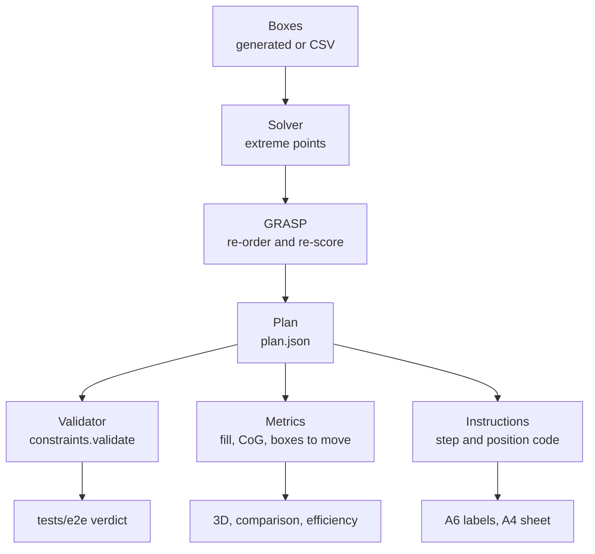

## Turning loading into a plan

Eighty parcels go into a kei van and are delivered in a fixed order. If a box for a later stop sits in front of or on top of an earlier one, the driver has to move it at every stop. Work inside the cargo area — searching, shifting, restacking — accounts for about 18% of a delivery driver's working time, according to a ride-along study that the repository quotes in `docs/research.md` §7.

**3d_packing** turns that loading decision into a plan. It enforces six rules: maximum payload, this-side-up, load bearing, support from below, unloadable in delivery order, and centre-of-gravity balance. It covers three scenes — last mile (kei van), line haul (truck or container), and warehouse pallet — with 10 to 200 sample boxes or your own CSV.

The code is Python 3.13 (`requires-python = ">=3.12,<3.14"` in `pyproject.toml`), and the only dependencies are numpy, plotly, reportlab, segno, and streamlit. The calculation engine is written from scratch, and validation lives in a separate module. This post explains that split and how the engine narrows its candidates.

## Architecture

The pipeline separates the layer that builds a plan from the layer that checks it.



Figure 1: How a load plan flows through the tool

The responsibilities are narrow on purpose:

- **Planning**: `src/packing/solver/` places one box at a time, scores candidate positions, and commits the best.
- **Validation**: `src/packing/constraints.py` recomputes the whole plan from scratch and counts violations.
- **Presentation**: `metrics.py`, `instructions.py`, `labels.py`, and `viz.py` produce the figures, instruction text, PDFs, and 3D views.

The validator exists because the solver's own checks should not be trusted as evidence. The e2e tests judge a plan only by the validator, so a single bug cannot be believed twice.

## Technology choices

| Question | Chosen | Alternative | Why |
|---|---|---|---|
| Placement | Extreme points + GRASP | MILP / CP-SAT | Field constraints are easier to express in code, and runs stay within a few seconds under a time cap |
| Feasibility | Independent validator | Reuse the solver's checks | Keeps the e2e verdict separate from the engine |
| Coordinates | Integer millimetres | Floating point | Contact, support ratio, and overlap compare exactly |
| Candidate scoring | Vectorised numpy | Nested Python loops | Tens of thousands of candidate-box checks per second |
| UI | Streamlit | React + API | The UI only calls the same functions as the CLI, so it holds no state |

Candidates are enumerated and screened in numpy array operations; Python loops only touch the handful of survivors. Whether the load is 80 boxes or 200, the run feels like a few seconds.

## Core implementation

### 1. Fix the coordinate system and orientation rules in the data model

The first decision was the axis convention. The docstring of `src/packing/models.py` states that x=0 is the front wall (cab side), x=L is the rear door, y=0 is left, and z=0 is the floor. The order of `Load.placements` is the loading order.

A this-side-up box may only rotate about the vertical axis, so its height never changes. `Box.orientations` returns the allowed extents.

```python
# src/packing/models.py (Box.orientations)
dims = (self.l, self.w, self.h)
if self.this_side_up:
    cands = [(self.l, self.w, self.h), (self.w, self.l, self.h)]
else:
    cands = [tuple(dims[i] for i in p) for p in permutations(range(3))]
```

Because orientation is a property of the data rather than something decided at placement time, the solver and the validator call the same function. Let that drift and you get a plan that looks fine but fails validation — a bug that is hard to trace.

### 2. Generate candidates, filter by hard rules, then score

Candidate positions come from extreme points: the corners of already placed boxes and of the container. Each candidate is checked for bounds, overlap, support ratio, load bearing, and delivery order, and the survivors are scored.

```python
# src/packing/solver/extreme_points.py (LoadState._eval_chunk)
ratio = np.where(floor, 1.0, sup / base)
keep = ratio >= scene.support_alpha
...
score = wts.x * c1[:, 0] / L + wts.z * c1[:, 2] / H + wts.y * c1[:, 1] / W
if wts.contact:
    score = score - wts.contact * cont / faces
```

The support floor is per scene: 0.75 for last mile and line haul, 0.80 for pallets (`src/packing/presets.py`). The score prefers deep, low, and left, and subtracts for contact area with walls and other boxes. Separate terms push heavy boxes down, limit centre-of-gravity drift, and avoid tip-prone orientations; their weights are varied across iterations.

### 3. The validator recomputes everything

The validator ignores the numbers in the plan and derives them again. Delivery-order feasibility reduces to whether a later box sits above an earlier one or between it and the rear door.

```python
# src/packing/constraints.py (rehandles)
above = xy & (arr[:, g.Z0] >= b[g.Z1])
door_side = yz & (arr[:, g.X0] >= b[g.X1])
blockers = np.nonzero(later & (above | door_side))[0]
```

The solver needs the same definition, so both sides carry a comment pointing at `constraints.rehandles`. Change one and the engine will happily produce plans that always fail validation.

### 4. Rebuild within a time budget

GRASP perturbs the box order and the scoring weights, rebuilds the load many times, and keeps the best plan. It stops on either of two budgets: a work-unit estimate and a wall-clock deadline.

```python
# src/packing/solver/grasp.py (_grasp_loop)
per_iter = ctx.work.units / max(iterations, 1)
while not ctx.out_of_budget(reserve=per_iter):
    ...
    noise = float(rng.uniform(0.0, 0.15))
    order = _order(ctx.boxes, ctx.scene, rule, rng, noise)
    built = _build_spill(ctx, order, _jitter_weights(wsets[wi], rng, 0.35), rng, p_rand)
```

The perturbation is small, 0 to 0.15, because the merit landscape is flat and large jumps almost always lose. With a fixed random seed the same plan comes back, which makes benchmarks and tests comparable.

## Quality and performance

`docs/benchmark.md` records runs for seeds 0 to 4. Of 27 targets, 24 are met.

| Metric | Last mile | Line haul | Pallet |
|---|---|---|---|
| Slowest run | 1.89 s | 2.77 s | 1.49 s |
| Hard-constraint violations | 0 | 0 | 0 |
| Boxes left unplaced | 0 | 0 | 0 |

Three targets are missed. For last mile, "tip risk no worse than the naive stack" and "first-vehicle fill at least as high" fail on some seeds, and the absence-robust stacking does not reach "halve the blocked boxes" (1 of 5 cases, 43% average reduction). Performance is not a merge condition: `benchmarks/report.py` measures it and the report keeps both the passes and the misses.

## Pitfalls

- **A full van turned out to be fastest**: the first delivery simulation said loading the van full was the quickest. The model had no time for digging boxes out or searching for them during the route. Adding `temp_out` (take it out and put it back) and `search` (look for it), and comparing against a load crammed regardless of order, flipped the conclusion. A missing term changes the sign of the answer.
- **The solver tipped more boxes than the naive stack**: the early version stood tall boxes upright and produced 18 to 24 tip-risk boxes, more than the baseline. A penalty term plus a post-pass repair took last mile from 159 to 0 (`docs/worklog.md`).
- **The sample load was too full**: at 80% of the cargo volume, pallet stacking always spilled onto a second pallet. Sample volume was reduced to 70% for line haul and 65% for pallets.

## Takeaways

The design comes down to one sentence: generate many candidates, filter with hard constraints, choose by score — but re-derive feasibility in separate code.

- Keep hard constraints in the data model and the validator, and mirror the same definition in the solver.
- Vectorise candidate screening; keep Python loops for the few survivors.
- Carry both a work-unit budget and a wall-clock cap, and make runs reproducible by seed.
- Treat performance targets as a report, not a merge gate.

There is no physical simulation here, and axle loads come from a two-axle lever model. Even so, two properties transfer to any constrained placement problem: a plan that respects field rules, and a zero-violation check that a different piece of code can confirm.

## Related posts

- [Cutting the time spent searching the cargo area: a load plan that does not cram the van](/en/post/202611153d-packing-solution/)

---

**Need help building logistics or placement optimisation tools?**

I take on technical consulting and development support.

[Hire me on Coconala](https://coconala.com/users/1993863)
