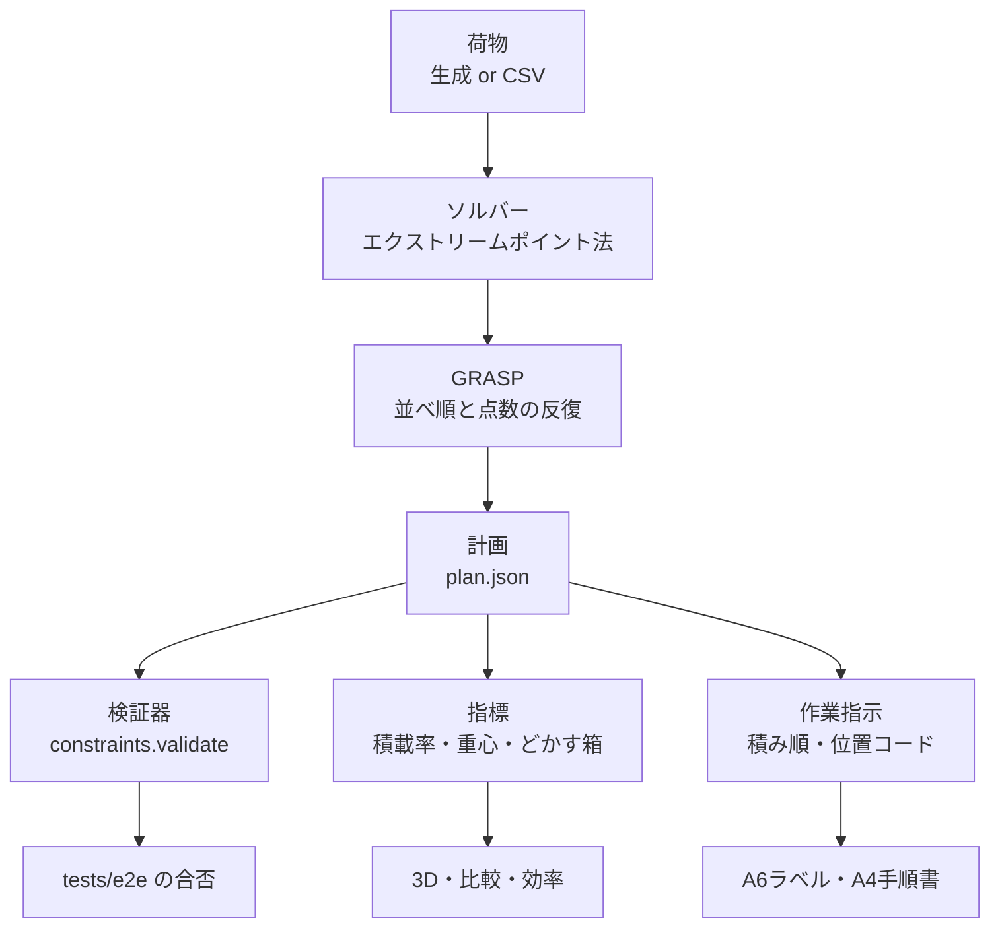

## 荷室の積み付けを「計画」として出す

軽バンに80箱を積み、決められた順番で配達先を回る。このとき、後から届ける箱が手前や上にあると、配達のたびに他の箱をどかすことになります。荷室作業（荷探し・どかす・積み替え）は、宅配ドライバーの作業時間のうち約18%を占めるという調査があります（リポジトリの `docs/research.md` §7 が引用しているヤマト運輸の同行調査）。

**3d_packing** は、この積み方を計画として出力するデモです。守るのは最大積載量、天地無用、耐荷重、下からの支え、配達順に降ろせること、重心バランスの6つです。対象はラストワンマイル（軽バン）、拠点間輸送（トラック・コンテナ）、倉庫パレットの3シーンで、荷物は10〜200箱のサンプル生成かCSVで与えます。

実装は Python 3.13（`pyproject.toml` の `requires-python` は `>=3.12,<3.14`）で、依存は numpy、plotly、reportlab、segno、streamlit だけです。計算エンジンは外部ソルバーを使わず自前で書き、検証は別モジュールに分けています。この記事では、その分担と、候補をどう絞っているかを整理します。

## 全体構成

処理は「計画を作る層」と「計画を確かめる層」に分かれています。



図1: 積み付け計画のデータの流れ

役割は次のように割り切っています。

- **計画**: `src/packing/solver/` が箱を1個ずつ置き、置き場所の候補を評価して選ぶ
- **検証**: `src/packing/constraints.py` が、計画を最初から計算し直して違反を数える
- **提示**: `metrics.py`、`instructions.py`、`labels.py`、`viz.py` が指標・指示文・PDF・3D表示を作る

検証器を別に持つのは、ソルバーの判定をそのまま信用しないためです。e2e テストの合否は検証器だけで決めます。ソルバーと検証器で同じバグを二重に信じる事故を避ける、というのがこの分割の主旨です。

## 技術選定

| 論点 | 採用 | 代替案 | 採用理由 |
|---|---|---|---|
| 配置アルゴリズム | エクストリームポイント法＋GRASP | MILP / CP-SAT | 制約を自前コードで書きやすく、時間上限つきで数秒に収まる |
| 制約の判定 | 独立した検証器 | ソルバー内の判定を流用 | e2e の合否を計算エンジンから切り離せる |
| 座標 | 整数 mm | 浮動小数 | 接触・支持率・重なりの境界を厳密に比較できる |
| 候補評価 | numpy で一括計算 | Python の二重ループ | 候補×配置済み箱の判定を毎秒数万回まわすため |
| 画面 | Streamlit | React + API | 計算は CLI と同じ関数を呼ぶだけなので、UI に状態を持たせない |

候補の列挙と評価は numpy の配列演算でまとめて行い、Python のループは「最後に選ばれた数個」にしか回しません。80箱でも200箱でも、体感は数秒です。

## 実装の核

### 1. 座標系と向きの制約をデータモデルに固定する

最初に決めたのは座標の向きです。`src/packing/models.py` の冒頭に、x=0 が奥（運転席側）、x=L が後扉、y=0 が左、z=0 が床、と明記しています。`Load.placements` の並び順がそのまま積み込み順になります。

天地無用の箱は、高さを変えない回転しか許しません。向きの候補は `Box.orientations` が返します。

```python
# src/packing/models.py（Box.orientations）
dims = (self.l, self.w, self.h)
if self.this_side_up:
    cands = [(self.l, self.w, self.h), (self.w, self.l, self.h)]
else:
    cands = [tuple(dims[i] for i in p) for p in permutations(range(3))]
```

向きを「置く直前」ではなく「データの性質」として持たせたことで、ソルバーも検証器も同じ関数を呼ぶだけで済みます。ここがずれると、計画は出るのに検証で落ちる、という追いにくい不具合になります。

### 2. 候補を作り、ハード制約で絞り、点数で選ぶ

置き場所の候補は、置いた箱の角と荷台の角から作るエクストリームポイントです。候補ごとに、はみ出し・重なり・支持率・耐荷重・配達順を判定し、残ったものに点を付けます。

```python
# src/packing/solver/extreme_points.py（LoadState._eval_chunk）
ratio = np.where(floor, 1.0, sup / base)
keep = ratio >= scene.support_alpha
...
score = wts.x * c1[:, 0] / L + wts.z * c1[:, 2] / H + wts.y * c1[:, 1] / W
if wts.contact:
    score = score - wts.contact * cont / faces
```

支持率の下限はシーンごとの設定で、ラストワンマイルと拠点間輸送が0.75、倉庫パレットが0.80です（`src/packing/presets.py`）。点数は奥・下・左を優先し、壁や他の箱との接触面積が多いほど下がる（＝良い）ようにしています。重い物を下に置く項、重心のずれを抑える項、転倒しやすい向きを避ける項は、重みを変えながら反復します。

### 3. 検証器は計算し直す

検証器は、計画の数値を信じずに全部やり直します。配達順の判定は「後から届ける箱が、上にあるか後扉との間にあるか」で決まります。

```python
# src/packing/constraints.py（rehandles）
above = xy & (arr[:, g.Z0] >= b[g.Z1])
door_side = yz & (arr[:, g.X0] >= b[g.X1])
blockers = np.nonzero(later & (above | door_side))[0]
```

この定義をソルバー側にも同じ形で書く必要があるため、両方にコメントで「`constraints.rehandles` と同じ定義」と残しています。

### 4. 時間予算の中で組み直す

GRASP は、並べ順と点数の重みを少しずつ変えながら何度も組み直し、一番良い計画を残します。打ち切りは作業量の予算と壁時計の上限の二本立てです。

```python
# src/packing/solver/grasp.py（_grasp_loop）
per_iter = ctx.work.units / max(iterations, 1)
while not ctx.out_of_budget(reserve=per_iter):
    ...
    noise = float(rng.uniform(0.0, 0.15))
    order = _order(ctx.boxes, ctx.scene, rule, rng, noise)
    built = _build_spill(ctx, order, _jitter_weights(wsets[wi], rng, 0.35), rng, p_rand)
```

揺らし幅は 0〜0.15 と小さめです。点数の地形が平坦なので、大きく変えるとほぼ確実に悪化します。乱数の種を固定すれば同じ計画が再現できるため、計測とテストの比較ができます。

## 品質と性能

`docs/benchmark.md` に、seed 0〜4 の計測が記録されています。目標27項目のうち24項目を達成しています。

| 指標 | ラストワンマイル | 拠点間輸送 | 倉庫パレット |
|---|---|---|---|
| 計算時間の最大 | 1.89秒 | 2.77秒 | 1.49秒 |
| 制約違反 | 0件 | 0件 | 0件 |
| 積み残し | 0個 | 0個 | 0個 |

未達は3項目です。ラストワンマイルで「倒れる恐れが単純な積み方以下」「1台目の積載率が単純な積み方以上」が一部の seed で崩れ、不在への備えは「ふさがれる箱を半減」に届いていません（5例中1例、平均43%減）。性能はマージの条件にはせず、`benchmarks/report.py` で計測して記録する運用にしています。

## つまずいた点

- **満載が一番速い、という結果**: 最初の配達シミュレーションでは、荷台を満載にする積み方が最も速いという結論が出ました。モデルに「配達中に箱をどかす・探す時間」が入っていなかったためです。荷室作業を temp_out（降ろして戻す）と search（探す）として足し、比べる相手を「配達順を崩して詰め込む」積み方に変えたところ、結論が反転しました。モデルの欠落は、結論の向きを変えます。
- **提案手法のほうが転倒しやすい**: 初期版は、背の高い箱を立てて置くため「倒れる恐れ」が18〜24個と、単純な積み方より多い状態でした。点数の減点と積み終わり後の手直しを入れて、ラストワンマイルで159→0個になっています（`docs/worklog.md`）。
- **サンプル荷物が満杯すぎた**: 荷台容積の80%の荷物を与えると、段単位で積むパレットでは必ず2枚目にはみ出しました。生成量を拠点間輸送70%、パレット65%に調整しています。

## まとめ

このツールの設計は「候補を大量に作り、制約で絞り、点数で選ぶ。ただし判定は別のコードで最初からやり直す」に集約されます。

- ハード制約はデータモデルと検証器に一元化し、ソルバーには同じ定義を写す
- 候補の評価は numpy で一括計算し、Python のループは選ばれた数個だけに回す
- 時間上限と作業量予算を両方持ち、乱数の種で再現できるようにする
- 性能目標はマージ条件から外し、計測レポートに達成・未達を残す

物理シミュレーションはしておらず、軸重も2軸のてこモデルによる概算です。それでも「現場のルールを守った計画が出る」「違反0件を別コードで確認できる」という2点は、積み付けに限らず制約の多い配置問題にそのまま流用できます。

## 関連記事

- [荷室で荷物を探す時間を減らす — 満杯に積まない積み付け計画](/post/202611153d-packing-solution/)

---

**物流・配置最適化ツールの開発でお困りのことはありませんか？**

技術相談や開発サポートを承っています。お気軽にご相談ください。

[ココナラで開発相談を依頼する](https://coconala.com/users/1117897)
