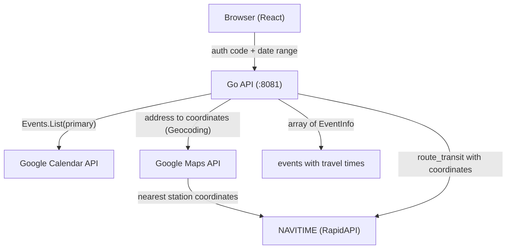

## Putting travel time back into the calendar

A 9 a.m. client visit, a 1 p.m. visit across town, and an 18:00 train. The calendar shows the meetings, but not what time you have to leave to reach them.

**BookingButler** reads Google Calendar events, works out how long it takes to get there from the previous event (or from home), and puts the departure and arrival times next to each event in a small web app. The backend is Go 1.23 with Gorilla Mux; the frontend is React 18 with TypeScript and Vite 6. Google Calendar API supplies the events, Google Maps API resolves the nearest station, and NAVITIME (through RapidAPI) returns the route.

This post walks through the repository to show where each decision is made. It is written for anyone splitting a small app across several external APIs.

## Architecture

The request path is a single line from the browser to three external services.



Figure 1: BookingButler architecture and data flow

The responsibilities are narrow:

- **Browser**: collect OAuth consent and render the `EventInfo` array.
- **Go API**: exchange the code, fetch events, resolve travel times.
- **External APIs**: location in Maps, routing in NAVITIME.

The client secret never reaches the browser, so the authorization code is sent to the server and exchanged there. Vite proxies `/api` to `http://localhost:8081`, which lets the frontend call the API as if it were same-origin (`vite-project/vite.config.ts`).

## Technology choices

| Question | Chosen | Alternative | Why |
|---|---|---|---|
| Authentication | Auth-code flow, exchanged server-side | Hold the access token in the browser | Keeps the client secret off the client |
| Calendar access | `google.golang.org/api/calendar/v3` | Raw REST calls | Types and paging come with the SDK |
| Location | Geocoding + NearbySearch | Pass the address string to the routing API | The routing API wants station coordinates |
| Routing | NAVITIME `route_transit` | Google Directions API | Routes can be planned backwards from an arrival time |
| Frontend | Vite + `@react-oauth/google` | `gapi-script` | The auth-code flow fits a hook |

## Core implementation

### 1. Two routes, one server on 8081

`backend/cmd/api/main.go` defines only two routes. The test endpoint skips authentication so the processing logic can be checked in isolation.

```go
// backend/cmd/api/main.go
r := mux.NewRouter()
r.HandleFunc("/api/events", api.HandleCalendarData).Methods("GET")
r.HandleFunc("/api/test-events", api.HandleTestCalendarData).Methods("GET")

srv := &http.Server{
	Addr:         ":8081",
	Handler:      r,
	ReadTimeout:  5 * time.Second,
	WriteTimeout: 10 * time.Second,
	IdleTimeout:  120 * time.Second,
}
```

A 5-second read and 10-second write timeout are tight for a handler that calls external APIs several times. Ten events spend five seconds on the wait described below, before any network latency is added.

### 2. Take a date range, hand over RFC3339

`backend/api/calendar_api.go` accepts `startDate` and `endDate` as `YYYY-MM-DD`, then sends the start of the first day and the last second of the final day.

```go
// backend/api/calendar_api.go
layout := "2006-01-02"
startTime, err := time.Parse(layout, startDateStr)
timeMin := startTime.Format(time.RFC3339)

endTime, err := time.Parse(layout, endDateStr)
timeMax := endTime.AddDate(0, 0, 1).Add(-time.Second).Format(time.RFC3339)

events, err := calendarService.Events.List("primary").
	ShowDeleted(false).
	SingleEvents(true).
	TimeMin(timeMin).
	TimeMax(timeMax).
	MaxResults(10).
	OrderBy("startTime").
	Do()
```

`SingleEvents(true)` expands recurring events into individual ones, and `OrderBy("startTime")` keeps them chronological. `MaxResults(10)` is a hard ceiling: one request handles ten events at most.

### 3. Same day means the previous event; a new day means home

The hard part of travel time is not the route but **where the trip starts**. `ProcessEvents` in `backend/calendar/calendar_processor.go` compares the current event's date with the previous one and switches the origin.

```go
// backend/calendar/calendar_processor.go (ProcessEvents)
if isDateDifferenceOverOneDay(previousDate, currentEventDateStr) {
	if location != homeLocation {
		transitFromTimeStr, transitToTimeStr = planRoute(mapsClient, homeLocation, location, eventTimeStr)
	}
} else if previousLocation != "" && previousLocation != location {
	transitFromTimeStr, transitToTimeStr = planRoute(mapsClient, previousLocation, location, eventTimeStr)
}
```

A new date means home; the same date means the previous event's location. If two events share a location, no route is requested at all. `isDateDifferenceOverOneDay` normalizes both timestamps to UTC dates, so the comparison is about dates rather than elapsed time.

### 4. Address, station, route

`getNearbyStationName` geocodes the address, then looks for a station within 3,000 meters and takes the first hit.

```go
// backend/calendar/calendar_processor.go (getNearbyStationName)
placesReq := &maps.NearbySearchRequest{
	Location: &maps.LatLng{Lat: lat, Lng: lng},
	Radius:   3000,
	Type:     maps.PlaceTypeTrainStation,
}
```

Those two coordinates go to NAVITIME's `route_transit`. Because the app works backwards from arrival, `goal_time` carries the event's start time; `term=1440`, `limit=5`, and `datum=wgs84` are sent along, and only the first item's `move.from_time` and `move.to_time` are kept.

The event loop waits half a second between iterations so the external APIs are not hammered back to back.

```go
// backend/calendar/calendar_processor.go
ticker := time.NewTicker(time.Second / 2)
for _, item := range events.Items {
	// ...
	<-ticker.C
}
```

## Quality and performance

These are the numbers the repository actually states.

| Item | Value | Source |
|---|---|---|
| Listen address | `:8081` | `backend/cmd/api/main.go` |
| Timeouts | read 5s / write 10s / idle 120s | same |
| Events per request | 10 max | `backend/api/calendar_api.go` |
| Wait between events | 500 ms | `backend/calendar/calendar_processor.go` |
| Station search radius | 3,000 m | same |

There are no automated tests on either side. The only check is `/api/test-events`, which reads `backend/data/sampleCalendarData.json`; that file holds 40 events, which makes the external API latency the dominant cost of a run.

Performance work here is about calling less rather than going faster. Each event costs a station lookup for the origin and the destination (Geocoding plus NearbySearch) and one NAVITIME call, so event count maps directly onto billing and waiting. The 500 ms pause and `MaxResults(10)` are the brakes.

## Pitfalls

- **README drift**: the README describes `gapi` and `grantOfflineAccess()`, with a redirect URI ending in `/callback`. The current `vite-project/src/App.tsx` uses `@react-oauth/google` with `useGoogleLogin({ flow: 'auth-code' })`, and `RedirectURL` is `http://localhost:5173/`. `gapi-script` is still a dependency but is not imported by `src`. Treat the code as the source of truth.
- **All-day events and time zones**: an all-day event with no `Start.DateTime` is treated as 9 a.m. for routing and as midnight for `EventInfo.StartTime`. Date comparison happens in UTC too, so events in other time zones can land on the wrong side of "same day".
- **`log.Fatalf` inside request handling**: a failed `planRoute`, a failed Maps client setup, or a JSON unmarshal error terminates the process. One unresolvable address stops the whole server. The code also logs the authorization code and part of the client secret, and carries a TODO comment about it.

## Takeaways

- Make the calendar the only input, and treat travel as the gap between two events.
- Split external APIs by job — location in one, routing in another.
- Keep the origin decision (home or previous event) inside one function.
- Decide the request ceiling and the pause before you start calling external APIs.

The app is small, but it contains the fragile parts of a real one: OAuth, external APIs, and time arithmetic. That makes it a reasonable starting shape for similar tools.

## Related posts

- [Stop calculating business trip travel time by hand: departure times derived from the calendar](/en/post/20261115booking-butler-solution/)
- [BookingButler: automating business trip management with Google Calendar (in Japanese)](/post/20250711booking-buttler/)

---

**Need help integrating calendars or external APIs?**

I take on technical consulting and development support.

[Hire me on Coconala](https://coconala.com/users/1117897)
