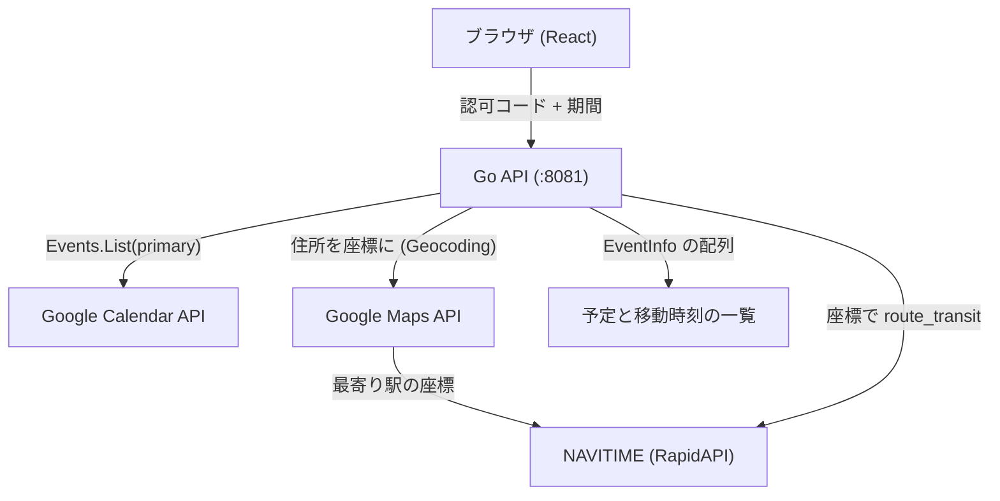

## 出張の予定表に、移動の時刻を書き戻す

9時の客先、13時の別の客先、18時の新幹線。何時に出れば間に合うのかは、予定表からは分かりません。

**BookingButler** は、Google カレンダーの予定を取得し、前の予定（または自宅）からの移動時間を計算して、出発と到着の時刻を予定の隣に並べる Web アプリです。バックエンドは Go 1.23 + Gorilla Mux、フロントエンドは React 18 + TypeScript + Vite 6。カレンダーは Google Calendar API、最寄り駅は Google Maps API、経路は RapidAPI 経由の NAVITIME から取ります。ここでは、外部 API をまたぐ小さなアプリの分割を実装に沿って整理します。

## 全体構成

処理は「ブラウザ → Go API → 外部 API 3種」の一直線です。



図1: BookingButler の構成とデータの流れ

- **ブラウザ**: OAuth の同意取得と、返ってきた `EventInfo` の表示だけ
- **Go API**: トークン交換、予定の取得、移動時間の解決
- **外部 API**: 位置の解決（Maps）と経路の探索（NAVITIME）を分担

ブラウザにクライアントシークレットを置かないため、認可コードはサーバーに送って交換します。Vite は `/api` を `http://localhost:8081` にプロキシします（`vite-project/vite.config.ts`）。

## 技術選定

| 論点 | 採用 | 代替案 | 採用理由 |
|---|---|---|---|
| 認証 | 認可コードフロー＋サーバーで交換 | ブラウザでアクセストークンを保持 | クライアントシークレットを配布せずに済む |
| カレンダー取得 | `google.golang.org/api/calendar/v3` | REST を直接叩く | 型とページングを SDK に任せられる |
| 位置解決 | Geocoding + NearbySearch | 住所文字列をそのまま経路 API へ | 経路 API は駅の座標を要求する |
| 経路 | NAVITIME `route_transit` | Google Directions API | 到着時刻を起点に電車経路を引ける |
| フロント | Vite + `@react-oauth/google` | `gapi-script` | auth-code フローをフックで扱える |

## 実装の核

### 1. ルートは2本、サーバーは8081で待つ

`backend/cmd/api/main.go` のルーターは2本だけです。`/api/test-events` は認証を挟まず、加工ロジックだけを確認する入口です。

```go
// backend/cmd/api/main.go
r := mux.NewRouter()
r.HandleFunc("/api/events", api.HandleCalendarData).Methods("GET")
r.HandleFunc("/api/test-events", api.HandleTestCalendarData).Methods("GET")

srv := &http.Server{
	Addr:         ":8081",
	Handler:      r,
	ReadTimeout:  5 * time.Second,
	WriteTimeout: 10 * time.Second,
	IdleTimeout:  120 * time.Second,
}
```

読み取り5秒・書き込み10秒は、外部 API を叩く処理には短めです。10件では後述の待機だけで5秒を使い、そこに応答時間が乗ります。

### 2. 期間は「日付」で受け取り、RFC3339 に直す

`backend/api/calendar_api.go` は `startDate` と `endDate` を `YYYY-MM-DD` で受け取り、開始はその日の0時、終了は翌日の0時から1秒引いた時刻として渡します。

```go
// backend/api/calendar_api.go
layout := "2006-01-02"
startTime, err := time.Parse(layout, startDateStr)
timeMin := startTime.Format(time.RFC3339)

endTime, err := time.Parse(layout, endDateStr)
timeMax := endTime.AddDate(0, 0, 1).Add(-time.Second).Format(time.RFC3339)

events, err := calendarService.Events.List("primary").
	ShowDeleted(false).
	SingleEvents(true).
	TimeMin(timeMin).
	TimeMax(timeMax).
	MaxResults(10).
	OrderBy("startTime").
	Do()
```

`SingleEvents(true)` で繰り返し予定を展開し、`OrderBy("startTime")` で時系列に並べます。予定は1リクエストで10件までです。

### 3. 起点は「同じ日なら前の予定、違う日なら自宅」

移動時間の計算で難しいのは経路そのものより、**どこから出発するか**です。`backend/calendar/calendar_processor.go` の `ProcessEvents` は、直前の予定の日付と比べて起点を切り替えます。

```go
// backend/calendar/calendar_processor.go（ProcessEvents）
if isDateDifferenceOverOneDay(previousDate, currentEventDateStr) {
	if location != homeLocation {
		transitFromTimeStr, transitToTimeStr = planRoute(mapsClient, homeLocation, location, eventTimeStr)
	}
} else if previousLocation != "" && previousLocation != location {
	transitFromTimeStr, transitToTimeStr = planRoute(mapsClient, previousLocation, location, eventTimeStr)
}
```

日付が変われば自宅から、同じ日なら前の予定の場所から。同じ場所が続く場合は検索自体を省きます。判定は `isDateDifferenceOverOneDay` が UTC の日付に正規化して行います。

### 4. 住所 → 最寄り駅 → 経路の3段階

`getNearbyStationName` は住所をジオコーディングし、その座標から半径3000メートル以内の駅を探して最初の1件を返します。

```go
// backend/calendar/calendar_processor.go（getNearbyStationName）
placesReq := &maps.NearbySearchRequest{
	Location: &maps.LatLng{Lat: lat, Lng: lng},
	Radius:   3000,
	Type:     maps.PlaceTypeTrainStation,
}
```

得た2地点の座標を NAVITIME の `route_transit` に渡します。到着時刻から逆算したいので、`goal_time` には予定の開始時刻を入れます。パラメータは `term=1440`、`limit=5`、`datum=wgs84` で、返ってきた `items` の先頭の `move.from_time` と `move.to_time` だけを使います。

外部 API を連続で叩かないよう、予定のループには500ミリ秒の間隔が入っています。

```go
// backend/calendar/calendar_processor.go
ticker := time.NewTicker(time.Second / 2)
for _, item := range events.Items {
	// ...
	<-ticker.C
}
```

## 品質と性能

リポジトリから読み取れる数値は次のとおりです。

| 項目 | 値 | 出典 |
|---|---|---|
| API サーバーの待受 | `:8081` | `backend/cmd/api/main.go` |
| タイムアウト | Read 5秒 / Write 10秒 / Idle 120秒 | 同上 |
| 1リクエストの予定数 | 最大10件 | `backend/api/calendar_api.go` |
| 予定間の待機 | 500ミリ秒 | `backend/calendar/calendar_processor.go` |
| 駅の探索半径 | 3000メートル | 同上 |

自動テストは Go 側にもフロント側にもありません。確認手段は `backend/data/sampleCalendarData.json` を使う `/api/test-events` で、このファイルには40件の予定が入っています。

性能面は速さよりも「呼びすぎない」に寄っています。予定ごとに Maps を起点と終点で2回（Geocoding と NearbySearch）、NAVITIME を1回呼ぶので、件数が課金と待ち時間に効きます。500ミリ秒の待機と `MaxResults(10)` が歯止めです。

## つまずいた点

- **README とコードのズレ**: README は `gapi` と `grantOfflineAccess()`、リダイレクトURIを `/callback` と説明しています。しかし現在の `vite-project/src/App.tsx` は `@react-oauth/google` の `useGoogleLogin({ flow: 'auth-code' })` を使い、`RedirectURL` は `http://localhost:5173/` です。`gapi-script` は依存に残るものの `src` では未使用です。実装を正として読む必要があります。
- **終日予定とタイムゾーン**: `Start.DateTime` が空の終日予定は、経路検索では当日9時、`EventInfo.StartTime` では0時として扱われます。日付比較も UTC なので、時差のある地域が混ざると「同じ日」の判定がずれます。
- **リクエスト処理の中の `log.Fatalf`**: `planRoute` や `SetupGoogleMapsClient`、JSON のパース失敗は `log.Fatalf` でプロセスごと終了します。1件の住所が解決できないだけでサーバー全体が止まります。認可コードとクライアントシークレットの一部をログに書く実装も残っており、コード内にも TODO が付いたままです。

## まとめ

- 予定表を唯一の入力にし、移動は「予定と予定のあいだ」として計算する
- 外部 API は位置の解決と経路の探索で分け、別サービスに任せる
- 起点の決定（自宅か前の予定か）を1つの関数に閉じ込める
- 外部 API を叩く前に、件数の上限と待機時間を決めておく

OAuth・外部 API・時刻計算という壊れやすい要素が一通り入った構成で、同じ形のツールの下敷きになります。

## 関連記事

- [出張の移動時間を手計算しない — カレンダーから出発時刻を逆算する仕組み](/post/20261115booking-butler-solution/)
- [BookingButler：Googleカレンダー連携で出張管理を自動化するWebアプリ](/post/20250711booking-buttler/)

---

**カレンダー連携や外部 API 統合の開発でお困りのことはありませんか？**

技術相談や開発サポートを承っています。お気軽にご相談ください。

[ココナラで開発相談を依頼する](https://coconala.com/users/1117897)
