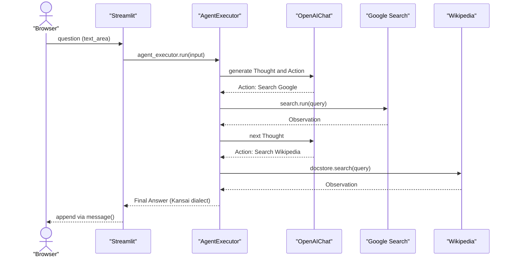

## A small chat UI that can search

ChatGPT on its own cannot answer questions about events after its training cutoff. If you want current information with sources, in your own language, you need an agent that can call a search tool.

`chatGPT_streamlit` is a minimal attempt at exactly that. The UI is Streamlit with streamlit-chat, the agent is LangChain's `ZeroShotAgent` (ReAct), the tools are Google Search and Wikipedia, and the LLM is `OpenAIChat`. A prompt asks for the final answer in Japanese, in a Kansai dialect.

The repository is six commits made on 7–8 March 2023. This post walks through which part owns which responsibility, quoting the code as it stands.

## Architecture

Five things are involved: Streamlit holds input and history, `AgentExecutor` runs the loop, the LLM decides, and two search tools supply outside knowledge.



Figure 1: From question to answer

The responsibilities are narrow:

- **UI**: `st.text_area` takes the question, and `message()` from streamlit-chat draws the history.
- **Reasoning**: `AgentExecutor` repeats Thought → Action → Observation and picks a tool.
- **Knowledge**: Google Search covers current events, Wikipedia covers historical topics.

There is no streaming. The page waits until `agent_executor.run()` returns the final answer. To watch the intermediate reasoning, you read the server's standard output rather than the browser.

## Technology choices

| Question | Chosen | Alternative | Why |
|---|---|---|---|
| UI | Streamlit + streamlit-chat | React + FastAPI | Screen and logic fit in one file |
| Agent | ZeroShotAgent (ReAct) | Fixed search-then-answer chain | The tool should depend on the question |
| LLM | OpenAIChat (temperature=0.5) | ChatOpenAI | It feeds straight into `LLMChain` |
| Search | GoogleSearchAPIWrapper | SerpAPI | Two environment variables: API key and CSE ID |
| History | A list of strings in session_state | ConversationBufferMemory | The minimum that survives a rerun |

SerpAPI was added first and then replaced: the import remains, commented out, while the code uses `GoogleSearchAPIWrapper`. The commit history still has an `add serp` entry, so the migration is visible in place.

## Core implementation

### 1. Define tools, then steer the reasoning with prefix and suffix

The top half of `chatgpt_streamlit/streamlit_run.py`:

```python
# chatgpt_streamlit/streamlit_run.py
docstore = DocstoreExplorer(Wikipedia())
llm = OpenAIChat(temperature=0.5)
# search = SerpAPIWrapper()
search = GoogleSearchAPIWrapper()

tools = [
    Tool(
        name="Search Google",
        func=search.run,
        description="useful for when you need to answer questions about current events",
    ),
    Tool(
        name="Search Wikipedia",
        func=docstore.search,
        description="useful for when you need to answer questions about historical events",
    ),
]
```

Each `description` states when to use the tool. That sentence is the only routing information the agent gets, so it is effectively configuration.

The prompt comes next.

```python
prefix = """Answer the following questions as best you can. 
You think step by step in English.
Finally answer in Japanese.
You have access to the following tools:"""

suffix = """Begin!  
最終的な答えは日本語で答えてください。
質問に答える時には根拠も述べてください。
不足する情報がある場合は質問してください。
関西弁で答えてください。

Question: {input}
{agent_scratchpad}"""

prompt = ZeroShotAgent.create_prompt(
    tools, prefix=prefix, suffix=suffix,
    input_variables=["input", "agent_scratchpad"],
)
```

Reasoning in English, output in Japanese, tone in Kansai dialect. `create_prompt()` slots the tool list in between, and `{agent_scratchpad}` accumulates the reasoning trace. Splitting the languages by role is the distinctive part of this prompt.

### 2. Keep history as a list of strings in session_state

The UI section of `streamlit_run.py`:

```python
# chatgpt_streamlit/streamlit_run.py (UI section)
if "message_history" not in st.session_state:
    st.session_state.message_history = []

for message_ in st.session_state.message_history:
    if "you:" in message_:
        message(message_, is_user=True,
                key=hash(message_ + str(datetime.datetime.today())))
    else:
        message(message_, key=hash(message_ + str(datetime.datetime.today())))

placeholder = st.empty()
input_ = st.text_area("you:")
st.session_state.message_history.append("you:" + input_)
if len(input_) > 0:
    input2_ = agent_executor.run(input_)
    st.session_state.message_history.append("AI:" + input2_)
```

Streamlit re-runs the whole script on every interaction, so history lives in `st.session_state` and the `"you:"` / `"AI:"` prefix marks the speaker. `message()` requires a `key`, which the code derives from the text plus the current date.

### 3. The Cloud Functions side is a conversation chain with memory

`chatgpt_streamlit/cloud_function_chatGPT.py` is a separate implementation without a UI.

```python
# chatgpt_streamlit/cloud_function_chatGPT.py
history = ConversationBufferWindowMemory(k=5)

conversation_with_summary = ConversationChain(
    llm=OpenAIChat(temperature=0.5),
    memory=history,
    verbose=True,
    prompt=prompt,
)
result = conversation_with_summary.predict(input="Hi, what's up?")
print(result)
```

`ConversationBufferWindowMemory(k=5)` keeps the last five turns, and the template pins a persona: an AI turtle butler, Kansai dialect, every sentence ending in "〜やで".

Note what this file is not. It calls `predict()` once and prints the result; there is no function that accepts an HTTP request. Deploying it to Cloud Functions requires adding an entry point. The README's claim of deployment support is best read as intent for now.

## Quality and performance

The repository records no latency or accuracy measurements. What can be said comes from the structure.

- Most of the wall time is LLM calls. A ReAct loop calls the model several times per question, so more tool use means more waiting.
- `verbose=True` prints Thought, Action, and Observation to standard output. The agent was checked mainly through that log; `chatgpt_streamlit/test.ipynb` holds earlier trials of the prompt and the conversation chain.
- There are no automated tests; `tests/` holds only `__init__.py`. Checks were manual.
- Dependencies are pinned to `langchain ^0.0.101`, `streamlit ^1.19.0`, and `openai ^0.27.0`. The code targets that era's API, so an upgrade means rewriting the imports.

## Pitfalls

- **The `message()` key**: `hash(text + date)` collides when the same text appears twice on the same day. Python's `hash()` also varies per process, so keys change on restart. A counter or a UUID would have been safer.
- **Where the append happens**: `append("you:" + input_)` runs on every rerun, whether or not anything was typed. An empty submit therefore adds an empty `"you:"`, and your own line never appears until the next interaction, because the render loop sits above the append. The order of drawing and appending needs to match.
- **README versus code**: the README describes `streamlit_run_chat.py` as a simple chat version, but the file actually sends one system message and one English sentence to `ChatOpenAI` to check translation, with no chat UI at all. Read the code as the source of truth.

## Takeaways

- A ReAct agent is shaped mostly by tool descriptions and the prefix/suffix prompt. The prompt is closer to a config file than the code is.
- Streamlit re-runs the script on every action, so put state in `session_state` and assume the drawing code starts from scratch.
- LangChain APIs from 2023 had short lives. Pinning versions and keeping a working snapshot is the right call for an experiment.

The skeleton of a search-enabled chat fits in a handful of files. Adding a request handler, persisting history, and writing tests are the parts you grow per use case.

## Related posts

- [A search-enabled chat UI in the shortest path: a research assistant with Streamlit and a ReAct agent](/en/post/20261115chatgpt-streamlit-solution/)
- [Building a ChatGPT UI with Streamlit and a LangChain ReAct agent (in Japanese)](/post/chatgpt-streamlit/)

---

**Working on an AI app with LangChain or Streamlit?**

I take on technical consulting and development support.

[Hire me on Coconala](https://coconala.com/users/1117897)
