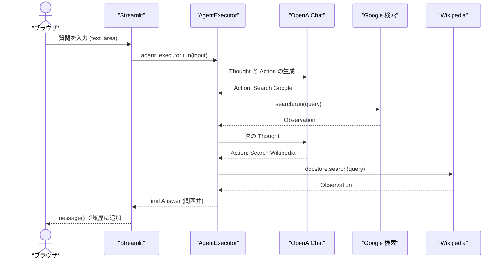

## 検索させるチャットUIを、小さく作りたい

ChatGPT 単体では、学習データのカットオフ以降の出来事を答えられません。「最新の話題を、根拠つきで、日本語で」と願うと、検索ツールを持たせたエージェントが必要になります。

`chatGPT_streamlit` は、その最小構成を試したリポジトリです。UI は Streamlit + streamlit-chat、エージェントは LangChain の `ZeroShotAgent`（ReAct）、ツールは Google 検索と Wikipedia、LLM は `OpenAIChat`。回答は関西弁で返すようにプロンプトで指示しています。

2023年3月7日から8日にかけての、6コミットだけの実験用コードです。この記事では、この小さな構成が「誰が何を担当しているか」を、実装の抜粋とともに整理します。

## 全体構成

登場人物は、Streamlit、`AgentExecutor`、LLM、2つの検索ツールの5つです。Streamlit が入力と履歴、`AgentExecutor` がループ、LLM が判断、ツールが外部知識を持ちます。



図1: 質問から回答までの流れ

責務は次のように分かれています。

- **UI**: `st.text_area` で質問を受け、`streamlit-chat` の `message()` で履歴を描く
- **判断**: `AgentExecutor` が「Thought → Action → Observation」を繰り返し、ツールを選ぶ
- **知識**: Google 検索が現在の情報、Wikipedia が過去の情報を担当する

ストリーミングはありません。`agent_executor.run()` が最終回答を返すまで、画面は待ちます。途中の思考は、画面ではなくサーバーの標準出力に出ます。

## 技術選定

| 論点 | 採用 | 代替案 | 採用理由 |
|---|---|---|---|
| UI | Streamlit + streamlit-chat | React + FastAPI | 1ファイルで画面と処理が完結する |
| エージェント | ZeroShotAgent (ReAct) | 固定の検索→回答チェーン | 質問に応じてツールを選ばせたかった |
| LLM | OpenAIChat (temperature=0.5) | ChatOpenAI | `LLMChain` にそのまま渡せる |
| 検索 | GoogleSearchAPIWrapper | SerpAPI | 環境変数が API キーと CSE ID の2つで済む |
| 履歴 | session_state の文字列リスト | ConversationBufferMemory | 再描画に耐える最小の保持で足りる |

SerpAPI は一度導入されたあと、コード上ではコメントアウトされ、`GoogleSearchAPIWrapper` に置き換わっています。コミット履歴にも `add serp` が残り、移行の途中経過が見えます。

## 実装の核

### 1. ツールを定義し、prefix / suffix で思考を誘導する

`chatgpt_streamlit/streamlit_run.py` の前半です。

```python
# chatgpt_streamlit/streamlit_run.py
docstore = DocstoreExplorer(Wikipedia())
llm = OpenAIChat(temperature=0.5)
# search = SerpAPIWrapper()
search = GoogleSearchAPIWrapper()

tools = [
    Tool(
        name="Search Google",
        func=search.run,
        description="useful for when you need to answer questions about current events",
    ),
    Tool(
        name="Search Wikipedia",
        func=docstore.search,
        description="useful for when you need to answer questions about historical events",
    ),
]
```

`description` は英語で「いつ使うか」を書いています。エージェントはこの文だけを頼りにツールを選ぶので、ここが実質的なルーティング設定です。

続いてプロンプトです。

```python
prefix = """Answer the following questions as best you can. 
You think step by step in English.
Finally answer in Japanese.
You have access to the following tools:"""

suffix = """Begin!  
最終的な答えは日本語で答えてください。
質問に答える時には根拠も述べてください。
不足する情報がある場合は質問してください。
関西弁で答えてください。

Question: {input}
{agent_scratchpad}"""

prompt = ZeroShotAgent.create_prompt(
    tools, prefix=prefix, suffix=suffix,
    input_variables=["input", "agent_scratchpad"],
)
```

思考は英語、出力は日本語、口調は関西弁。`create_prompt()` がツール一覧を間に差し込み、`{agent_scratchpad}` に思考の履歴が積まれます。役割を英語と日本語で分けているのが、このプロンプトの特徴です。

### 2. 履歴は session_state の文字列リストで持つ

`streamlit_run.py` の UI 部分です。

```python
# chatgpt_streamlit/streamlit_run.py（UI 部分）
if "message_history" not in st.session_state:
    st.session_state.message_history = []

for message_ in st.session_state.message_history:
    if "you:" in message_:
        message(message_, is_user=True,
                key=hash(message_ + str(datetime.datetime.today())))
    else:
        message(message_, key=hash(message_ + str(datetime.datetime.today())))

placeholder = st.empty()
input_ = st.text_area("you:")
st.session_state.message_history.append("you:" + input_)
if len(input_) > 0:
    input2_ = agent_executor.run(input_)
    st.session_state.message_history.append("AI:" + input2_)
```

Streamlit は操作のたびにスクリプト全体を上から実行し直します。そのため履歴は `st.session_state` に置き、`"you:"` / `"AI:"` の接頭辞で発話者を見分ける形にしています。`message()` は `key` が必須なので、本文と日付から作っています。

### 3. Cloud Functions 側は会話チェーンと memory

`chatgpt_streamlit/cloud_function_chatGPT.py` は、UI を持たない別系統の実装です。

```python
# chatgpt_streamlit/cloud_function_chatGPT.py
history = ConversationBufferWindowMemory(k=5)

conversation_with_summary = ConversationChain(
    llm=OpenAIChat(temperature=0.5),
    memory=history,
    verbose=True,
    prompt=prompt,
)
result = conversation_with_summary.predict(input="Hi, what's up?")
print(result)
```

直近5往復だけを保持する `ConversationBufferWindowMemory(k=5)` を使い、テンプレートで人格（AIカメ執事・関西弁・語尾に「〜やで」）を固定しています。

ただし、このファイルは `predict()` を1回呼んで `print()` する単体スクリプトで、HTTP リクエストを受ける関数は含まれていません。Cloud Functions に置くには、入り口となるハンドラを足す必要があります。README の「デプロイ対応」は、現状では設計の意図として読むのが正確です。

## 品質と性能

リポジトリには応答時間や精度の計測値がありません。性能として語れるのは、構造から読み取れる性質だけです。

- 待ち時間の大半は LLM の呼び出しです。ReAct は1質問で複数回 LLM を呼ぶため、ツールを使うほど遅くなります
- `verbose=True` により、Thought / Action / Observation が標準出力に出ます。エージェントの動作確認は主にこのログ越しで、`chatgpt_streamlit/test.ipynb` にはプロンプトと会話チェーンを試した跡が残っています
- 自動テストは `tests/` にありません（`__init__.py` のみ）。確認は手動です
- 依存は `langchain ^0.0.101`、`streamlit ^1.19.0`、`openai ^0.27.0` に固定されています。当時の API を前提にしたコードなので、上げると import から作り直しになります

## つまずいた点

- **`message()` の key**: `hash(本文 + 日付)` を渡しているため、同じ日に同じ文が2回来ると key が衝突します。Python の `hash()` はプロセスごとに変わるので、再起動で key も変わります。連番か UUID のほうが安全でした。
- **append の位置**: `append("you:" + input_)` が入力の有無に関係なく毎回走ります。空欄のまま再描画すると空の `"you:"` が積まれ、逆に自分の発言は次の操作まで画面に出ません（履歴の描画ループが append より前にあるため）。描画と追記の順序を揃えるべき箇所です。
- **README と実装のずれ**: README は `streamlit_run_chat.py` を「シンプルなチャット版」と説明していますが、実際の中身は `ChatOpenAI` にシステムメッセージと1文を渡して英仏翻訳をさせるだけの呼び出し確認で、チャット UI はありません。読むときは実装を正とする必要があります。

## まとめ

- ReAct エージェントの挙動は、ツールの `description` と prefix / suffix でほぼ決まる。コードよりプロンプトが設定ファイルに近い
- Streamlit は再実行モデルなので、状態は `session_state` に、描画は毎回最初から、という前提で組む
- 2023年時点の LangChain は API の寿命が短い。バージョンを固定し、動く形をそのまま残すのが実験用としては正解

骨格は数ファイルで把握できます。ハンドラの追加、履歴の永続化、テストは用途に応じて足す部分です。

## 関連記事

- [検索付きチャットUIを最短で用意する — Streamlit と ReAct エージェントで作る調査アシスタント](/post/20261115chatgpt-streamlit-solution/)
- [StreamlitでChatGPTのUIを作る—LangChain ReActエージェントとGoogle検索の組み合わせ](/post/chatgpt-streamlit/)

---

**LangChain や Streamlit を使った AI アプリ開発でお困りのことはありませんか？**

技術相談や開発サポートを承っています。お気軽にご相談ください。

[ココナラで開発相談を依頼する](https://coconala.com/users/1117897)
