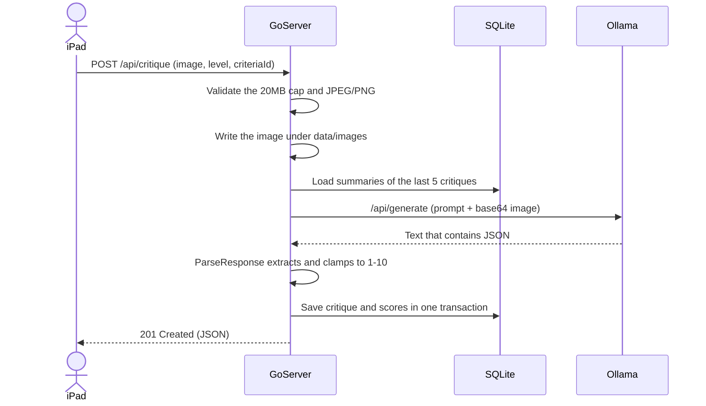

## The person who can critique your drawing is not always there

When you practise drawing, progress speeds up if someone can tell you right after a session which part fell apart and why. Having that person every day is not realistic. Uploading practice sketches to a cloud image-analysis service does not feel right either, and I hear that hesitation often.

**Dessan-sensei** ("drawing teacher") replaces that reviewer with a local vision model. You send a photo of a drawing from an iPad browser, and the app returns a score out of ten plus a comment for each of six criteria. The backend is Go's `net/http`, storage is SQLite in WAL mode, the UI is React with Vite and TypeScript, and inference runs on Qwen3.5 through Ollama.

This post walks the implementation in the repository and explains why the app is split into these four layers.

## Architecture

There are four participants: Safari on the iPad, the Go server on the Mac (:8080), Ollama on the same Mac (:11434), and the SQLite database and image files under `data/`.



Figure 1: The data flow of a single critique

Responsibilities are divided like this:

- **Go server**: input validation, prompt assembly, persistence, history responses
- **Ollama**: only the part that looks at the image and produces scores and comments
- **SQLite**: critique results and scoring criteria, all in one file, `data/dessan.db`
- **React**: upload, result view, history, criteria editing

The server listens on `0.0.0.0:8080` (cmd/server/main.go), and the iPad on the same Wi-Fi opens `http://<mac-ip>:8080`. In development, the Vite dev server on :5173 proxies `/api` to :8080 (web/vite.config.ts). There is no authentication; the app assumes a trusted LAN.

## Technology choices

| Point | Chosen | Alternative | Why |
|---|---|---|---|
| HTTP | Standard `net/http` with Go 1.22 patterns | Echo / chi | Ten routes are enough for `mux.HandleFunc("POST /api/critique", ...)`, and one less dependency |
| Storage | SQLite with mattn/go-sqlite3 | PostgreSQL | One user; a single DB file covers backup and migration between machines |
| VLM | Ollama + Qwen3.5 | A cloud VLM API | Drawings never leave the machine, and there is no per-call billing |
| UI | React + Vite + TypeScript | Server-rendered templates | The screens are mostly state switches between idle, analysing, result, and history |
| API separation | JSON API + `fetch` | GraphQL | Ten endpoints; hand-written types in types.ts are sufficient |

The decisions that actually paid off were the database and the model. Declaring SQLite as "for one user" justifies skipping a connection pool and a migration framework. Choosing Ollama instead of a cloud API gives up managed capacity in exchange for two things: the drawing never leaves the Mac, and the monthly bill is zero.

## Core implementation

### 1. Bake the criteria and a JSON skeleton into the prompt

`internal/ollama/prompt.go` builds the answer format from the list of criteria, so adding a criterion in the UI automatically changes the JSON keys the model is asked for.

```go
// internal/ollama/prompt.go
for i, item := range req.Items {
    comma := ","
    if i == len(req.Items)-1 {
        comma = ""
    }
    sb.WriteString(fmt.Sprintf("    {\"key\": \"%s\", \"label\": \"%s\", \"value\": <1-10の整数>, \"note\": \"<この項目についてのコメント>\"}%s\n", item.Key, item.Label, comma))
}
```

The `value` slot holds a placeholder (`<1-10の整数>`, an integer from 1 to 10), while `key` and `label` are written from server-side values. The model never invents key names, so keys cannot drift between runs. The same function also injects the recent critique history (date, average score, previous improvement point) and the tone for the selected level.

### 2. Images go in as base64, and the timeout is five minutes

`internal/ollama/client.go` base64-encodes the image and posts it to `/api/generate`. Ollama expects the `images` field to be an array of base64 strings.

```go
// internal/ollama/client.go
imageB64 := base64.StdEncoding.EncodeToString(req.ImageBytes)

reqBody := generateRequest{
    Model:  c.model,
    Prompt: prompt,
    Images: []string{imageB64},
    Stream: false,
}
```

With `Stream: false` the whole answer arrives in one response. The HTTP client sets a five-minute timeout (`Timeout: 5 * time.Minute`) instead of relying on the default, because vision inference is slow compared with a normal API call. At startup a `HealthCheck` calls `/api/tags`; if Ollama is down, the server logs a warning and keeps running (cmd/server/main.go) so the other screens stay usable.

### 3. The answer is not always "just JSON"

Even when asked for JSON only, a VLM may wrap it in a fenced block or add prose around it. `internal/ollama/parse.go` tries three extraction paths.

```go
// internal/ollama/parse.go
var jsonBlockRe = regexp.MustCompile("(?s)```(?:json)?\\s*\\n?(\\{.*?\\})\\s*```")
var jsonObjectRe = regexp.MustCompile("(?s)(\\{[^{}]*\"scores\"[^{}]*\\[.*?\\].*?\\})")
```

It tries a fenced block first, then any object containing `"scores"`, then the whole string if it starts with `{` and ends with `}`. Once extracted, every `value` is clamped to 1–10, so a model that returns 0 or 12 still leaves only valid numbers in the database.

### 4. One transaction per save, migrations at startup

`Create` in `internal/store/critique_store.go` wraps the inserts into `critiques` and `scores` in a single transaction, so a row can never keep the overall comment while losing its scores.

```go
// internal/store/critique_store.go
tx, err := s.db.BeginTx(ctx, nil)
if err != nil {
    return fmt.Errorf("begin tx: %w", err)
}
defer tx.Rollback()

_, err = tx.ExecContext(ctx,
    `INSERT INTO critiques (id, image_path, criteria_id, feedback, improvement, next_practice, created_at) VALUES (?, ?, ?, ?, ?, ?, ?)`,
    c.ID, c.ImagePath, c.CriteriaID, c.Feedback, c.Improvement, c.NextPractice, c.CreatedAt,
)
```

The schema comes from `Migrate` in `internal/store/db.go`, which runs `CREATE TABLE IF NOT EXISTS` and then executes `ALTER TABLE` statements for columns added later, ignoring the error when the column already exists. No migration tool is needed, and an existing `data/dessan.db` keeps working.

One detail that earns its keep: the `scores` table stores `label` and `note` itself. Editing the criteria set later does not rewrite old critiques, because each stored score keeps the label used at the time. Deliberately not normalising all the way preserves history as a snapshot.

## Quality and performance

- Tests run with `go test ./...`. There are five test files and 17 test functions under `internal/` (prompt, parse, client, store, domain).
- Uploads are capped at 20 MB and limited to JPEG and PNG (internal/handler/critique_handler.go).
- History returns 20 items per page by default and 100 at most. The history screen fetches 100 at once (web/src/features/history/HistoryPage.tsx).
- Inference time per critique depends on the model and the machine, and the repository records no measurement. The reference environment is a Mac M4 with 48 GB (docs/adr/0001-system-architecture.md).
- SQLite opens in WAL mode (`_journal_mode=WAL` in the DSN in internal/store/db.go), so reading history while a critique is being written does not block much.

Because inference dominates, the bottleneck is almost entirely Ollama. The Go server just waits and watches the request context for cancellation, which is exactly why keeping SQLite — instant startup, no daemon — pays off here.

## Pitfalls

- **Model name mismatch**: the README tells you to run `ollama pull qwen3.5` and lists `qwen3.5` as the default, but cmd/server/main.go defaults to `qwen3.5:27b`. `HealthCheck` only checks that `/api/tags` returns 200, so a wrong tag produces no startup warning. Set `OLLAMA_MODEL` explicitly.
- **Image memory**: the upload is read fully into memory with `io.ReadAll`, then base64-encoded to roughly 1.33x its size and embedded in the JSON body. Even with the 20 MB cap, one critique temporarily uses tens of megabytes. That is acceptable for a single user; raising the cap would call for streaming.
- **Static files are not wired**: `internal/handler/router.go` has a `spaHandler` and `NewRouter` accepts an `fs.FS`, but cmd/server/main.go calls `handler.NewRouter(critiqueH, criteriaH, nil)`. The binary from `make build` serves the API only, and the UI still depends on the Vite dev server. The README says the same thing ("SPA bundled binary: not supported yet"), so the code and the documentation agree.

## Takeaways

- Push the heavy work (the VLM) into another process and keep the Go side to validation, prompting, and persistence.
- Never let the model invent structure; build the JSON skeleton on the server from your own data.
- Assume the answer will be malformed, and always extract and clamp before saving.
- Use a transaction for related rows, and migrate at startup so the app runs without an operations toolchain.

The same shape works for any tool that takes one image and returns a local model's opinion — not only for drawing critique.

## Related posts

- [Putting the reviewer on your own machine: the two walls Dessan-sensei removed](/en/post/20261115dessan-sensei-solution/)
- [Building a drawing critique app with a local LLM: Ollama + Qwen3.5 + Go + React (in Japanese)](/post/dessan-sensei/)

---

**Building something with a local LLM and not sure where it gets stuck?**

I take on technical consulting and development support.

[Hire me on Coconala](https://coconala.com/users/1117897)
