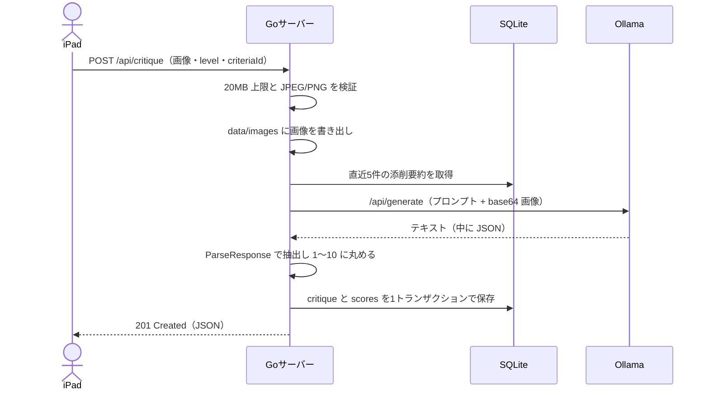

## 添削を頼める相手が、いつも隣にいるわけではない

デッサンの練習では、描いた直後に「どこが崩れているか」を言葉にできる人に会えると上達が速くなります。とはいえ、毎日見てもらうのは現実的ではありません。かといって、練習中のラフをクラウドの画像解析サービスに送るのは気が引ける、という声もよく聞きます。

**デッサン先生（dessan-sensei）** は、その「添削の相手」をローカルの VLM に置き換えた Web アプリです。iPad のブラウザからデッサン写真を送ると、6つの評価項目ごとに10点満点のスコアとコメントが返ります。バックエンドは Go の `net/http`、保存は SQLite（WAL モード）、画面は React + Vite + TypeScript、推論は Ollama 上の Qwen3.5 に任せています。

この記事では、リポジトリの実装を追いながら、なぜこの4層に分けたのかを整理します。

## 全体構成

登場人物は4つです。iPad の Safari、Mac 上の Go サーバー（:8080）、同じ Mac の Ollama（:11434）、そして `data/` 配下の SQLite と画像ファイルです。



図1: 添削1回のデータの流れ

責務は次のように割り切っています。

- **Go サーバー**: 入力検証、プロンプトの組み立て指示、保存、履歴の返却
- **Ollama**: 画像を見てスコアとコメントを作る部分だけ
- **SQLite**: 添削結果と評価軸の保存。`data/dessan.db` 1ファイルで完結
- **React**: アップロード、結果表示、履歴、評価軸の編集

Go サーバーは `0.0.0.0:8080` で待ち受けます（cmd/server/main.go）。同じ Wi-Fi 上の iPad から `http://<MacのIP>:8080` を開く前提です。開発時は Vite の dev server（:5173）が `/api` を :8080 にプロキシします（web/vite.config.ts）。認証はなく、LAN の中だけで使う割り切りです。

## 技術選定

| 論点 | 採用 | 代替案 | 採用理由 |
|---|---|---|---|
| HTTP | Go 標準の `net/http`（Go 1.22 のパターン記法） | Echo / chi | ルートが10本程度なら `mux.HandleFunc("POST /api/critique", ...)` で足りる。依存を1つ減らせる |
| 保存 | SQLite + mattn/go-sqlite3 | PostgreSQL | 利用者は1人。DB ファイル1つでバックアップも移動も済む |
| VLM | Ollama + Qwen3.5 | クラウド VLM API | 絵を外部に送らない。従量課金も発生しない |
| 画面 | React + Vite + TypeScript | サーバーサイドテンプレート | 添削中・結果・履歴を状態で切り替える画面が中心で、SPA の方が書きやすい |
| 画面と API の分離 | JSON API + `fetch` | GraphQL | エンドポイントが10本、型は types.ts の手書きで足りる |

このうち実際に効いたのは、DB と VLM の選択です。SQLite は「1人用」を明言することで、接続プールやマイグレーション基盤を持たない構成を正当化できます。Ollama は OpenAI 互換のクラウドを捨てる代わりに、絵が Mac の外に出ないことと、月額費用がゼロであることを取っています。

## 実装の核

### 1. プロンプトに評価項目と JSON の雛形を埋め込む

`internal/ollama/prompt.go` は、指導項目（criteria）の一覧から回答フォーマットを動的に組み立てます。項目を UI から増やしても、モデルに要求する JSON のキーが自動で揃う仕掛けです。

```go
// internal/ollama/prompt.go
for i, item := range req.Items {
    comma := ","
    if i == len(req.Items)-1 {
        comma = ""
    }
    sb.WriteString(fmt.Sprintf("    {\"key\": \"%s\", \"label\": \"%s\", \"value\": <1-10の整数>, \"note\": \"<この項目についてのコメント>\"}%s\n", item.Key, item.Label, comma))
}
```

`value` の位置に `<1-10の整数>` というプレースホルダを置き、`key` と `label` はサーバー側の値をそのまま書きます。モデルにキー名を考えさせないので、保存時にキーがぶれる余地が減ります。同じ関数は、直近の添削履歴（日付・平均点・前回の改善ポイント）と、レベル別の口調も差し込みます。

### 2. 画像は base64、待ち時間は5分

`internal/ollama/client.go` は、画像を base64 にして `/api/generate` に POST します。Ollama の `images` フィールドは base64 文字列の配列を受け取る形式です。

```go
// internal/ollama/client.go
imageB64 := base64.StdEncoding.EncodeToString(req.ImageBytes)

reqBody := generateRequest{
    Model:  c.model,
    Prompt: prompt,
    Images: []string{imageB64},
    Stream: false,
}
```

`Stream: false` にして、1回のレスポンスで JSON を受け取ります。HTTP クライアントのタイムアウトは5分（`Timeout: 5 * time.Minute`）。VLM の推論は秒単位で待たされるので、デフォルトに任せず明示しています。起動時には `/api/tags` を叩く `HealthCheck` が走り、Ollama が落ちていれば警告だけ出して起動を続けます（cmd/server/main.go）。添削以外の画面はそのまま使えます。

### 3. 返答は「JSON だけ」とは限らない

VLM は指示しても JSON の前後に文章を足したり、コードフェンスで囲んだりします。`internal/ollama/parse.go` は3段階で JSON を拾います。

```go
// internal/ollama/parse.go
var jsonBlockRe = regexp.MustCompile("(?s)```(?:json)?\\s*\\n?(\\{.*?\\})\\s*```")
var jsonObjectRe = regexp.MustCompile("(?s)(\\{[^{}]*\"scores\"[^{}]*\\[.*?\\].*?\\})")
```

まずフェンス付きブロック、次に `"scores"` を含むオブジェクト、最後に文字列全体が `{` で始まり `}` で終わる場合、という順で試します。拾えたら `value` を1〜10に丸めます。モデルが0点や12点を返しても、DB には範囲内の値だけが入ります。

### 4. 保存は1トランザクション、スキーマは起動時マイグレーション

`internal/store/critique_store.go` の `Create` は、`critiques` と `scores` への INSERT を1つのトランザクションにまとめています。総評だけ保存されてスコアが欠けた行を作らないためです。

```go
// internal/store/critique_store.go
tx, err := s.db.BeginTx(ctx, nil)
if err != nil {
    return fmt.Errorf("begin tx: %w", err)
}
defer tx.Rollback()

_, err = tx.ExecContext(ctx,
    `INSERT INTO critiques (id, image_path, criteria_id, feedback, improvement, next_practice, created_at) VALUES (?, ?, ?, ?, ?, ?, ?)`,
    c.ID, c.ImagePath, c.CriteriaID, c.Feedback, c.Improvement, c.NextPractice, c.CreatedAt,
)
```

スキーマは `internal/store/db.go` の `Migrate` が `CREATE TABLE IF NOT EXISTS` で作り、後から足した列は `ALTER TABLE` を実行してエラーを無視する方式です。マイグレーションツールを入れずに、既存の `data/dessan.db` をそのまま使い続けられます。

設計上うまく効いているのが、`scores` テーブルが `label` と `note` を自前で持つ点です。指導項目を後から編集しても、過去の添削結果は当時の項目名のまま読めます。マスタを正規化しきらないことで、履歴のスナップショット性を確保しています。

## 品質と性能

- テストは `go test ./...`。`internal/` 配下に5つのテストファイル、17個のテスト関数があります（prompt / parse / client / store / domain）
- アップロード上限は20MB、JPEG と PNG のみ（internal/handler/critique_handler.go）
- 履歴の1ページは既定20件、最大100件。画面は100件をまとめて取得します（web/src/features/history/HistoryPage.tsx）
- 添削1回の推論時間はモデルとマシン次第で、リポジトリに実測値は記録されていません。動作環境として Mac M4 48GB を想定しています（docs/adr/0001-system-architecture.md）
- SQLite は WAL モードで開きます（internal/store/db.go の DSN に `_journal_mode=WAL`）。履歴の読み取りと添削結果の書き込みが同時に走っても待たされにくくなります

推論が重い処理なので、性能のボトルネックはほぼ Ollama 側です。Go サーバーは待ち時間の間に何もせず、`context` でリクエストのキャンセルだけを見ています。だからこそ、DB を SQLite にして即使える状態を保つ価値が出ます。

## つまずいた点

- **モデル名の食い違い**: README の手順は `ollama pull qwen3.5`、`OLLAMA_MODEL` の既定値も `qwen3.5` ですが、cmd/server/main.go の既定値は `qwen3.5:27b` です。`HealthCheck` は `/api/tags` が 200 を返すかしか見ないため、タグが違っても起動時の警告は出ません。環境変数で明示するのが安全です。
- **画像のメモリ**: アップロードは `io.ReadAll` で全部メモリに読み、base64 で約1.33倍にして JSON に載せます。20MB の上限があっても、1回の添削で数十MB の一時領域を使います。1人用なので許容していますが、上限を上げるならストリーミングを考える必要があります。
- **静的ファイル配信が未接続**: `internal/handler/router.go` には SPA を返す `spaHandler` があり、`NewRouter` も `fs.FS` を受け取ります。しかし cmd/server/main.go は `handler.NewRouter(critiqueH, criteriaH, nil)` と nil を渡しています。つまり `make build` したバイナリは API だけを返し、画面は Vite の dev server 頼りです。README にも「SPA 同梱バイナリ、現時点では未対応」とあり、実装と一致しています。

## まとめ

- 重い処理（VLM）は別プロセスに逃がし、Go 側は入力検証・プロンプト・保存に絞る
- モデルに構造を書かせず、JSON の雛形はサーバー側で組み立てる
- 返答は壊れる前提で、抽出と値の丸めを必ず用意する
- 保存はトランザクション、スキーマは起動時マイグレーションで、運用ツールなしに回す

同じ形は、画像1枚に対してローカルモデルの所見を返すツールなら、デッサン以外にもそのまま流用できます。

## 関連記事

- [添削の相手をローカルに置く — デッサン先生が解いた「見せられない」問題](/post/20261115dessan-sensei-solution/)
- [ローカルLLMでデッサン添削アプリを作った！Ollama + Qwen3.5 + Go + Reactの構成](/post/dessan-sensei/)

---

**ローカル LLM を使ったアプリ開発でお困りのことはありませんか？**

技術相談や開発サポートを承っています。お気軽にご相談ください。

[ココナラで開発相談を依頼する](https://coconala.com/users/1117897)
