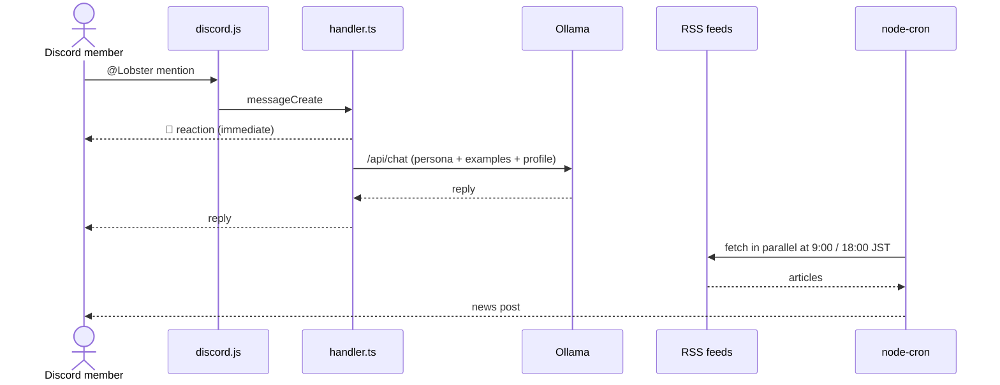

## A bot that replies is not a bot that belongs there

Putting a bot in a Discord server is not hard. A mention handler that replies is a few dozen lines. The hard part comes after that. If every reply sounds the same, people stop talking to it.

**Lobster** is a Kansai-dialect bot that lives in a Discord server's general chat. It talks with members, posts tech news twice a day, and answers "tell me about X" with related articles. Inference runs entirely on Ollama on a Mac mini, with no cloud LLM API.

This post walks through how the Node.js + TypeScript + discord.js + Ollama stack handles the bot's persona, memory, and conversation material, using code from the repository.

## Architecture

There is a single process. discord.js connects to the Gateway and receives messages, the handler calls Ollama's HTTP API, and node-cron starts the news jobs.



Figure 1: Message handling and scheduled posting

Responsibilities are split across discord.js (connection, mention detection, replies), the handler (routing), Ollama (generation, keyword extraction, summarization), news (fetch, dedup, selection, formatting), and node-cron (schedules plus a monthly source audit). All state is JSON. Chat history stays in memory; posted URLs, user profiles, and the synonym cache live under `data/`, with no database.

## Technology choices

| Question | Chosen | Alternative | Why |
|---|---|---|---|
| Bot framework | discord.js 14 | OpenClaw Gateway | Drops the Gateway dependency and keeps one process |
| LLM runtime | Ollama (`/api/chat`) | Cloud LLM API | Conversation never leaves the machine, and cost is fixed |
| Scheduler | node-cron | External cron + CLI | Starts with the bot and stops inside the process |
| RSS parsing | fast-xml-parser | A dedicated RSS library | Handles RSS1, RSS2, and Atom through one path |
| Config validation | zod | Manual checks | Missing env vars or config keys fail at startup |

## Core implementation

### 1. Build the persona from a system prompt, examples, and the other person

The character lives in `config/persona.json`: tone rules, six short example exchanges, and fallback lines. All of it is prepended to every request.

```ts
// src/ollama/client.ts
function buildPreamble(profile?: UserProfile): ReadonlyArray<ChatMessage> {
  const { systemPrompt, examples } = config.persona

  const profileContext = profile
    ? `\n\n【話し相手の情報】\n名前: ${profile.displayName}\n特徴: ${profile.summary}`
    : ''

  const systemMsg: ChatMessage = {
    role: 'system',
    content: systemPrompt + profileContext,
  }

  const fewShot: ReadonlyArray<ChatMessage> = examples.flatMap(e => [
    { role: 'user' as const, content: e.user },
    { role: 'assistant' as const, content: e.assistant },
  ])

  return [systemMsg, ...fewShot]
}
```

The important part is that the examples are not pasted into the system prompt as text. They are pushed as user/assistant turns, so the model learns the tone from demonstrations rather than instructions. Showing the tone tends to work better than describing it, especially for models that drift into polite Japanese.

The caller generates in one shot with `stream: false` and sets `keep_alive` to 30 minutes.

```ts
// src/ollama/client.ts (fetchChat)
body: JSON.stringify({
  model: config.ollama.model,
  messages: [...buildPreamble(profile), ...messages],
  stream: false,
  keep_alive: KEEP_ALIVE,
}),
```

A chat bot is called irregularly. Without this setting, the first mention after a quiet hour pays the model load cost, which reads as "it is only slow when I come back."

### 2. React with 👀 before generating

Generation takes time, so the handler acknowledges the mention first.

```ts
// src/discord/handler.ts
if (!isMentioned) return

// 受け付けたことを最速で知らせる（完了は待たない）
void message.react(ACK_EMOJI).catch(() => {})

const userContent = stripMentions(message.content, botId)
```

Not awaiting is the point. Waiting for the reaction would delay the start of generation by that round trip. Failures are swallowed so the reply path continues.

Routing order is part of the design: interests commands, then topic questions, then news requests, then open chat.

```ts
// src/discord/handler.ts (excerpt)
const interestIntent = classifyInterestRequest(userContent)
if (interestIntent) {
  await handleInterestRequest(message, userContent, interestIntent)
  return
}

if (isRecommendationRequest(userContent)) {
  const topics = await extractTopics(userContent)
  if (topics.length > 0) {
    // expand synonyms → fetch feeds → rank → format
    return
  }
}

if (isNewsRequest(userContent)) {
  // fetch feeds → dedup → select → format
  return
}

const reply = await chat(getHistory(), getProfile(userId))
```

Phrases like 「おすすめ」 and 「最新情報」 can match both news requests and topic questions. Put the specific intent first, or the message falls through to small talk.

### 3. Split news into fetch, drop, and pick

Feeds are fetched in parallel, and one failure does not stop the rest.

```ts
// src/news/fetcher.ts
const results = await Promise.allSettled(
  sources.map((source) => fetchFeed(source))
)
```

The timeout is 15 seconds and failed source names are logged.

Selection is score-based, but the scores use two different scales.

```ts
// src/news/selector.ts
function scoreArticle(article: NewsArticle, interests: ReadonlyArray<string>): number {
  const base = article.source === 'hatena' && article.bookmarkCount != null
    ? article.bookmarkCount
    : new Date(article.publishedAt).getTime()
  return base + (matchesInterests(article, interests) ? INTEREST_BOOST : 0)
}
```

Hatena entries score by bookmark count; everything else scores by publication time in milliseconds. Those are not comparable, so any article matching an interest gets `1e15` added and wins outright, while the rest effectively sort newest-first. Each source is capped at two articles so the post is not dominated by one site.

### 4. Interests change from chat, with no restart

`interests` in `config/news.json` is only the startup seed. At runtime the array in `src/interests/runtime.ts` is the source of truth, and additions or removals are written back to the file at the same time.

```ts
// src/interests/store.ts
function writeNewsJsonAtomic(path: string, data: unknown): void {
  const tmp = path + '.tmp'
  writeFileSync(tmp, JSON.stringify(data, null, 2))
  renameSync(tmp, path)
}
```

Writing to a temporary file and renaming protects `news.json` from a crash mid-write. Confirmation happens with a ✅ reaction, and pending requests expire after 60 seconds.

## Quality and performance

Here are the numbers the repository actually records.

| Item | Value | Source |
|---|---|---|
| News sources | 17 (RSS1 / RSS2 / Atom) | `src/news/feeds.ts` |
| Scheduled posts | Twice a day (9:00 and 18:00 JST) | `config/news.json` |
| Articles per post | 5 (max 2 per source) | `config/news.json`, `src/news/selector.ts` |
| Dedup retention | 500 URLs | `src/news/dedup.ts` |
| Memory | 20 messages, 100 profiles expiring after 90 days | `src/chat/history.ts`, `src/memory/profiles.ts` |

Timeouts are 60 seconds for chat, 15 for feed fetches, 60 for synonym expansion, and 30 for source discovery. The repository records no latency measurements for local inference, so I am not quoting any.

The vitest suite has 30 files and 217 tests. One caveat: `src/news/sources.test.ts` depends on module caching and can fail a single test depending on execution order (observed locally). Test isolation is still an open issue.

## Pitfalls

- **Two homes for the persona**: `config/Modelfile.lobster` still says `FROM qwen2.5:14b`, but the current code does not use the Modelfile at all. It reads `config/persona.json` and `OLLAMA_MODEL`. Editing the old Modelfile changes nothing, which is confusing.
- **Shared chat history**: `src/chat/history.ts` is not a per-user Map. It keeps the last 20 messages in one array, so simultaneous conversations blur together. The profile summarizer compensates: every 10 messages it condenses the user's last 20 messages into 200 characters with Ollama and attaches that to the next reply.
- **Mixed score scales**: bookmark counts and timestamps share a `number`. Boosting interest matches with `INTEREST_BOOST = 1e15` is easy to read, but among interest matches the two scales still mix. For now the rule is simply "match beats recency."

## Takeaways

Lobster is one example of building a resident persona without a heavy framework.

- Compose the persona from a system prompt plus short examples, and attach the other person's profile every time.
- Acknowledge with 👀 and a typing indicator before generation, so the wait is visible rather than silent.
- Split news into fetch, drop, and pick modules, and isolate a single feed failure.
- Separate the startup seed from the runtime source of truth so settings can change from chat.

The same shape fits any tool that runs all day and is called only occasionally.

## Related posts

- [Filling a quiet Discord channel and a broken news flow with one resident bot](/en/post/20261115discord-bot-solution/)
- [A Discord bot running a local LLM on a Mac mini M4 (Japanese)](/post/discord-bot/)

---

**Building a Discord bot or running a local LLM?**

I take on technical consulting and development support.

[Hire me on Coconala](https://coconala.com/users/1117897)
