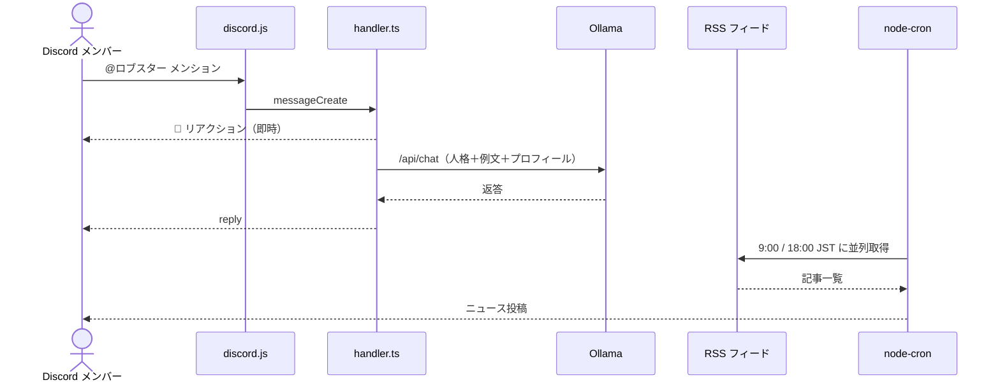

## 「返事をする Bot」と「そこにいる Bot」の差

Discord に Bot を置くこと自体は難しくありません。メンションに返事をさせるだけなら数十行で動きます。難しいのはその先で、毎回同じ調子で返すだけでは、しばらくすると誰も話しかけなくなります。

**ロブスター** は、Discord サーバーの雑談チャンネルに常駐する関西弁の Bot です。会話の相手として振る舞いながら、テック系ニュースを1日2回投稿し、「これについて教えて」と聞けば関連記事を探して返します。推論は Mac mini 上の Ollama で完結します。

この記事では、Node.js + TypeScript + discord.js + Ollama という構成で、Bot の「人格・記憶・ネタ」をどう組み立てているかを、リポジトリのコードとともに整理します。

## 全体構成

プロセスは1つです。discord.js が Gateway に接続してメッセージを受け取り、Ollama の HTTP API を呼び、ニュースは node-cron が起動します。



図1: メッセージ処理と定期投稿の流れ

責務は、discord.js（接続・検知・返信）、handler（振り分け）、Ollama（生成・抽出・要約）、news（取得・排除・選別・整形）、node-cron（定時実行と月1回の棚卸し）に分かれます。状態はすべて JSON です。会話履歴はメモリ上、投稿済み URL・プロフィール・同義語キャッシュは `data/` 配下に置きます。

## 技術選定

| 論点 | 採用 | 代替案 | 採用理由 |
|---|---|---|---|
| Bot フレームワーク | discord.js 14 | OpenClaw Gateway | Gateway 依存を外し、単一プロセスで完結させる |
| LLM 実行 | Ollama（`/api/chat`） | クラウド LLM API | 会話内容を外部に出さず、定額で動かせる |
| スケジューラ | node-cron | 外部 cron + CLI | 起動時に一緒に開始でき、停止もプロセス内で完結する |
| RSS パース | fast-xml-parser | 専用 RSS ライブラリ | RSS1 / RSS2 / Atom を同じ経路で扱える |
| 設定の検証 | zod | 手動バリデーション | 環境変数と `config/*.json` の欠落を起動時に落とせる |

## 実装の核

### 1. 人格は「システムプロンプト＋例文＋相手の情報」の合成で作る

キャラクターの定義は `config/persona.json` にあります。口調のルール、6組の短い例文、失敗時のセリフの3つです。これを毎回のリクエストの先頭に積みます。

```ts
// src/ollama/client.ts
function buildPreamble(profile?: UserProfile): ReadonlyArray<ChatMessage> {
  const { systemPrompt, examples } = config.persona

  const profileContext = profile
    ? `\n\n【話し相手の情報】\n名前: ${profile.displayName}\n特徴: ${profile.summary}`
    : ''

  const systemMsg: ChatMessage = {
    role: 'system',
    content: systemPrompt + profileContext,
  }

  const fewShot: ReadonlyArray<ChatMessage> = examples.flatMap(e => [
    { role: 'user' as const, content: e.user },
    { role: 'assistant' as const, content: e.assistant },
  ])

  return [systemMsg, ...fewShot]
}
```

例文をシステムプロンプトに混ぜず、user / assistant の対話として積むのがポイントです。口調は指示だけで縛るより、例で示すほうが伝わりやすいと考えています。

呼び出し側は `stream: false` で一括生成し、`keep_alive` を30分にしています。

```ts
// src/ollama/client.ts（fetchChat）
body: JSON.stringify({
  model: config.ollama.model,
  messages: [...buildPreamble(profile), ...messages],
  stream: false,
  keep_alive: KEEP_ALIVE,
}),
```

雑談 Bot は呼ばれる間隔が空くため、これがないと「久しぶりに話しかけたときだけ遅い」体験になります。

### 2. 返事より先に 👀 を付ける

生成には時間がかかります。そこで、メンションを受け取った時点でリアクションだけ先に付けます。

```ts
// src/discord/handler.ts
if (!isMentioned) return

// 受け付けたことを最速で知らせる（完了は待たない）
void message.react(ACK_EMOJI).catch(() => {})

const userContent = stripMentions(message.content, botId)
```

`await` しないのが肝です。リアクションの送信を待つと、その分だけ本文の生成開始が遅れます。失敗しても黙って捨てます。

振り分けの順序も設計の一部です。interests の操作 → トピック質問 → ニュース要求 → 雑談、の順に判定します。

```ts
// src/discord/handler.ts（分岐の抜粋）
const interestIntent = classifyInterestRequest(userContent)
if (interestIntent) {
  await handleInterestRequest(message, userContent, interestIntent)
  return
}

if (isRecommendationRequest(userContent)) {
  const topics = await extractTopics(userContent)
  if (topics.length > 0) {
    // 同義語展開 → フィード取得 → ランキング → 整形
    return
  }
}

if (isNewsRequest(userContent)) {
  // フィード取得 → 重複排除 → 選別 → 整形
  return
}

const reply = await chat(getHistory(), getProfile(userId))
```

「おすすめ」「最新情報」のような語はニュース要求にもトピック質問にも当たるため、具体的な意図を先に置かないと雑談に落ちます。

### 3. ニュースは「取る・捨てる・選ぶ」に分ける

フィード取得は17本を並列で投げ、1本の失敗が全体を止めないようにしています。

```ts
// src/news/fetcher.ts
const results = await Promise.allSettled(
  sources.map((source) => fetchFeed(source))
)
```

タイムアウトは15秒で、落ちたソース名はログに残ります。

選別はスコア順ですが、尺度が2種類あります。

```ts
// src/news/selector.ts
function scoreArticle(article: NewsArticle, interests: ReadonlyArray<string>): number {
  const base = article.source === 'hatena' && article.bookmarkCount != null
    ? article.bookmarkCount
    : new Date(article.publishedAt).getTime()
  return base + (matchesInterests(article, interests) ? INTEREST_BOOST : 0)
}
```

はてブはブックマーク数、それ以外は公開日時のミリ秒です。そのままでは比較できないので、interests に一致した記事だけ `1e15` を足して最優先にし、残りは実質「新しい順」で並びます。1ソース最大2件に制限して多様性を確保しています。

### 4. interests は会話で書き換え、再起動しない

`config/news.json` の `interests` は起動時に読むだけの初期値です。実行中は `src/interests/runtime.ts` の配列が真実源で、追加・削除はファイル書き戻しと同時に反映されます。

```ts
// src/interests/store.ts
function writeNewsJsonAtomic(path: string, data: unknown): void {
  const tmp = path + '.tmp'
  writeFileSync(tmp, JSON.stringify(data, null, 2))
  renameSync(tmp, path)
}
```

書き込み中に落ちても `news.json` が壊れないよう、一時ファイルから `rename` します。確定は ✅ リアクションで、待ち状態は60秒で失効します。

## 品質と性能

リポジトリから読み取れる数値を整理します。

| 項目 | 値 | 出典 |
|---|---|---|
| ニュースソース | 17本（RSS1 / RSS2 / Atom） | `src/news/feeds.ts` |
| 定時投稿 | 1日2回（9:00 / 18:00 JST） | `config/news.json` |
| 1回の投稿記事数 | 5件（1ソース最大2件） | `config/news.json`, `src/news/selector.ts` |
| 重複排除の保持 | 500 URL | `src/news/dedup.ts` |
| 会話の記憶 | 履歴20件・プロフィール100件（90日で失効） | `src/chat/history.ts`, `src/memory/profiles.ts` |

タイムアウトは、チャットが60秒、フィード取得が15秒、同義語展開が60秒、ソース探索が30秒です。ローカル LLM の応答時間そのものはリポジトリに記録がないため、ここでは数値を書きません。

テストは vitest で30ファイル・217件あります。`src/news/sources.test.ts` はモジュールのキャッシュに依存し、実行順で1件落ちることがあります（手元で確認）。分離は残課題です。

## つまずいた点

- **人格設定の二重管理**: `config/Modelfile.lobster` は `FROM qwen2.5:14b` のまま残っていますが、現在の実装は Modelfile を使わず、`config/persona.json` と `OLLAMA_MODEL` で動きます。古い Modelfile を編集しても挙動は変わりません。
- **会話履歴がチャンネル共有**: `src/chat/history.ts` はユーザーごとの Map ではなく、直近20件を1本の配列で持ちます。複数人が話すと文脈が混ざります。これを補うのがプロフィールで、10メッセージごとに直近20発言を Ollama で200文字に要約し、次の応答に添えています。
- **スコアの尺度混在**: はてブ数と公開日時を同じ `number` で扱うため、素直には比較できません。`INTEREST_BOOST = 1e15` で興味一致を押し上げる方式は分かりやすい反面、一致した記事同士では尺度が混在します。いまは「一致 > 新着」と割り切っています。

## まとめ

ロブスターの構成は、特別なフレームワークなしで「常駐する人格」を作る一例です。

- 人格はシステムプロンプトと短い例文の合成で作り、相手のプロフィールを毎回添える
- 生成を待たずに 👀 と入力中表示で反応を返し、体感の待ち時間を隠す
- ニュースは取得・排除・選別を別モジュールに分け、1本のフィード障害を局所化する
- 設定は「起動時の初期値」と「実行時の真実源」を分け、会話から更新できるようにする

この形は、雑談 Bot に限らず「常時動いていて、たまに呼ばれる」タイプのツールにそのまま流用できます。

## 関連記事

- [静かな雑談チャンネルと分断されたニュースを、常駐する Bot でつなぐ](/post/20261115discord-bot-solution/)
- [Mac mini M4でローカルLLMを動かすDiscord Bot—関西弁AIとニュース自動投稿の実装](/post/discord-bot/)

---

**Discord Bot やローカル LLM の実装でお困りのことはありませんか？**

技術相談や開発サポートを承っています。お気軽にご相談ください。

[ココナラで開発相談を依頼する](https://coconala.com/users/1117897)
