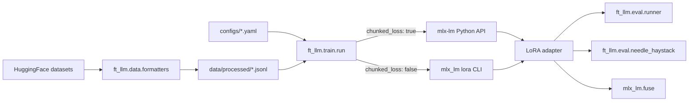

## Training a Japanese LLM on one Mac

Fine-tuning a model for Japanese reading comprehension usually starts with the environment. You provision a CUDA GPU, write a training script, prepare the data, and build an evaluation harness. That round trip alone can take days.

**FT_LLM** packs that round trip into one repository. The target model is LiquidAI's **LFM2.5-1.2B-JP** in its MLX 8-bit form, built on MLX and mlx-lm. Configuration is YAML, training is one command, and both evaluation and long-context testing live in the same place.

This post walks through the pipeline's structure and the numbers it has recorded.

## Architecture



Figure 1: Module layout of FT_LLM

The center is `src/ft_llm/train/run.py`. It reads the config, reshapes it into something mlx-lm accepts, and picks an execution mode. Training itself stays with mlx-lm; this repository holds only preprocessing, configuration, evaluation, and conversion.

`src/ft_llm/data/formatters.py` converts HuggingFace datasets into JSONL where each line is `{"messages": [{role, content}, ...]}`. It covers JsQuAD and JaQuAD (extractive QA), JCommonsenseQA (five-choice), and JNLI (entailment).

## Technology choices

| Question | Chosen | Alternative | Why |
|---|---|---|---|
| Training framework | mlx-lm | PyTorch + MPS | ADR-0001 rejected PyTorch MPS at roughly 1/30 of MLX's inference speed |
| Method | LoRA (rank 16 for 1.2B) | Full fine-tuning | Trains on the 8-bit model as-is; the adapter is about 34 MB |
| Long-sequence loss | Chunked cross-entropy | mlx-lm default loss | Projects logits chunk by chunk to cap peak memory |
| Config | YAML + required-key validation | Values in code | `--dry-run` shows the resolved config first |
| Distribution | GGUF → Ollama | Ship MLX weights | Runs from Ollama as a 14 GB q4_K_M model |

## Core implementation

### 1. YAML config, two execution modes

`configs/lora_1.2b_jp.yaml` holds the Phase 1 setup.

```yaml
# configs/lora_1.2b_jp.yaml
model: "LiquidAI/LFM2.5-1.2B-JP-MLX-8bit"

lora_parameters:
  rank: 16
  dropout: 0.0
  scale: 20.0
  keys:
    - "self_attn.q_proj"
    - "self_attn.k_proj"
    - "self_attn.v_proj"
    - "self_attn.out_proj"
    - "conv.in_proj"
    - "conv.out_proj"
    - "feed_forward.w1"
    - "feed_forward.w3"

train: true
data: "data/processed/jsquad"
num_layers: 16
batch_size: 4
iters: 15000
learning_rate: 2.0e-4
adapter_path: "models/adapters/lora_1.2b_jp_jsquad"
max_seq_length: 2048
seed: 42
```

`run.py` strips the keys it owns and passes the rest to mlx-lm.

```python
# src/ft_llm/train/run.py
CUSTOM_KEYS = {
    "chunked_loss",
    "chunked_loss_chunk_size",
    "early_stopping_patience",
    "early_stopping_min_delta",
}

# ... at the end of main()
if use_chunked_loss:
    _run_python_api(config, mlx_config)
else:
    _run_cli(mlx_config)
```

With `chunked_loss: false`, the wrapper just launches `python -m mlx_lm lora -c <tmp.yaml>`. With `true`, it calls mlx-lm's Python API and swaps in a custom loss. One flag moves you between the two paths.

### 2. Accumulate loss without materializing logits

At 8K sequence length, holding logits for every token at once puts pressure on memory. `src/ft_llm/train/chunked_loss.py` runs the backbone once, then projects to the LM head and computes cross-entropy chunk by chunk.

```python
# src/ft_llm/train/chunked_loss.py (chunked_loss_fn)
hidden = model.model(inputs)

for start in range(0, seq_len, chunk_size):
    end = min(start + chunk_size, seq_len)
    chunk_logits = _project_to_logits(model, hidden[:, start:end, :])
    chunk_targets = targets[:, start:end]
    chunk_mask = mask[:, start:end]

    chunk_ntoks = chunk_mask.sum()
    ce = nn.losses.cross_entropy(chunk_logits, chunk_targets) * chunk_mask
    total_loss = total_loss + ce.astype(mx.float32).sum()
    total_tokens = total_tokens + chunk_ntoks

safe_total = mx.maximum(total_tokens, mx.array(1))
return total_loss / safe_total.astype(mx.float32), total_tokens
```

The module docstring records the effect: at 16K sequence length with a 32K vocabulary, peak logits memory drops from about 6.5 GB to about 200 MB with `chunk_size=512`. The `mx.maximum` guard is a second difference from the default loss — it avoids dividing by zero when every token in a batch is masked.

### 3. Stop on validation loss

`src/ft_llm/train/early_stopping.py` subclasses mlx-lm's `TrainingCallback` and raises an exception when validation loss stops improving.

```python
# src/ft_llm/train/early_stopping.py (on_val_loss_report)
if val_loss < self.best_val_loss - self.min_delta:
    self.best_val_loss = val_loss
    self.counter = 0
    self.best_iteration = iteration
else:
    self.counter += 1
    if self.counter >= self.patience:
        raise EarlyStopException(
            f"Early stop at iter {iteration}. "
            f"Best val_loss={self.best_val_loss:.4f} "
            f"at iter {self.best_iteration}"
        )
```

`_run_python_api` catches that exception and treats it as a normal stop. In the 24B mixed-data run, patience=5 fired at iteration 5000, and the best validation loss was 2.5951 at iteration 2500 (ADR-0002).

### 4. Score Japanese at the character level

Japanese has no word boundaries, so `src/ft_llm/eval/metrics.py` implements character-level F1 and ROUGE-L. Preprocessing is NFKC normalization, punctuation and symbol removal, and lowercasing.

```python
# src/ft_llm/eval/metrics.py
text = unicodedata.normalize("NFKC", text)
text = re.sub(r"[\s。、．，！？!?・「」『』（）()【】\[\]{}《》〈〉…―─\-–—]", "", text)
text = text.lower()

# ... f1_score_chars
pred_counter = Counter(pred_chars)
gold_counter = Counter(gold_chars)
common = sum((pred_counter & gold_counter).values())
precision = common / len(pred_chars)
recall = common / len(gold_chars)
return 2 * precision * recall / (precision + recall)
```

Metrics follow the task name: exact match and F1 for extractive QA, accuracy for five-choice and NLI, ROUGE-L for summarization.

## Quality and performance

These are the measurements stored under `results/`.

| Item | LFM2.5-1.2B-JP | LFM2-24B-A2B |
|---|---|---|
| LoRA rank / layers | 16 / 16 | 8 / 8 |
| Training data | 62,859 JsQuAD rows | 15,000 mixed rows |
| max_seq_length | 2,048 | 8,192 |
| Peak memory | not recorded | 28.055 GB |
| Adapter size | about 34 MB | about 3.2 MB |

Evaluation on 100 held-out JsQuAD examples:

| Model | Base F1 | With adapter F1 |
|---|---|---|
| LFM2.5-1.2B-JP | 0.3426 (EM 0.09) | 0.0236 (EM 0.00) |
| LFM2-24B-A2B | 0.2268 (EM 0.00) | 0.6945 (EM 0.42) |

Long context is measured with needle-in-a-haystack: five facts embedded in 2,048–16,384 characters of filler text at five positions from 0.1 to 0.9, for 100 tests total.

| Context length | Base | Mixed-data adapter |
|---|---|---|
| 2,048 chars | 0.8047 | 0.7715 |
| 4,096 chars | 0.5794 | 0.7635 |
| 8,192 chars | 0.4508 | 0.5039 |
| 16,384 chars | 0.4451 | 0.3089 |

Overall, the base model scores F1 0.5700 / EM 0.1100 and the mixed-data adapter scores F1 0.5870 / EM 0.2700 across 100 tests each. The adapter wins at 4K and 8K, and falls short at 16K.

## Pitfalls

- **The 1.2B adapter made things worse.** JsQuAD F1 fell from 0.3426 to 0.0236 and exact match from 0.09 to 0.00. Training completed all 15,000 iterations and the adapter was saved. No analysis of the cause is recorded in the repository, so this remains open. Since the same evaluation harness shows gains on the 24B model, I treat it as a model-and-data problem rather than a pipeline problem.
- **Staged long-context training destroyed long-context ability.** Training short QA, then 4K, then 8K dropped 16K F1 from a 0.4451 baseline to 0.0870 (ADR-0002). Adding more stages did not recover it; switching to a single stage that mixes short, medium, and long examples brought it back to 0.3089.
- **The custom loss depends on mlx-lm internals.** mlx-lm's CLI cannot accept a replacement loss function, so `_run_python_api` re-implements model loading, LoRA application, and `TrainingArgs` construction itself. If mlx-lm's internals change, this path breaks first.

## Takeaways

FT_LLM settles on a simple split: mlx-lm trains, the repository owns preprocessing and evaluation.

- Keep configuration in YAML and check the resolved values with `--dry-run` before spending compute.
- Drop to the Python API only where memory is tight, and split the loss into chunks there.
- Score Japanese at the character level so models stay comparable.
- Write training conditions and results to JSON under `results/`, so later decisions have evidence.

The 1.2B result is left in place as it is. Numbers are what let you tell later whether a change actually helped.

## Related posts

- [Fine-tuning a Japanese LLM without a GPU: a training and evaluation loop on one Mac](/en/post/20261115ft-llm-solution/)
- [Fine-tuning an LLM on Apple Silicon with MLX and LoRA (in Japanese)](/post/ft-llm/)

---

**Working on Japanese LLM fine-tuning or an evaluation harness?**

I take on technical consulting and development support.

[Hire me on Coconala](https://coconala.com/users/1993863)
