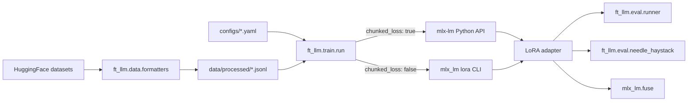

## Mac 1台で回す日本語 LLM の学習

日本語の読解タスクに合わせてモデルを調整したいとき、最初の壁は環境です。CUDA のGPUを用意し、学習スクリプトを書き、データを整形し、評価まで用意する。この往復だけで数日かかります。

**FT_LLM** は、その往復を1つのリポジトリにまとめたパイプラインです。対象は LiquidAI の **LFM2.5-1.2B-JP**（MLX 8bit 量子化版）で、土台は MLX と mlx-lm です。設定は YAML、実行は1コマンド、評価と長文テストも同じ場所から呼べます。

## 全体構成



図1: FT_LLM のモジュール構成

中心は `src/ft_llm/train/run.py` です。設定を読み、mlx-lm に渡せる形へ整え、実行モードを選びます。学習そのものは mlx-lm に任せ、このリポジトリは前処理・設定・評価・変換を持つ薄い層に留めています。

`src/ft_llm/data/formatters.py` は HuggingFace のデータを `{"messages": [{role, content}, ...]}` の JSONL に変換します。JsQuAD と JaQuAD（抽出型QA）、JCommonsenseQA（5択）、JNLI（含意判定）に対応しています。

## 技術選定

| 論点 | 採用 | 代替案 | 採用理由 |
|---|---|---|---|
| 学習フレームワーク | mlx-lm | PyTorch + MPS | ADR-0001 が PyTorch MPS を約1/30の推論速度として不採用にした |
| 学習方式 | LoRA（1.2B は rank 16） | 全パラメータ学習 | 8bit 量子化のまま学習でき、アダプタは約34MB |
| 長文の損失計算 | Chunked Cross-Entropy | mlx-lm の既定損失 | logits をチャンク単位で射影し、ピークメモリを下げる |
| 設定管理 | YAML + 必須キー検証 | コードに直書き | `--dry-run` で解決後の設定を先に確認できる |
| 配布 | GGUF → Ollama | MLX のまま配布 | 14GB の q4_K_M として Ollama から呼べる |

## 実装の核

### 1. 設定は YAML、実行モードは損失関数で切り替える

`configs/lora_1.2b_jp.yaml` が Phase 1 の設定です。

```yaml
# configs/lora_1.2b_jp.yaml
model: "LiquidAI/LFM2.5-1.2B-JP-MLX-8bit"

lora_parameters:
  rank: 16
  dropout: 0.0
  scale: 20.0
  keys:
    - "self_attn.q_proj"
    - "self_attn.k_proj"
    - "self_attn.v_proj"
    - "self_attn.out_proj"
    - "conv.in_proj"
    - "conv.out_proj"
    - "feed_forward.w1"
    - "feed_forward.w3"

train: true
data: "data/processed/jsquad"
num_layers: 16
batch_size: 4
iters: 15000
learning_rate: 2.0e-4
adapter_path: "models/adapters/lora_1.2b_jp_jsquad"
max_seq_length: 2048
seed: 42
```

`run.py` は自前のキーだけを取り除き、残りを mlx-lm の設定として渡します。

```python
# src/ft_llm/train/run.py
CUSTOM_KEYS = {
    "chunked_loss",
    "chunked_loss_chunk_size",
    "early_stopping_patience",
    "early_stopping_min_delta",
}

# ... main() の末尾
if use_chunked_loss:
    _run_python_api(config, mlx_config)
else:
    _run_cli(mlx_config)
```

`chunked_loss` が false なら `python -m mlx_lm lora -c <tmp.yaml>` を起動するだけです。true なら mlx-lm の Python API を直接呼び、損失関数を差し替えます。設定1つで2つの経路を切り替えられます。

### 2. 長い系列では logits を作らずに損失を積む

8K の系列長では、全トークンの logits を一度に持つとメモリを圧迫します。`src/ft_llm/train/chunked_loss.py` はバックボーンを1回だけ通し、LM ヘッドへの射影と交差エントロピーをチャンクごとに実行します。

```python
# src/ft_llm/train/chunked_loss.py（chunked_loss_fn）
hidden = model.model(inputs)

for start in range(0, seq_len, chunk_size):
    end = min(start + chunk_size, seq_len)
    chunk_logits = _project_to_logits(model, hidden[:, start:end, :])
    chunk_targets = targets[:, start:end]
    chunk_mask = mask[:, start:end]

    chunk_ntoks = chunk_mask.sum()
    ce = nn.losses.cross_entropy(chunk_logits, chunk_targets) * chunk_mask
    total_loss = total_loss + ce.astype(mx.float32).sum()
    total_tokens = total_tokens + chunk_ntoks

safe_total = mx.maximum(total_tokens, mx.array(1))
return total_loss / safe_total.astype(mx.float32), total_tokens
```

ファイル冒頭には、語彙数 32K・系列長 16K で logits のピークが約6.5GBから約200MB（chunk_size=512）になると書かれています。マスクされたトークンしかないバッチで 0 除算を避ける `mx.maximum` も、既定の損失関数との違いです。

### 3. 検証損失で打ち切る

`src/ft_llm/train/early_stopping.py` は mlx-lm の `TrainingCallback` を継承し、検証損失が改善しなくなったら例外で学習を止めます。

```python
# src/ft_llm/train/early_stopping.py（on_val_loss_report）
if val_loss < self.best_val_loss - self.min_delta:
    self.best_val_loss = val_loss
    self.counter = 0
    self.best_iteration = iteration
else:
    self.counter += 1
    if self.counter >= self.patience:
        raise EarlyStopException(
            f"Early stop at iter {iteration}. "
            f"Best val_loss={self.best_val_loss:.4f} "
            f"at iter {self.best_iteration}"
        )
```

例外は `run.py` の `_run_python_api` が捕まえます。24B の混合データ学習では patience=5 が発動して iter 5000 で停止し、最良の検証損失は iter 2500 の 2.5951 でした（ADR-0002）。

### 4. 日本語の採点は文字単位で行う

日本語には単語境界がないため、`src/ft_llm/eval/metrics.py` は文字単位の F1 と ROUGE-L を実装しています。前処理は NFKC 正規化、句読点と記号の除去、小文字化です。

```python
# src/ft_llm/eval/metrics.py
text = unicodedata.normalize("NFKC", text)
text = re.sub(r"[\s。、．，！？!?・「」『』（）()【】\[\]{}《》〈〉…―─\-–—]", "", text)
text = text.lower()

# ... f1_score_chars
pred_counter = Counter(pred_chars)
gold_counter = Counter(gold_chars)
common = sum((pred_counter & gold_counter).values())
precision = common / len(pred_chars)
recall = common / len(gold_chars)
return 2 * precision * recall / (precision + recall)
```

指標はタスク名から選びます。抽出型QAは EM と F1、5択と NLI は accuracy、要約は ROUGE-L です。

## 品質と性能

`results/` に残っている実測値です。

| 項目 | LFM2.5-1.2B-JP | LFM2-24B-A2B |
|---|---|---|
| LoRA rank / 層数 | 16 / 16 | 8 / 8 |
| 学習データ | JsQuAD 62,859件 | 混合 15,000件 |
| max_seq_length | 2,048 | 8,192 |
| ピークメモリ | 記録なし | 28.055 GB |
| アダプタサイズ | 約34MB | 約3.2MB |

JsQuAD の検証データから100件を抜き出した評価です。

| モデル | ベース F1 | アダプタ適用後 F1 |
|---|---|---|
| LFM2.5-1.2B-JP | 0.3426（EM 0.09） | 0.0236（EM 0.00） |
| LFM2-24B-A2B | 0.2268（EM 0.00） | 0.6945（EM 0.42） |

長文側は needle-in-a-haystack で測っています。5つの事実を 2,048〜16,384 文字のダミー文章に埋め、位置を 0.1〜0.9 の5通りに変えた計100テストです。

| コンテキスト長 | ベース | 混合データのアダプタ |
|---|---|---|
| 2,048 文字 | 0.8047 | 0.7715 |
| 4,096 文字 | 0.5794 | 0.7635 |
| 8,192 文字 | 0.4508 | 0.5039 |
| 16,384 文字 | 0.4451 | 0.3089 |

全体ではベースが F1 0.5700 / EM 0.1100、混合データのアダプタが F1 0.5870 / EM 0.2700 です（各100テスト）。4K と 8K ではベースを上回り、16K では届いていません。

## つまずいた点

- **1.2B のアダプタで性能が落ちた**: JsQuAD の F1 はベース 0.3426 から 0.0236 へ、EM は 0.09 から 0.00 へ下がりました。学習は15,000イテレーションまで完走し、アダプタも保存されています。原因の分析はリポジトリに残っておらず、未解決です。同じ評価系で 24B は改善しているため、パイプライン全体ではなくモデルとデータの組み合わせ側の問題と見ています。
- **段階的な長文訓練で長文能力が壊れた**: 短文QAのあとに 4K、8K と段階的に伸ばす方式では、16K の F1 がベース 0.4451 に対して 0.0870 まで落ちました（ADR-0002）。段階を追加しても回復せず、短文・中文・長文を混ぜた単一ステージに切り替えて 0.3089 まで戻しました。
- **自作損失は mlx-lm の内部 API に依存する**: mlx-lm の CLI は損失関数を差し替えられません。そのため `_run_python_api` はモデル読み込み、LoRA 適用、`TrainingArgs` の組み立てを自前で再現しています。mlx-lm の内部構造が変わると、この経路から先に壊れます。

## まとめ

FT_LLM の設計は「学習は mlx-lm、前処理と評価は自前」という分担に寄っています。

- 設定は YAML に閉じ、`--dry-run` で解決後の値を確認してから実行する
- メモリが厳しい長文学習だけ Python API に降り、損失をチャンク分割する
- 日本語の評価は文字単位で揃え、モデルを変えても同じ土俵で比べる
- 学習条件と結果を `results/` に JSON で残し、判断の根拠を辿れるようにする

1.2B の結果が伴っていない点も、そのまま残しています。数値があれば、次の変更が効いたかを後から判定できるからです。

## 関連記事

- [GPU なしで日本語 LLM をファインチューニングする — Mac 1台で回す学習と評価](/post/20261115ft-llm-solution/)
- [Apple SiliconでLLMをファインチューニング！MLX + LoRAで日本語読解モデルを自作する方法](/post/ft-llm/)

---

**日本語 LLM のファインチューニングや評価基盤の構築でお困りのことはありませんか？**

技術相談や開発サポートを承っています。お気軽にご相談ください。

[ココナラで開発相談を依頼する](https://coconala.com/users/1993863)
