## Bringing a drawing-only part back as editable 3D

Plenty of parts survive only as a paper drawing or a PDF. Copying the shape is one problem. Getting back to a state where a designer can change a dimension is another: if the dimensions are not part of the model history, the first edit breaks it.

**image2CAD** generates a history-based FreeCAD PartDesign model (`.FCStd`) from a drawing: vector PDF or a scan. The pipeline runs on Python 3.13, FreeCAD ships its own Python 3.11, so the two sides never import each other and exchange JSON only. This post walks through the ingest-to-CAD flow and how the boundaries were drawn, using code from the repository.

## Architecture

The work is split into the eight stages listed in `docs/PLAN.md`.

```mermaid
flowchart LR
  IN["Drawing PDF / image"] --> ING["ingest<br/>extract lines and text"]
  ING --> VEC["vectorize<br/>line types, split views"]
  VEC --> DIM["dimensions<br/>values and scale"]
  DIM --> CC["crosscheck<br/>projection consistency"]
  CC --> INF["infer<br/>feature plan (IR)"]
  INF --> BLD["builder<br/>build with FreeCADCmd"]
  BLD --> VAL["validate + verify<br/>constraints, reprojection, round trip"]
  VAL --> OUT["model.FCStd<br/>with a Params sheet"]
  VAL -.->|next candidate| BLD
```



Figure 1: From drawing to model

The responsibilities are narrow on purpose.

- **ingest**: pull lines, Bezier curves, fills and text out of a vector PDF in paper millimetres; for raster input, deskew and binarise into the same primitives.
- **vectorize**: classify line types and split views by their third-angle positions.
- **dimensions**: assemble dimensions from arrowheads and leaders, then snap the scale to a standard one.
- **crosscheck**: compare projections between views and dimension values against measured geometry. Errors stop the run here.
- **infer**: build Pad / Pocket / Hole plans (the IR) from three base-direction candidates.
- **builder**: construct the PartDesign Body with FreeCADCmd, headless.
- **validate / verify**: check constraints, conventions, reprojection and the round trip; accept only a candidate that passes everything.

The reader and the builder share nothing but the IR, and that split is the centre of the design.

## Technology choices

| Question | Chosen | Alternative | Why |
|---|---|---|---|
| Intermediate form | JSON IR (Pad / Pocket / Hole) | Call the FreeCAD API from the reader | Reader and builder are testable apart; STL input can target the same IR |
| Running FreeCAD | FreeCADCmd in a separate process | Import FreeCAD as a module | FreeCAD is 3.11, the pipeline is 3.13; they cannot share a process |
| Holding dimensions | Named cells in a `Params` spreadsheet | Bake numbers into sketches | A designer can edit them later, and a 5% edit test proves they still drive geometry |
| Pass/fail | Reprojection + round trip + readback | Only check that a model was produced | Confirms the output matches the drawing, and catches false accepts |
| Input tolerance | Derived from resolution (0.05 mm / 3 px) | One fixed tolerance | At 300 dpi one pixel is 0.085 mm; a vector-grade threshold is meaningless |

## Core implementation

### 1. Make the IR the contract

`Plan` in `src/image2cad/ir/model.py` describes one part as an ordered list of sketch-based features. Every numeric value is either a literal or an arithmetic expression over named parameters. FreeCAD's own restrictions are rejected before anything is built.

```python
# src/image2cad/ir/model.py (Plan.validate)
for name in self.parameters:
    if not _IDENT.match(name):
        raise IRError(f"invalid parameter name {name!r}")
    if name in RESERVED_PARAM_NAMES or _CELL_ADDR.match(name):
        raise IRError(f"parameter name {name!r} is reserved in FreeCAD "
                      "(unit symbol, constant or cell address)")
if not isinstance(self.features[0], Pad):
    raise IRError("first feature must be a pad (base feature)")
```

`RESERVED_PARAM_NAMES` was measured on FreeCAD 1.1.4 and contains unit symbols and constants such as `H`, `W`, `mm`, `psi` and `pi`. Without this guard the failure surfaces at the very end of a build, as an error that says nothing about the cause.

### 2. Rewrite expressions into FreeCAD expressions

The builder turns an IR expression such as `L/2 - 5` into `Params.L/2 - 5`, a reference to the spreadsheet. It rewrites names through the AST rather than by string replacement.

```python
# src/image2cad/builder/freecad_builder.py (_to_fc_expr)
def _to_fc_expr(expr: str) -> str:
    """Rewrite parameter names to spreadsheet references: L/2 -> Params.L/2."""
    tree = ast.parse(expr, mode="eval")

    class R(ast.NodeTransformer):
        def visit_Name(self, node):
            return ast.copy_location(
                ast.Attribute(value=ast.Name(SHEET, ast.Load()), attr=node.id,
                              ctx=ast.Load()), node)

    return ast.unparse(R().visit(tree))
```

With `L` in a `Params` cell, the sketch constraint references that cell, which is why editing a number moves the geometry. Constraints are handed to `addConstraint(list)` once per sketch, and the returned indices receive the expressions. Adding them one at a time makes the solver run each time: for a 192-edge Koch outline, 23.580 s of the 56.333 s build went into per-constraint additions and 32.375 s into recompute (`docs/PLAN.md`).

### 3. Try candidates in order, keep the one that passes

`drawing_to_model()` in `src/image2cad/pipeline.py` walks the inferred candidates in design-intent order.

```python
# src/image2cad/pipeline.py (drawing_to_model)
b = fc.build(cand_dir / "plan.json", model)
if not b.get("ok"):
    attempt.update(ok=False, stage="build", error=b.get("error"))
    report["attempts"].append(attempt)
    continue
v = fc.validate(model)
if not v.get("ok"):
    attempt.update(ok=False, stage="validate", failed=failed or v.get("error"))
    report["attempts"].append(attempt)
    continue
cmp = compare(str(model), read)
if cmp["ok"]:
    rt = roundtrip(str(model), read, cand_dir, drawing=False)
```

`fc.build` starts FreeCADCmd as a child process and reads the result back as JSON. A failed validate or a failed reprojection just moves on to the next candidate. Only the first candidate that clears every check ends up as `model.FCStd`.

Tolerances follow the input type. `src/image2cad/tolerance.py` uses 0.05 mm for vector PDFs and three pixels for raster input (0.085 mm per pixel at 300 dpi), whichever is larger. Dimension values themselves are compared at ±0.01 mm.

## Quality and performance

All figures below are recorded in the repository. Evaluating only against the project's own renderer would be circular, so drawings from an independent engine (TechDraw in FreeCAD 1.1.4) are included.

| Evaluation | Result |
|---|---|
| Own renderer, 10 drawings | 85/85 dimensions, all scales and views correct |
| 200 drawings with randomised styles | 1700/1700 dimensions |
| TechDraw, 20 drawings (independent source) | 170/170 dimensions, 20/20 pipeline, 20/20 validate |
| Round trip | 10 parts × 2 styles, every dimension and angle matched |
| Synthetic scan L1 (300 dpi) | 10/10 parts reached a model |

The 20 TechDraw drawings were 0/20 and crashed with exceptions before the fixes. The failures were split into ten items by layer and fixed from the top down: arrowheads were not treated as arrowheads, the page has a nested pair of frames, and TechDraw draws a dimension line plus its two extension lines as a single PDF path. Every fix follows a drafting convention (arrowheads are filled triangles, frames are nested, dashes are evenly spaced runs) rather than a value tuned to that template.

Complex shapes were measured over 16 cases: 11 matched, 2 were rejected by the round trip, 2 hit the 90-second timeout while validating the reference model, 1 raised because a view was missing, and there were no false accepts.

## Pitfalls

- **FreeCADCmd arguments**: argv handling is unreliable enough that passing arguments directly sometimes fails. They go through environment variables (`I2C_CMD`, `I2C_ARGS`, `I2C_OUT`) instead, and exceptions come back inside the result JSON under `error` and `traceback`. Adding a command on the FreeCAD side means touching both `scripts/fc_run.py` and the wrapper in `src/image2cad/fc.py`.
- **SVG styles are ignored**: the drawing SVGs are converted to PDF with PyMuPDF, but MuPDF's SVG renderer ignores CSS inside `<style>` and ignores `stroke-dasharray`. Styles have to be written as attributes on each element, and dashed and dash-dot lines are emitted as short segments.
- **Headless TechDraw is limited**: the reference drawings were meant to come from FreeCAD itself, but TechDraw without a GUI can project and cannot export SVG or PDF or place dimensions. Only the projected edges come from FreeCAD; layout, dimensions and drawing are done by the project's own renderer.

## Takeaways

- Splitting reader and builder at the IR means fixing one does not break the other, and STL input can target the same IR.
- Keeping dimensions as expressions makes "editable" a property a test can check, not a claim.
- Deciding acceptance with reprojection, round trip and readback moves the question from "did it build" to "does it match the drawing".

## Related posts

- [Turning a drawing-only part back into editable 3D: how image2CAD keeps dimensions and history](/en/post/20261115image2cad-solution/)

---

**Working on drawing digitisation or CAD automation?**

I take on technical consulting and development support.

[Hire me on Coconala](https://coconala.com/users/1117897)
