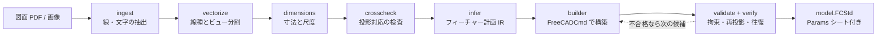

## 図面しか残っていない部品を、編集できる3Dに戻す

紙の図面や PDF だけが残っていて、CAD データが無い部品は珍しくありません。形を写すだけなら何とかなりますが、設計者が後から寸法を変えられる状態に戻すのは別の話です。寸法が履歴に残っていなければ、数値を変えた瞬間にモデルが壊れます。

**image2CAD** は、図面（ベクター PDF とスキャン画像）から、履歴付きの FreeCAD PartDesign モデル（.FCStd）を生成するプロジェクトです。パイプラインは Python 3.13、FreeCAD は内蔵の Python 3.11 で動くため、両者を import でつながず JSON だけで受け渡します。この記事では、ingest から CAD までの流れと、その境目の決め方を実装から整理します。

## 全体構成

処理は `docs/PLAN.md` の8段に対応します。



図1: 図面からモデルまでの流れ

- **ingest**: ベクター PDF なら線・ベジェ曲線・塗り・文字を用紙 mm 座標で取り出す。ラスターなら傾き補正・二値化して同じプリミティブに落とす
- **vectorize**: 線種を分類し、第三角法の位置関係でビューを分割・命名する
- **dimensions**: 矢じりと引出線から寸法を組み立て、尺度を標準尺度に丸める
- **crosscheck**: ビュー間の投影対応、寸法値と実測の一致、寸法の不足を検査する。エラーならここで止める
- **infer**: 3方向のベース候補から Pad / Pocket / Hole の計画（IR）を作る
- **builder**: IR を FreeCADCmd（ヘッドレス）で PartDesign Body に構築する
- **validate / verify**: 拘束・作法・再投影・往復を検査し、合格した候補だけを採用する

読み取り側と構築側が IR を挟んで分かれているのが中心です。

## 技術選定

| 論点 | 採用 | 代替案 | 採用理由 |
|---|---|---|---|
| 中間表現 | JSON の IR（Pad / Pocket / Hole） | 読み取り側から FreeCAD API を呼ぶ | 読み取りと構築を別々にテストできる |
| FreeCAD の起動 | FreeCADCmd を別プロセスで実行 | FreeCAD を import する | FreeCAD は 3.11、パイプラインは 3.13 で同居できない |
| 寸法の持ち方 | Spreadsheet `Params` への名前付き参照 | 数値を直接スケッチに入れる | 後から数値を変えられる。5%編集テストで効果も検査できる |
| 合否判定 | 再投影 + 往復 + 描き戻し | 生成できたかどうかだけを見る | 生成物が図面と一致するかを独立に確かめ、誤合格を防ぐ |
| 入力の許容差 | 解像度から決める（0.05 mm / 3画素） | 固定の許容差 | 300 dpi のスキャンは1画素 0.085 mm。ベクターと同じ基準で比べられない |

## 実装の核

### 1. IR を契約にする

`src/image2cad/ir/model.py` の `Plan` は、1部品をスケッチベースのフィーチャーの順序付きリストとして表します。数値はリテラルか、パラメーター名を使った四則演算の式です。FreeCAD 側の都合は構築前に IR で落とします。

```python
# src/image2cad/ir/model.py（Plan.validate）
for name in self.parameters:
    if not _IDENT.match(name):
        raise IRError(f"invalid parameter name {name!r}")
    if name in RESERVED_PARAM_NAMES or _CELL_ADDR.match(name):
        raise IRError(f"parameter name {name!r} is reserved in FreeCAD "
                      "(unit symbol, constant or cell address)")
if not isinstance(self.features[0], Pad):
    raise IRError("first feature must be a pad (base feature)")
```

`RESERVED_PARAM_NAMES` は FreeCAD 1.1.4 で実測したリストで、`H` `W` `mm` `psi` `pi` のような単位記号と定数を含みます。ここで弾かないと、構築の最後で分かりにくいエラーが返ります。

### 2. 式を FreeCAD の式に書き換える

builder は IR の式 `L/2 - 5` を、Spreadsheet を参照する `Params.L/2 - 5` に変換します。文字列置換ではなく AST で名前だけを置き換えています。

```python
# src/image2cad/builder/freecad_builder.py（_to_fc_expr）
def _to_fc_expr(expr: str) -> str:
    """Rewrite parameter names to spreadsheet references: L/2 -> Params.L/2."""
    tree = ast.parse(expr, mode="eval")

    class R(ast.NodeTransformer):
        def visit_Name(self, node):
            return ast.copy_location(
                ast.Attribute(value=ast.Name(SHEET, ast.Load()), attr=node.id,
                              ctx=ast.Load()), node)

    return ast.unparse(R().visit(tree))
```

`Params` シートのセルに `L` を置けば、スケッチの拘束がそのセルを参照します。設計者が数値を変えると形が追従するのは、この経路が通っているためです。拘束はスケッチ単位で `addConstraint(list)` にまとめて渡し、返ってきたインデックスに式を付けます。1本ずつ追加すると、そのたびにソルバーが走ります。192辺のコッホ輪郭では構築 56.333 秒のうち拘束の追加が 23.580 秒、再計算が 32.375 秒でした（`docs/PLAN.md`）。

### 3. 候補を順に試し、合格したものだけ返す

`src/image2cad/pipeline.py` の `drawing_to_model()` は、推定した候補を設計意図の順に試します。

```python
# src/image2cad/pipeline.py（drawing_to_model）
b = fc.build(cand_dir / "plan.json", model)
if not b.get("ok"):
    attempt.update(ok=False, stage="build", error=b.get("error"))
    report["attempts"].append(attempt)
    continue
v = fc.validate(model)
if not v.get("ok"):
    attempt.update(ok=False, stage="validate", failed=failed or v.get("error"))
    report["attempts"].append(attempt)
    continue
cmp = compare(str(model), read)
if cmp["ok"]:
    rt = roundtrip(str(model), read, cand_dir, drawing=False)
```

`fc.build` は FreeCADCmd を別プロセスで起動し、結果を JSON で返します。validate が落ちれば次の候補へ、再投影比較が落ちれば次の候補へ進むだけです。**すべての検査を通った最初の候補だけ**が `model.FCStd` として残ります。

許容差も入力で変えます。`src/image2cad/tolerance.py` はベクター PDF が 0.05 mm、ラスターが 3画素分（300 dpi なら1画素 0.085 mm）の大きいほうを使い、寸法値の照合は ±0.01 mm です。

## 品質と性能

数値はすべてリポジトリ内の記録です。自前レンダラーだけでは循環になるため、独立した描画エンジン（TechDraw）の図面も使います。

| 評価 | 結果 |
|---|---|
| 自前レンダラー 10 図面の読み取り | 寸法 85/85、尺度・ビュー全問正解 |
| 描画スタイルを変えた 200 図面 | 寸法 1700/1700 |
| TechDraw 20 図面（独立ソース） | 寸法 170/170、パイプライン 20/20、validate 20/20 |
| 往復検証 | 10 部品 × 2 スタイルで寸法・角度が全件一致 |
| 合成スキャン L1（300 dpi） | 10/10 部品がモデルまで合格 |

TechDraw の 20 図面は対応前が 0/20（例外落ち）でした。失敗は層ごとに10項目へ切り分けられ、上流から矢じりの扱い、二重の枠、1パスに複数の線分を持つ寸法線の順に直しました。いずれも「その図面だけの決め打ち」ではなく、製図の約束（矢じりは塗り、枠は入れ子、破線は等間隔の並び）で判定しています。

複雑形状は 16 ケースで測りました。形状一致 11、往復検証で拒否 2、入力モデルの検査で 90 秒時間切れ 2、ビュー欠落 1 で、誤合格は 0 件です。

## つまずいた点

- **FreeCADCmd の引数**: argv の扱いが不安定で、そのまま渡すと落ちることがあります。引数は環境変数（`I2C_CMD` / `I2C_ARGS` / `I2C_OUT`）で渡し、例外は結果 JSON の `error` と `traceback` に載せて返します。FreeCAD 側にコマンドを足すときは、`scripts/fc_run.py` と `src/image2cad/fc.py` の両方を触ります。
- **SVG のスタイルが効かない**: 図面の SVG を PDF に変換するのに PyMuPDF を使っていますが、MuPDF の SVG 描画は `<style>` の CSS と `stroke-dasharray` を無視します。スタイルは各要素の属性に直接書き、破線と一点鎖線は短い線分に分割して描く必要がありました。
- **ヘッドレス TechDraw の限界**: GUI なしの TechDraw は投影はできても、SVG / PDF の書き出しと寸法が使えません。投影線だけ FreeCAD から取り、配置・寸法・描画は自前のレンダラーで行っています。

## まとめ

- 読み取りと構築を IR で切り離すと、片方を直しても片方が壊れない。STL 入力も同じ IR に落とせる
- 寸法を式のまま持ち回ると「編集できるか」を機械的に検査できる（5%編集テスト）
- 合否を再投影・往復・描き戻しの3段にすると、「生成できたか」ではなく「図面と合っているか」で判断できる

## 関連記事

- [図面しか残っていない部品を、編集できる3Dに戻す — image2CAD が寸法と履歴を守る方法](/post/20261115image2cad-solution/)

---

**図面のデジタル化や CAD 自動化の開発でお困りのことはありませんか？**

技術相談や開発サポートを承っています。お気軽にご相談ください。

[ココナラで開発相談を依頼する](https://coconala.com/users/1993863)
