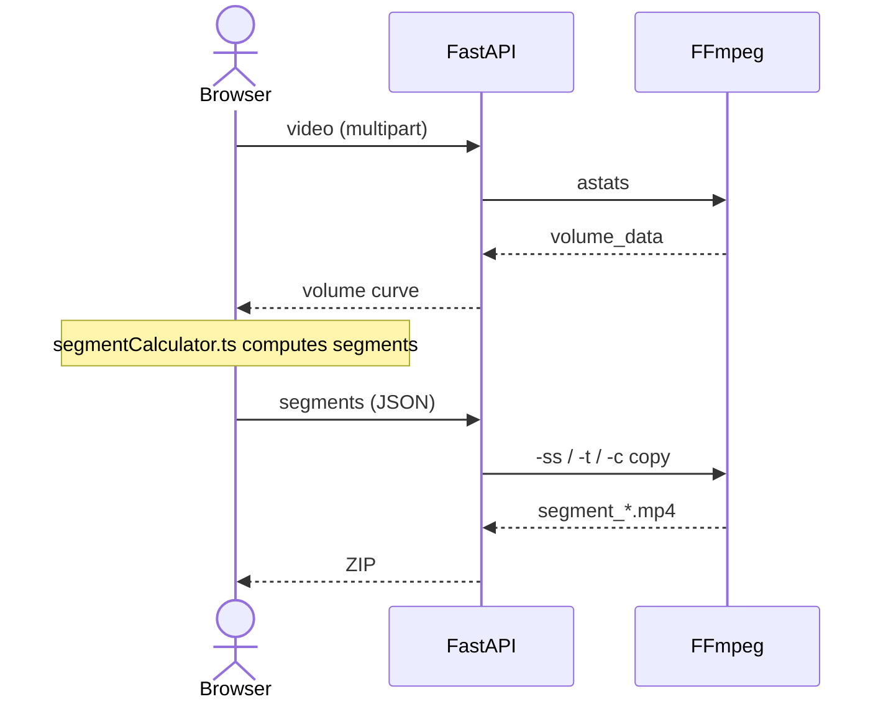

## Cutting a long recording into songs is tedious

A live recording or a stream archive usually contains several songs in one file. Splitting it means watching the video, writing down start and end times, and typing those timestamps into an editor. The more songs, the more chances to make a mistake.

**JamSlicer** automates that split. You upload a video, it detects silent gaps, you adjust the threshold while watching the result, then cut every segment at once. The backend is Python 3.11 with FastAPI; the frontend is React 19 with TypeScript and Vite; FFmpeg does all of the media work.

This post explains how JamSlicer divides analysis, adjustment, and cutting, using excerpts from the repository.

## Architecture

The app is split into three layers.



Figure 1: How JamSlicer processes a video

The responsibilities are deliberately narrow:

- **Analysis**: the server runs FFmpeg once and returns volume samples every 0.5 seconds.
- **Adjustment**: changing the threshold recomputes segments in the browser, with no re-upload.
- **Cutting**: only the confirmed ranges go back to the server, which stream-copies them.

## Technology choices

| Question | Chosen | Alternative | Why |
|---|---|---|---|
| Volume analysis | FFmpeg `astats` | librosa | Read volume while the video is decoded; no waveform array in Python |
| Silence detection | FFmpeg `silencedetect` | Custom threshold logic | Keeps memory flat on long videos |
| Splitting | `-c copy` (stream copy) | Re-encoding | Preserves quality and finishes quickly |
| Segment calculation | Browser (TypeScript) | Recompute on the server | Slider updates must not wait for a round trip |
| API | FastAPI + uvicorn | Flask | Awaiting a subprocess fits the async model directly |

## Core implementation

### 1. Analyze in a single FFmpeg pass

The analysis function in `backend/main.py` chains `astats` and `silencedetect` into one filter graph.

```python
# backend/main.py
threshold_db = 20 * (threshold ** 0.5) - 40  # simple conversion
min_silence_duration = 1.0

cmd = [
    'ffmpeg',
    '-i', video_path,
    '-af', f'astats=metadata=1:reset=1:length=0.5,silencedetect=noise={threshold_db}dB:d={min_silence_duration}',
    '-f', 'null', '-'
]
```

`-f null -` discards the output frames, and the app parses only the `astats` and `silencedetect` lines that FFmpeg writes to `stderr`. Nothing decodes into a Python buffer, so file size matters much less.

### 2. Keep segment math in the browser

The endpoint the current UI calls, `/analyze-volume`, returns only the volume data. `frontend/src/segmentCalculator.ts` turns that into segments, and the component recomputes them with `useMemo` whenever the threshold changes.

```tsx
// frontend/src/App.tsx
const segments = useMemo(() => {
  if (!volumeResult) return [];
  return calculateSegments(
    volumeResult.volume_data,
    threshold,
    volumeResult.total_duration
  );
}, [volumeResult, threshold]);
```

Dragging the slider updates the highlighted ranges without any network call. The analysis result is the same for every threshold, so this split is what makes the tool feel immediate.

### 3. Cut with stream copy

Confirmed ranges are posted to `/cut-simple` and cut by FFmpeg.

```python
# backend/main.py (cut_video_segments)
cut_cmd = [
    'ffmpeg',
    '-i', video_path,
    '-ss', str(segment['start']),
    '-t', str(segment['duration']),
    '-c', 'copy',
    '-avoid_negative_ts', 'make_zero',
    '-y', tmp_segment
]
```

No re-encode means the picture is untouched and the work is close to a file copy. `-avoid_negative_ts make_zero` keeps timestamps from going negative at the cut point.

### 4. Turn silence ranges into music ranges

`silencedetect` reports where silence starts and ends. What the app needs is the opposite: the audio ranges between them. `backend/main.py` rebuilds that.

```python
# backend/main.py (generate_segments_from_silence)
current_pos = 0.0
for start, end in silence_pairs:
    if start > current_pos:
        segments.append({"start": current_pos, "end": start, "duration": start - current_pos})
    current_pos = max(current_pos, end)

if current_pos < total_duration:
    segments.append({"start": current_pos, "end": total_duration,
                     "duration": total_duration - current_pos})
```

A single `current_pos` covers both cases: a video that starts with audio, and one that ends in silence.

### 5. Cleaning up and zipping

Cutting happens in `POST /cut-simple`. The upload is streamed to a temporary file in 8 KB chunks, and the output directory comes from `tempfile.mkdtemp()`.

```python
# backend/main.py (cut_simple)
output_dir = tempfile.mkdtemp()
...
with zipfile.ZipFile(zip_path, 'w', zipfile.ZIP_DEFLATED) as zipf:
    for file_path in output_files:
        zipf.write(file_path, os.path.basename(file_path))
```

Segments are written as `segment_01.mp4` and so on, then packed into a ZIP. The input temp file is removed in a `finally` block, so the server keeps no state between requests and leaves nothing behind after a restart.

## Quality and performance

The README records numbers from the earlier librosa / moviepy implementation.

| Metric | Previous | Current |
|---|---|---|
| Memory usage | 5–10 GB | 30–50 MB |
| Volume analysis speed | baseline | 2–5x faster |
| Splitting speed | baseline | 10–20x faster |

The gap comes from never loading audio into a Python array, and from avoiding re-encoding entirely.

## Pitfalls

- **Units**: the UI uses a linear 0–1 threshold, while `silencedetect` expects dB. The code bridges them with `20 * sqrt(t) - 40`, which is an approximation, so the displayed value should be treated as a guide.
- **Unpaired silence markers**: `silence_start` and `silence_end` do not always come in matching pairs. Zipping them drops the remainder, so a video that ends in silence needs the explicit final segment shown above.
- **Frame boundaries**: `-c copy` cuts on keyframes, so the actual cut can land a few frames away from the requested time. Tight cue points require re-encoding.

## Operational notes

Supported inputs are MP4, MOV, AVI, MKV, and M4V. The backend listens on port 8000 and the Vite dev server on 5173, so the frontend calls the API across origins; both are started together by `start.sh`. FFmpeg is a system dependency, not a Python package, which keeps the container image small but means `ffmpeg` must be on `PATH`.

## Takeaways

JamSlicer's design comes down to one split: heavy media work in FFmpeg, interactive state in the browser, and only the confirmed operation on the server.

- Let FFmpeg do analysis and cutting; keep Python as the orchestrator.
- Recompute trial-and-error parameters locally instead of over the network.
- Avoid re-encoding to protect both quality and runtime.

The same shape applies to many tools: heavy preprocessing, light interactive tuning, and a final confirmed operation.

## Related posts

- [Automating the split of stream archives: three walls of manual work, memory, and speed](/en/post/20261115jam-slicer-solution/)
- [Splitting stream recordings automatically with FFmpeg silencedetect (in Japanese)](/post/jam-slicer/)

---

**Need help building video or automation tooling?**

I take on technical consulting and development support.

[Hire me on Coconala](https://coconala.com/users/1993863)
