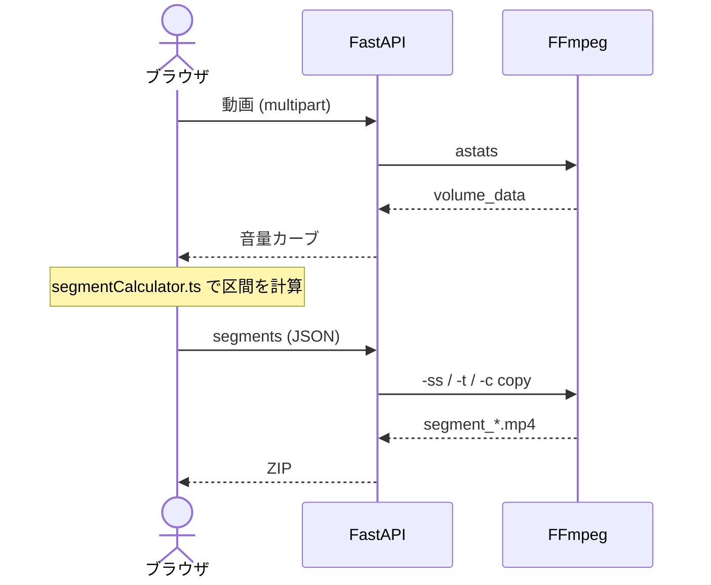

## ライブ録画を曲ごとに切り出すまでが面倒

バンドのスタジオ録音や配信のアーカイブは、1本の動画に何曲も入っています。それを曲ごとに切り出す作業は、再生しながら開始と終了の時刻をメモし、編集ソフトに打ち直すという手作業になりがちです。曲数が増えるほどミスも増え、作業そのものが目的化してしまいます。

**JamSlicer** は、この分割作業を自動化するWebアプリです。動画をアップロードすると無音区間を検出し、しきい値を調整しながら区切りを確認して、最後に一括で切り出します。バックエンドは Python 3.11 + FastAPI、フロントエンドは React 19 + TypeScript + Vite、動画処理はすべて FFmpeg に任せています。

この記事では、JamSlicer が「解析・調整・切り出し」をどう分担しているかを、実装の抜粋とともに整理します。

## 全体構成

処理は3つの層に分かれています。



図1: JamSlicer の処理構成

役割は次のように割り切っています。

- **解析**: サーバーが FFmpeg を1回だけ実行し、0.5秒間隔の音量データを返す
- **調整**: しきい値の変更はブラウザ内で再計算する（再アップロードしない）
- **切り出し**: 確定した区間だけをサーバーに送り、ストリームコピーで分割する

## 技術選定

| 論点 | 採用 | 代替案 | 採用理由 |
|---|---|---|---|
| 音量解析 | FFmpeg `astats` | librosa | 動画をデコードしたまま音量を取りたい。Python 側に波形を載せない |
| 無音検出 | FFmpeg `silencedetect` | 自前のしきい値判定 | 検出を FFmpeg に任せると、長い動画でもメモリ使用量が増えない |
| 分割 | `-c copy`（ストリームコピー） | 再エンコード | 画質を落とさず、処理時間を短くする |
| 区間計算 | ブラウザ (TypeScript) | サーバーで都度計算 | スライダー操作のたびに通信すると待ち時間が出る |
| API | FastAPI + uvicorn | Flask | 非同期のサブプロセス待ちをそのまま書ける |

## 実装の核

### 1. 解析は FFmpeg のワンパスで済ませる

`backend/main.py` の解析関数は、`astats` と `silencedetect` を1本のフィルタチェーンにまとめています。

```python
# backend/main.py
threshold_db = 20 * (threshold ** 0.5) - 40  # 簡易変換
min_silence_duration = 1.0

cmd = [
    'ffmpeg',
    '-i', video_path,
    '-af', f'astats=metadata=1:reset=1:length=0.5,silencedetect=noise={threshold_db}dB:d={min_silence_duration}',
    '-f', 'null', '-'
]
```

`-f null -` で映像を書き出さず、`stderr` に出る `astats` と `silencedetect` のログだけを読む構成です。動画全体をメモリに展開しないため、ファイルサイズの影響を受けにくくなります。

### 2. 区間計算はブラウザに持たせる

現在のUIが使う `/analyze-volume` は、音量データだけを返します。区間の計算は `frontend/src/segmentCalculator.ts` が担当し、しきい値が変わるたびに `useMemo` で再計算します。

```tsx
// frontend/src/App.tsx
const segments = useMemo(() => {
  if (!volumeResult) return [];
  return calculateSegments(
    volumeResult.volume_data,
    threshold,
    volumeResult.total_duration
  );
}, [volumeResult, threshold]);
```

スライダーを動かすと、通信なしで区間のハイライトが更新されます。解析結果は同じでも、しきい値は動画ごとに変わるため、この分担は体感速度に大きく効きます。

### 3. 切り出しはストリームコピー

確定した区間は `/cut-simple` に JSON で送り、FFmpeg で切り出します。

```python
# backend/main.py（cut_video_segments）
cut_cmd = [
    'ffmpeg',
    '-i', video_path,
    '-ss', str(segment['start']),
    '-t', str(segment['duration']),
    '-c', 'copy',
    '-avoid_negative_ts', 'make_zero',
    '-y', tmp_segment
]
```

再エンコードしないので画質はそのまま、処理はほぼファイルコピーです。`-avoid_negative_ts make_zero` は、切り出し開始時にタイムスタンプが負になるのを避けるために入れています。

### 4. 無音区間から音楽区間へ変換する

`silencedetect` が返すのは「無音の開始と終了」です。必要なのはその間の「音声区間」なので、`backend/main.py` で組み替えます。

```python
# backend/main.py（generate_segments_from_silence）
current_pos = 0.0
for start, end in silence_pairs:
    if start > current_pos:
        segments.append({"start": current_pos, "end": start, "duration": start - current_pos})
    current_pos = max(current_pos, end)

if current_pos < total_duration:
    segments.append({"start": current_pos, "end": total_duration,
                     "duration": total_duration - current_pos})
```

動画が音声で始まる場合と、無音で終わる場合の両方を、`current_pos` の更新だけで扱える形にしています。

### 5. 一時ファイルと ZIP の後片付け

切り出しは `POST /cut-simple` で行います。アップロードされた動画は 8KB ずつ一時ファイルに書き出され、出力先は `tempfile.mkdtemp()` で作ったディレクトリです。

```python
# backend/main.py（cut_simple）
output_dir = tempfile.mkdtemp()
...
with zipfile.ZipFile(zip_path, 'w', zipfile.ZIP_DEFLATED) as zipf:
    for file_path in output_files:
        zipf.write(file_path, os.path.basename(file_path))
```

各セグメントは `segment_01.mp4` のような連番で出力され、そのまま ZIP に詰められます。入力の一時ファイルは `finally` で必ず削除されます。サーバー側に状態を持たないので、プロセスを再起動してもゴミが残りません。

## 品質と性能

README には、従来の librosa / moviepy 実装と比較した数値が記録されています。

| 項目 | 従来版 | 現在版 |
|---|---|---|
| メモリ使用量 | 5〜10GB | 30〜50MB |
| 音量解析速度 | 基準 | 2〜5倍高速 |
| 動画分割速度 | 基準 | 10〜20倍高速 |

この差が出るのは、音声を Python の配列に読み込まず、FFmpeg のパイプの中で処理しているためです。分割も再エンコードをしないので、CPU を使わずに済みます。

## つまずいた点

- **しきい値の単位**: UIは 0〜1 の線形値ですが、`silencedetect` は dB を要求します。`20 * sqrt(t) - 40` という簡易変換で橋渡ししています。厳密な対応ではないため、UI の表示は「目安」として扱う必要があります。
- **無音の対応関係**: `silence_start` と `silence_end` の数が揃わないことがあります。`zip` で組にすると末尾の余りは捨てられるため、動画が無音で終わる場合は「最後の音声区間」が生成されません。この場合は `total_duration` までの区間を明示的に足す必要があります。
- **カット位置のずれ**: `-c copy` はキーフレーム単位で切るため、指定した時刻と実際の切れ目が数フレームずれることがあります。曲の頭出しを厳密にしたい場合は再エンコードが必要です。

## 運用メモ

対応する入力は MP4、MOV、AVI、MKV、M4V です。バックエンドは 8000 番、Vite の開発サーバーは 5173 番で動くため、フロントエンドはオリジンをまたいで API を呼びます。FFmpeg は Python パッケージではなくシステム依存なので、`PATH` が通っている必要があります。

## まとめ

JamSlicer の設計は「重い処理は FFmpeg、状態はブラウザ、確定処理だけサーバー」という分担に集約されています。

- 解析と切り出しは FFmpeg に任せ、Python 側はオーケストレーションだけにする
- しきい値のような試行錯誤の多いパラメータは、通信を挟まずブラウザで再計算する
- 再エンコードを避けることで、画質と処理時間を同時に守る

同じ構造は、音声の区間検出に限らず「重い前処理 + 軽い調整 + 確定処理」という形のツールにそのまま流用できます。

## 関連記事

- [配信録画の分割作業を自動化する — 手作業・メモリ・速度の3つの壁](/post/20261115jam-slicer-solution/)
- [配信録画を自動で分割！FFmpegのsilencedetectで作る動画分割Webアプリ](/post/jam-slicer/)

---

**動画処理・自動化ツールの開発でお困りのことはありませんか？**

技術相談や開発サポートを承っています。お気軽にご相談ください。

[ココナラで開発相談を依頼する](https://coconala.com/users/1993863)
