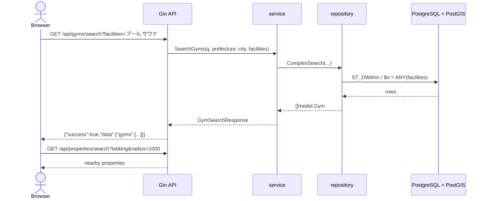

## Start with the gym, then decide where to live

House hunting normally starts with the commute to work. The gym is something you find after you move. For anyone training every day, that order feels backwards.

**Muscle Real Estate** is a web app that starts from the gym instead. You filter gyms by facilities, narrow the area by commute time, and then look at properties around the gym you picked. That order is what the API encodes. The backend is Go with Gin, the database is PostgreSQL with PostGIS, and the frontend is React 19 with TypeScript and Vite.

This post covers how the search order became an API, and which parts were pushed into the database. The commute calculation is still mocked, and I describe it as it is.

## Architecture

Gin handlers take the request, the service assembles conditions, and the repository issues SQL. Locations are stored as PostGIS `GEOMETRY(POINT, 4326)`, and distance is computed in the database.



Figure 1: From gym search to property search

Each layer has one job:

- **handler**: parse query strings and validate input. A non-numeric `lat` returns 400.
- **service**: assemble search conditions and convert the repository's pointer slice into a value slice.
- **repository**: issue SQL that uses PostGIS functions.
- **model**: the JSON shape. `APIResponse` unifies `success` / `data` / `error`.

## Technology choices

| Question | Chosen | Alternative | Why |
|---|---|---|---|
| API | Gin v1.9.1 | Echo / net/http | `c.Query` and `ShouldBindJSON` keep handlers short; all routes fit in one file |
| Geo search | PostGIS (`ST_DWithin`, geography cast) | Compute distance in Go | The database filters candidates and can use a GIST index |
| Data access | GORM + raw SQL | Query builder only | Dynamic conditions are easier to read with explicit placeholders |
| UI state | React `useState` | Redux | One screen, and the only shared state is the selected gym |
| Commute time | Mock for now | Google Distance Matrix API | The API shape and UI can be built without a key |

## Core implementation

### 1. Keep all routes in one file

`server/cmd/main.go` holds the routing and nothing else. A handler is constructed with a service, and a service with a repository.

```go
// server/cmd/main.go
api := r.Group("/api")
{
    gyms := api.Group("/gyms")
    {
        gyms.GET("/search", gymHandler.SearchGyms)
        gyms.GET("/:id", gymHandler.GetGymByID)
    }

    commute := api.Group("/commute")
    {
        commute.POST("/calculate", commuteHandler.CalculateCommute)
        commute.GET("/areas", commuteHandler.GetCommutableAreas)
    }
}
```

The CORS origin defaults to `http://localhost:5173` and the server listens on `3001`.

### 2. Build placeholders by hand for compound filters

Facilities, area, and location are all optional, so the SQL changes with the number of conditions. `ComplexSearch` in `server/internal/repository/gym_repository.go` numbers `$1, $2, ...` as it appends to `args`.

```go
// server/internal/repository/gym_repository.go (ComplexSearch)
if len(facilities) > 0 {
    facilityConditions := []string{}
    for _, facility := range facilities {
        facilityConditions = append(facilityConditions,
            fmt.Sprintf("$%d = ANY(facilities)", argIndex))
        args = append(args, facility)
        argIndex++
    }
    if len(facilityConditions) > 0 {
        conditions = append(conditions, "("+strings.Join(facilityConditions, " AND ")+")")
    }
}
```

Facilities are ANDed, not ORed: only gyms with both a pool and a sauna survive. Since `facilities` is a `TEXT[]`, repeating `= ANY(facilities)` and joining with `AND` was the straightforward form.

When a location is given, the distance expression is added to the `SELECT` and results are ordered by `distance_meters`. `ST_MakePoint` takes longitude first, so the values are appended as `lng, lat`.

### 3. Build the commute API's shape before its logic

`POST /api/commute/calculate` and `GET /api/commute/areas` respond, but the payload is mock data. `server/internal/service/commute_service.go` makes that explicit, even when a key is present.

```go
// server/internal/service/commute_service.go
if s.googleMapsAPIKey == "" {
    return s.getMockCommuteResults(req), nil
}

// TODO: Implement Google Maps Distance Matrix API call
// For now, return mock data even if API key is set
return s.getMockCommuteResults(req), nil
```

The mock values come from the position of each destination, with a multiplier per travel mode: `driving` halves the duration, `walking` triples it, and `bicycling` doubles it.

```go
// server/internal/service/commute_service.go (getMockCommuteResults)
duration := 25 + (i * 5)      // 25, 30, 35 minutes...
distance := 2000 + (i * 500)  // 2000, 2500, 3000 meters...
switch req.Mode {
case "driving":
    duration = duration / 2
case "walking":
    duration = duration * 3
case "bicycling":
    duration = duration * 2
}
```

The commutable-areas endpoint is the same idea: five fixed Tokyo stations (Shibuya, Shinjuku, Ikebukuro, Shinagawa, Ebisu), filtered by `max_time` and `mode`. Fixing the response shape and validation early means the UI will not change when the real API replaces the mock.

### 4. The UI goes as far as gym selection

`client/src/pages/HomePage.tsx` fetches properties from the selected gym's coordinates. The radius is fixed at 1,000 m.

```tsx
// client/src/pages/HomePage.tsx
const handleGymSelect = async (gym: Gym) => {
  setSelectedGym(gym);
  setIsLoadingProperties(true);
  try {
    const nearbyProperties = await searchPropertiesNearGym(gym, 1000);
    setProperties(nearbyProperties);
  } catch (error) {
    console.error('Failed to fetch properties:', error);
    setProperties([]);
  } finally {
    setIsLoadingProperties(false);
  }
};
```

Rent, size, and floor-plan filters live in `client/src/components/PropertyList.tsx` and run as a client-side `filter`, with no second request. The server only receives a location and a radius.

## Quality and performance

The repository has no measured benchmarks. What can be stated is the design work.

- `server/migrations/001_initial_schema.sql` creates a GIST index on `location` and a GIN index on `facilities`
- The connection pool is 10 idle, 100 open, one hour lifetime (`server/internal/database/connection.go`)
- Property search defaults to a 1,000 m radius; location-based gym search defaults to 50 km
- The frontend axios client times out at 10,000 ms (`client/src/services/api.ts`)

`docs/api-strategy.md` describes caching commute results for one day and estimates a hit rate above 80%. The `commute_cache` table is defined, but no code reads or writes it yet, so those numbers are targets rather than measurements.

## Pitfalls

- **Virtual latitude and longitude**: `Lat` and `Lng` on `model.Gym` are tagged `gorm:"-"`. Without `ST_Y` / `ST_X` aliases in the `SELECT`, they arrive as zero. The alias used by `ORDER BY` and the scan target both have to match.
- **Placeholder drift**: every condition advances `argIndex`, so a mismatch between `args` order and `$n` produces zero rows rather than an error. Keeping the condition and its argument in the same block, including the `lng, lat` order, avoids it.
- **Two copies of mock data**: `server/data/mock_properties.go` has 14 entries and `server/migrations/002_seed_data.sql` has 15, and they do not match. The SQL is what runs; the Go mocks are not referenced by the server.

## Takeaways

- Encoding the search order in the API reduces the state the screen has to hold.
- Keep geometry in the database and let Go assemble conditions.
- Give an external API its request and response shape first, and build against a mock.

That last point comes with a condition: never render mock values as if they were real commute times. The current UI does not call the commute endpoints, so mock values never reach the screen.

## Related posts

- [Reversing the order of house hunting: the design behind gym-first search](/en/post/20261115muscle-realestate-solution/)
- [Choosing where to live from the gym: building Muscle Real Estate with Go and React (in Japanese)](/post/muscle-realestate/)

---

**Working on a location or map-based API?**

I take on technical consulting and development support.

[Hire me on Coconala](https://coconala.com/users/1993863)
