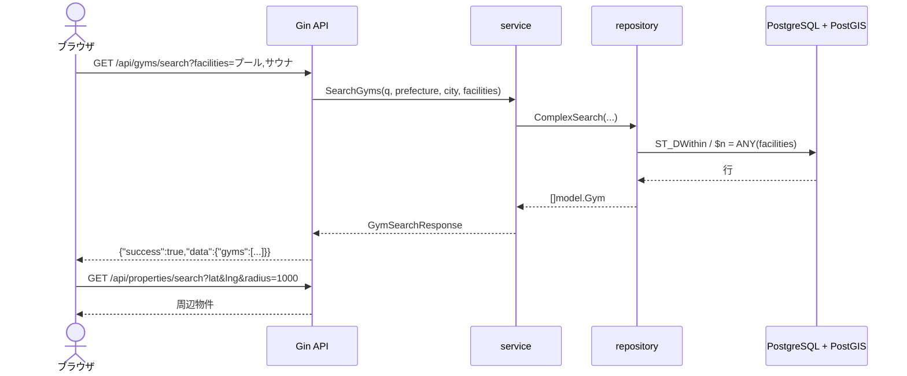

## ジムを選んでから、住む場所を決める

住まい探しは「職場への通勤時間」から始まるのが普通です。ジムは住んでから探すもの、という順序が前提になっています。毎日通うトレーニーにとっては、その順序を逆にしたほうが自然です。

**筋肉不動産** は、ジムを起点に住まいを探すWebアプリです。施設条件でジムを絞り、通勤圏でエリアを決め、選んだジムの周辺物件を見る。この順序をそのままAPIの形にしました。バックエンドは Go + Gin、DBは PostgreSQL + PostGIS、フロントエンドは React 19 + TypeScript + Vite です。

この記事では、検索の順序をどうAPIに落としたか、どこをDBに任せたかを実装から整理します。通勤時間の計算はまだモックなので、その状態も含めて書きます。

## 全体構成

リクエストは Gin のハンドラーが受け、service が条件を組み立て、repository が SQL を発行します。位置情報は PostGIS の `GEOMETRY(POINT, 4326)` として保存し、距離の計算もDB側で行います。



図1: ジム検索から物件検索までの流れ

層の責務は次のとおりです。

- **handler**: クエリ文字列のパースと入力検証。`lat` が数値でなければ 400 を返す
- **service**: 検索条件の組み立てと、repository が返すポインタのスライスを値のスライスへ変換
- **repository**: PostGIS の関数を使う SQL の発行
- **model**: JSON の形。`APIResponse` で `success` / `data` / `error` を統一する

## 技術選定

| 論点 | 採用 | 代替案 | 採用理由 |
|---|---|---|---|
| API | Gin v1.9.1 | Echo / net/http | `c.Query` と `ShouldBindJSON` で入力を短く書ける。ルーティングが1ファイルに収まる |
| 地理検索 | PostGIS (`ST_DWithin`, geography キャスト) | Go 側で距離計算 | 候補をDBで絞れる。GIST インデックスが効く |
| DBアクセス | GORM + Raw SQL | クエリビルダのみ | 複合条件はプレースホルダを自分で組むほうが読みやすい |
| 画面の状態 | React の `useState` | Redux | 画面が1枚で、共有する状態は選択中のジムだけ |
| 通勤時間 | 現状はモック | Google Distance Matrix API | APIキーが無くてもUIとAPIの形を先に固められる |

## 実装の核

### 1. ルーティングは1ファイルに集約する

`server/cmd/main.go` はルーティングだけを持ちます。ハンドラーは生成時に service を、service は repository を持つ、という一本道です。

```go
// server/cmd/main.go
api := r.Group("/api")
{
    gyms := api.Group("/gyms")
    {
        gyms.GET("/search", gymHandler.SearchGyms)
        gyms.GET("/:id", gymHandler.GetGymByID)
    }

    commute := api.Group("/commute")
    {
        commute.POST("/calculate", commuteHandler.CalculateCommute)
        commute.GET("/areas", commuteHandler.GetCommutableAreas)
    }
}
```

CORS の許可オリジンは既定で `http://localhost:5173`、待受ポートは `3001` です。

### 2. 複合条件はプレースホルダを自前で組む

施設・エリア・位置がすべて任意なので、SQL は条件の数だけ変わります。`server/internal/repository/gym_repository.go` の `ComplexSearch` は、`$1, $2, ...` を手で採番しながら `args` を積みます。

```go
// server/internal/repository/gym_repository.go（ComplexSearch）
if len(facilities) > 0 {
    facilityConditions := []string{}
    for _, facility := range facilities {
        facilityConditions = append(facilityConditions,
            fmt.Sprintf("$%d = ANY(facilities)", argIndex))
        args = append(args, facility)
        argIndex++
    }
    if len(facilityConditions) > 0 {
        conditions = append(conditions, "("+strings.Join(facilityConditions, " AND ")+")")
    }
}
```

施設は OR ではなく AND です。「プールとサウナの両方がある」ジムだけを残します。`facilities` は `TEXT[]` なので、`= ANY(facilities)` を条件の数だけ AND でつなぐ形が素直でした。

位置が指定されたときは、距離の計算を SELECT に足して `ORDER BY distance_meters` で並べます。`ST_MakePoint` の引数は経度が先なので、`args` に積む順番は `lng, lat` です。

### 3. 通勤時間APIは「口だけ先に作る」

`POST /api/commute/calculate` と `GET /api/commute/areas` は動きますが、返しているのはモックです。`server/internal/service/commute_service.go` には、APIキーがあっても実APIを呼ばない状態が明示されています。

```go
// server/internal/service/commute_service.go
if s.googleMapsAPIKey == "" {
    return s.getMockCommuteResults(req), nil
}

// TODO: Implement Google Maps Distance Matrix API call
// For now, return mock data even if API key is set
return s.getMockCommuteResults(req), nil
```

モック値は destination の並び順から作り、交通手段で係数を変えます（`driving` は半分、`walking` は3倍、`bicycling` は2倍）。

```go
// server/internal/service/commute_service.go（getMockCommuteResults）
duration := 25 + (i * 5)      // 25, 30, 35 分…
distance := 2000 + (i * 500)  // 2000, 2500, 3000 m…
switch req.Mode {
case "driving":
    duration = duration / 2
case "walking":
    duration = duration * 3
case "bicycling":
    duration = duration * 2
}
```

通勤圏エリアも同じで、渋谷・新宿・池袋・品川・恵比寿の5地点を固定で持ち、`max_time` と `mode` で絞るだけです。レスポンスの形とバリデーションを先に決めておくと、実APIに差し替えるときにUIを触らずに済みます。

### 4. UI は「ジムを選ぶと周辺物件」まで

`client/src/pages/HomePage.tsx` は、選択されたジムの緯度経度で物件を引きます。半径は1,000mで固定です。

```tsx
// client/src/pages/HomePage.tsx
const handleGymSelect = async (gym: Gym) => {
  setSelectedGym(gym);
  setIsLoadingProperties(true);
  try {
    const nearbyProperties = await searchPropertiesNearGym(gym, 1000);
    setProperties(nearbyProperties);
  } catch (error) {
    console.error('Failed to fetch properties:', error);
    setProperties([]);
  } finally {
    setIsLoadingProperties(false);
  }
};
```

家賃・広さ・間取りの絞り込みは `client/src/components/PropertyList.tsx` が受け持ち、APIを呼び直さずにクライアント側で `filter` します。サーバーに投げるのは位置と半径だけです。

## 品質と性能

リポジトリに実測ベンチマークはありません。性能に関して書けるのは、設計上の作り込みまでです。

- `server/migrations/001_initial_schema.sql` で `location` に GIST、`facilities` に GIN のインデックスを張っている
- 接続プールは idle 10 / open 100 / 寿命1時間（`server/internal/database/connection.go`）
- 物件検索の `radius` は既定 1,000m、位置指定のジム検索は既定 50km
- フロントの axios はタイムアウト 10,000ms（`client/src/services/api.ts`）

`docs/api-strategy.md` には、通勤時間を1日キャッシュする方針と「ヒット率80%以上」という見込みが書かれています。ただし `commute_cache` テーブルの定義はあるものの、読み書きするコードはまだありません。数字は目標値として読む必要があります。

## つまずいた点

- **緯度経度の仮想フィールド**: `model.Gym` の `Lat` / `Lng` は `gorm:"-"` です。SELECT で `ST_Y` / `ST_X` を別名で出さないと 0 が入ります。`ORDER BY` に使う別名と Scan 先を両方合わせる必要がありました。
- **プレースホルダの番号ズレ**: 条件を足すたびに `argIndex` を進める作りなので、`args` に積む順番と `$n` が1つでもずれると、エラーではなく「0件」が返ります。距離計算が `lng, lat` の順である点も含め、条件の追加と引数の追加は同じブロックに置いています。
- **モックの二重管理**: `server/data/mock_properties.go` は14件、`server/migrations/002_seed_data.sql` は15件で一致していません。実行時に効くのはSQLのほうで、Go側のモックはサーバーから参照されていません。

## まとめ

- 検索の順序をAPIの引数に落とすと、画面が持つ状態を減らせる
- 地理演算はDBに寄せ、Go は条件の組み立てに徹する
- 外部APIは呼び出し口とレスポンス形だけ先に作り、モックで開発を止めない

最後の項目には条件があります。モック値を「通勤時間」として画面に出さないことです。今のUIは通勤APIを呼んでいないので、モック値が画面に出ることはありません。

## 関連記事

- [住まい探しの優先順位を逆にする — ジム起点の検索を成立させた設計](/post/20261115muscle-realestate-solution/)
- [ジムから住む場所を決める！Go + Reactで作る「筋肉不動産」アプリの設計](/post/muscle-realestate/)

---

**住まい・地図系APIの設計でお困りのことはありませんか？**

技術相談や開発サポートを承っています。お気軽にご相談ください。

[ココナラで開発相談を依頼する](https://coconala.com/users/1993863)
