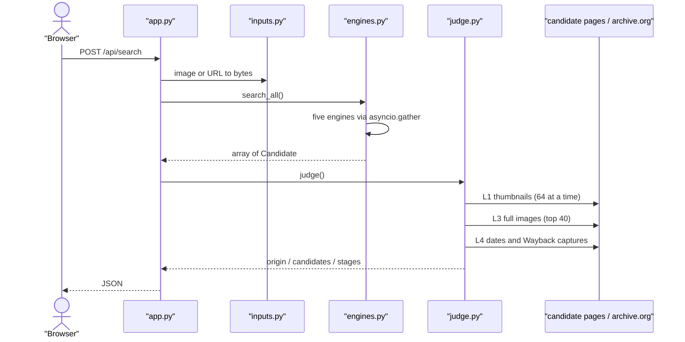

## Deciding an image's origin mechanically

When you want to know whether an image you saw on social media is a repost, finding the original post takes more work than expected. There are several reverse image search engines, and each returns a different set of candidates. You open them one by one, check the date on every page, and compare the images by eye. **Origin Finder** exists to cut down that loop.

It accepts an image file, an image URL, or an X post URL. The image goes through five engines at once — Yandex, TinEye, Bing, ascii2d and SauceNAO — and the app decides which candidates are the same image, attaches dates, and returns the oldest one as the origin. The stack is Python 3.12 with FastAPI, OpenCV and imagehash for the image work, and a single static HTML page with no build step. The scope is the first appearance of the same image; it does not do face search or identify people.

## Architecture

The pipeline is five modules.

- `inputs.py` resolves the input. X posts are fetched through the no-auth FxTwitter API, and the post itself is added as a candidate.
- `engines.py` calls the five engines in parallel and normalizes results into `Candidate`.
- `judge.py` deduplicates, runs the staged matching, attaches dates, and picks the origin.
- `matching.py` and `fetch.py` compare images and fetch full-resolution versions from candidate pages.
- `dates.py` and `archive.py` extract dates from post IDs, page metadata, and Wayback Machine captures.



Figure 1: The flow of `POST /api/search`

Inside `judge.py` there are four stages. L0 normalizes URLs and merges duplicates. L1 compares thumbnail pHashes, L2 compares thumbnail keypoints, and L3 refetches full images and compares again. Dates come from L4 (page metadata), which runs in parallel with Wayback lookups. A single search can return dozens to hundreds of candidates, so cheap checks filter first and expensive checks run on a small subset.

## Technology choices

| Question | Chosen | Alternative | Why |
|---|---|---|---|
| Search engines | PicImageSearch | Scraping each service | One interface for five engines; a broken engine can be dropped on its own |
| Same-image check | pHash + high-frequency NCC → ORB + RANSAC | Deep features (SSCD and similar) | Runs on CPU with no extra model |
| Image fetching | httpx AsyncClient + asyncio | requests with threads | Almost all of the wait is network |
| Dates | Post IDs, page metadata, Wayback captures | Page metadata only | Many pages carry no date, and the strength of the evidence differs |

## Core implementation

### 1. Engines run in parallel, failures stay contained

The engines depend on other services' HTML and APIs, so a single failure should not stop the search. `src/origin_finder/engines.py` turns a single engine's exception into `EngineResult(ok=False)` and gathers the rest.

```python
# src/origin_finder/engines.py
async def _run_one(name: str, file: bytes) -> tuple[EngineResult, list[Candidate]]:
    try:
        cands, search_url = await asyncio.wait_for(ENGINES[name](file), ENGINE_TIMEOUT)
        for i, c in enumerate(cands, 1):
            c.page_url = clean_url(c.page_url)
            c.sources = [{"engine": name, "rank": i}]
        return EngineResult(name, True, len(cands), search_url=search_url), cands
    except Exception as e:  # engine sites are scraped and break often, so swallow per engine
        return EngineResult(name, False, error=f"{type(e).__name__}: {e}"[:300]), []
```

Bing fails every time because PicImageSearch no longer matches its markup (`BCID not found`). The other engines still return candidates, so the search works, and the failed engine appears with a count of zero in the UI, which makes the broken path visible.

### 2. Same-image matching in three cheaper-first stages

Thresholds live in `src/origin_finder/matching.py`. A pHash plus a high-frequency correlation confirms copies that were only recompressed or resized. If that is not conclusive, ORB keypoints are aligned with RANSAC and judged on inliers, coverage, and photometric agreement.

```python
# src/origin_finder/matching.py
INLIERS_SAME_MIN = 18
COVERAGE_MIN = 0.15
PHOTOMETRIC_MIN = 0.7
```

Only candidates that survive L2 go on to full-image fetching. `_pick_l3` in `src/origin_finder/judge.py` takes the top 40 and prefers social posts.

```python
# src/origin_finder/judge.py (_pick_l3)
ranked = [(c.inliers or 0, c) for c in survivors] + [(L2_GATE_INLIERS, c) for c in no_thumb if _is_sns(c.page_url)]
# scene verdicts may still be promoted by the full image, but they go after the rest
ranked.sort(key=lambda t: (t[1].verdict == "scene", -t[0], not _is_sns(t[1].page_url)))
return [c for _, c in ranked[:FULL_FETCH_LIMIT]]
```

Those 40 are the only candidates that cost network requests. Thumbnail checks run 64 at a time; full images and pages run 10 at a time.

### 3. Dates keep their evidence type

X, TikTok, and Instagram embed the time in the post ID, so no network call is needed. For everything else the date comes from meta tags or JSON-LD, and the image URL is also queried against archive.org's availability API for its first capture.

```python
# src/origin_finder/judge.py (end of judge)
eligible = [c for c in cands if c.date and is_match(c) and c.date_source != OTHER_IMAGE]
# every date is evidence the image existed by then, so the oldest wins regardless of source
eligible.sort(key=lambda c: (effective_date(c), DATE_RANK.get(c.date_source, 9)))
origin = eligible[0] if eligible else None
```

`DATE_RANK` puts X post IDs at 0, page metadata at 1, and TinEye crawl dates and Wayback captures at 2. The rank only breaks ties; the origin is the oldest date regardless of source, because every date is evidence that the image existed at that moment. Dates known only to the day are treated as the end of that day by `effective_date`.

### 4. Fix the time limits first

```python
# src/origin_finder/judge.py
RERANK_TIMEOUT = 30
DATE_TIMEOUT = 20
```

The search budget was set first: one search may take up to a minute. Search takes about 10 seconds, L1 to L3 at most 30, dates at most 20. When a stage is cut off, the partial results already written to the candidates are returned; because the candidates are updated outside `asyncio.wait_for`, nothing computed so far is discarded.

## Quality and performance

Numbers recorded in `docs/plan.md`, measured on the author's machine with an Eiffel Tower image and one specific post.

| Metric | Before | After |
|---|---|---|
| Thumbnail matching, L1 (Eiffel Tower) | 5.0 s | 1.1 s |
| Whole search (sink post) | 20 s | 13–15 s |
| L3 candidates with no full image | 18 | 7 |
| Same-photo candidates with no date (Eiffel Tower) | 51 | 40 |

L1 got faster by fetching each thumbnail URL once and sharing it, and by running 64 fetches at a time. Full-image fetching improved by keeping the direct image URL the engines return and by raising the HTML read limit. Deduplication merged 106 pages into 30 groups for the Eiffel Tower and 179 pages into 32 groups for the sink post, and the origin did not change in either case.

Matching accuracy was checked on the real photo pairs in `eval/pairs/`: all 20 pairs were classified correctly. That is a small sample, and the miss rate has not been measured.

## Pitfalls

- **pHash alone is not enough.** It sees only low frequencies, so different photos of the same composition score close. A high-frequency correlation backs it up, and nearly flat images are skipped by standard deviation. Even then, a different Eiffel Tower photo was called identical, which is why the final decision also looks at photometric agreement after alignment.
- **A page's date is not the image's date.** A page's publish date belongs to that page's main image. If the og:image differs from the input, the date is shown as "page metadata (different image)" and never used to pick the origin. That removed a false origin from a 2021 Tenor page. The cost is that about 40 percent of candidates with a page date get demoted to "different image".
- **Tall subjects do not fill the frame.** For something narrow like a tower, a true copy can have many inliers and a strong photometric score while coverage stays at 0.11–0.15. Lowering the floor lets other photos through, so two extra rules were added: coverage of 0.10 is enough when the photometric score is at least 0.9, and a score of 0.5 is enough when inliers reach 100. On the Eiffel Tower set, same-photo verdicts rose from 32 to 58 and same-scene verdicts fell from 26 to 1.

## Takeaways

Origin Finder comes down to "enumerate outside, decide inside, fix the clock first."

- Let several search engines enumerate candidates; keep only the cross-engine comparison in-house.
- Split the decision into cheap stages and cap how many candidates reach the network.
- Compare dates while keeping the type of evidence, and call the oldest one the origin.

The same shape applies to any task that combines several external APIs into one conclusion. The part that matters most is resisting the urge to run the expensive check on everything.

## Related posts

- [Folding the search for a repost's origin into one query — the design of Origin Finder](/en/post/20261115origin-finder-solution/)

---

**Working on a system that has to combine several external APIs?**

I take on technical consulting and development support.

[Hire me on Coconala](https://coconala.com/users/1117897)
