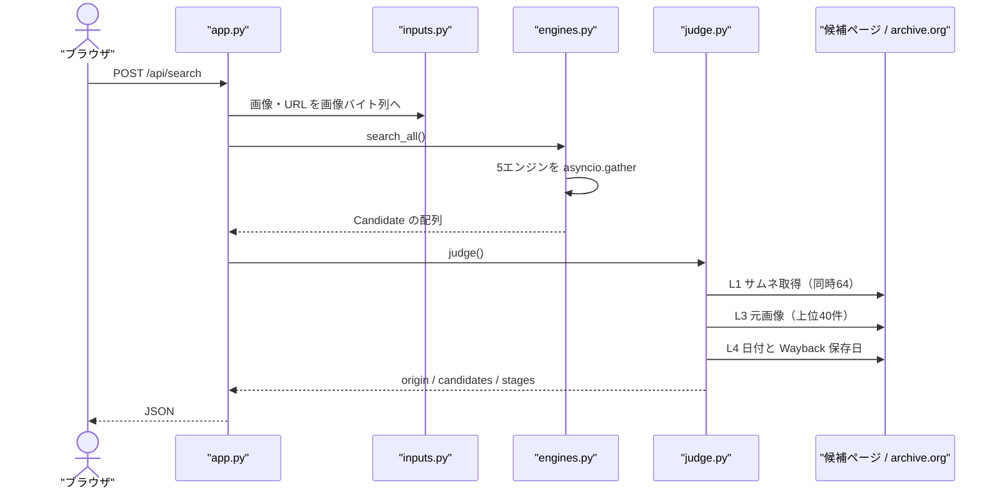

## 転載画像の「原典」を機械的に決める

SNS で見かけた画像が転載かどうかを確かめたいとき、元の投稿を探す作業は意外に手間がかかります。逆画像検索は何種類もあり、返す候補もそれぞれ違います。1つずつ開いて日付を確認し、同じ画像かを目で比べる。この繰り返しを減らすために作ったのが **Origin Finder** です。

入力は画像ファイル、画像URL、X 投稿URLの3種類。Yandex / TinEye / Bing / ascii2d / SauceNAO の5つの逆画像検索に同時にかけ、候補が同一画像かを判定し、日時を付けて最古のものを原典として返します。Python 3.12 + FastAPI、画像処理は OpenCV と imagehash、画面はビルドなしの静的HTML 1枚です。対象は「同一画像の初出」だけで、顔検索や身元特定はしません。

## 全体構成

処理は5つのモジュールに分かれています。

- `inputs.py`: 入力解決。X投稿は認証不要の FxTwitter API で添付画像を取得し、投稿自身も候補に加える
- `engines.py`: 5エンジンの並列呼び出しと `Candidate` への正規化
- `judge.py`: 重複統合、段階的な同一判定、日時付与、原典の選択
- `matching.py` / `fetch.py`: 画像の照合と、候補ページからの元画像取得
- `dates.py` / `archive.py`: 投稿ID・ページメタ・Wayback 保存日からの日時抽出



図1: `POST /api/search` の処理の流れ

`judge.py` の中は4段です。L0 で URL を正規化して重複を統合し、L1 でサムネイルの pHash、L2 でサムネイルの特徴点、L3 で元画像を照合します。日時は L4（ページのメタ情報）と Wayback を並行して引きます。候補は数十〜数百件なので、安い判定で絞ってから高い判定を少数にだけかけます。

## 技術選定

| 論点 | 採用 | 代替案 | 採用理由 |
|---|---|---|---|
| 検索エンジン | PicImageSearch | 各サービスを直接スクレイピング | 5エンジンの差異を吸収でき、壊れたものは個別に切り離せる |
| 同一判定 | pHash + 高周波NCC → ORB + RANSAC | 深層特徴（SSCD など） | 追加モデルなしで CPU だけで動く |
| 画像取得 | httpx の AsyncClient + asyncio | requests + スレッド | 待ち時間の大半がネットワーク |
| 日時 | 投稿ID・ページメタ・Wayback 保存日 | ページ記載のみ | 日付の無いページが多く、根拠の強さを区別する必要がある |

## 実装の核

### 1. エンジンは並列、失敗は握りつぶす

エンジンは他サービスの HTML や API に依存するので、1つ壊れても検索全体は止めません。`src/origin_finder/engines.py` は1エンジンの例外を `EngineResult(ok=False)` に変換し、`asyncio.gather` でまとめます。

```python
# src/origin_finder/engines.py
async def _run_one(name: str, file: bytes) -> tuple[EngineResult, list[Candidate]]:
    try:
        cands, search_url = await asyncio.wait_for(ENGINES[name](file), ENGINE_TIMEOUT)
        for i, c in enumerate(cands, 1):
            c.page_url = clean_url(c.page_url)
            c.sources = [{"engine": name, "rank": i}]
        return EngineResult(name, True, len(cands), search_url=search_url), cands
    except Exception as e:  # エンジンはスクレイピングで壊れやすいので個別に握りつぶす
        return EngineResult(name, False, error=f"{type(e).__name__}: {e}"[:300]), []
```

Bing は PicImageSearch 側の仕様追従が切れて常に失敗します（`BCID not found`）。それでも残りが候補を返すので検索は成立し、UI に件数0として出るので壊れた経路に気づけます。

### 2. 同一判定は粗い順に3段

閾値は `src/origin_finder/matching.py` にあります。pHash と高周波成分の相関で再圧縮やリサイズ程度のコピーを確定し、確定しなければ ORB の特徴点を RANSAC で位置合わせして、インライア数・一致範囲・見た目の3つで判定します。

```python
# src/origin_finder/matching.py
INLIERS_SAME_MIN = 18
COVERAGE_MIN = 0.15
PHOTOMETRIC_MIN = 0.7
```

L2 を通った候補だけが元画像の取得に進みます。`src/origin_finder/judge.py` の `_pick_l3` が上位40件を選び、SNS の候補を優先します。

```python
# src/origin_finder/judge.py（_pick_l3）
ranked = [(c.inliers or 0, c) for c in survivors] + [(L2_GATE_INLIERS, c) for c in no_thumb if _is_sns(c.page_url)]
# scene（サムネでは別カット寄りだが見た目が断定できないもの）は、元画像で同一写真に昇格し得るが、他の候補より後回し
ranked.sort(key=lambda t: (t[1].verdict == "scene", -t[0], not _is_sns(t[1].page_url)))
return [c for _, c in ranked[:FULL_FETCH_LIMIT]]
```

ネットワークに出るのはこの40件だけ。サムネイル照合は同時64件、元画像とページは同時10件で流します。

### 3. 日時は根拠の種類を保持したまま最古を選ぶ

X / TikTok / Instagram は投稿IDに時刻が埋め込まれているため、ネットワークなしで日時が分かります。それ以外はページの meta タグや JSON-LD から拾い、さらに archive.org の availability API で画像URLの最初の保存日を引きます。

```python
# src/origin_finder/judge.py（judge の末尾）
eligible = [c for c in cands if c.date and is_match(c) and c.date_source != OTHER_IMAGE]
# どの日時も「その時点で既に存在した」証拠なので、根拠を問わず最古を原典とする
eligible.sort(key=lambda c: (effective_date(c), DATE_RANK.get(c.date_source, 9)))
origin = eligible[0] if eligible else None
```

`DATE_RANK` は X投稿ID が 0、ページ記載が 1、TinEye のクロール日と Wayback 保存日が 2 です。順位は同着のときの優先度にだけ使い、原典は根拠を問わず最古を選びます。どの日時も「その時点で既に存在した」証拠としては等価だからです。日付しか分からない日時は `effective_date` でその日の終わりとして扱います。

### 4. 打ち切り時間を先に決める

```python
# src/origin_finder/judge.py
RERANK_TIMEOUT = 30
DATE_TIMEOUT = 20
```

検索1回は1分まで許容する、という前提を先に決めました。検索が約10秒、L1〜L3 が最大30秒、日時が最大20秒で、最悪でも1分に収まります。打ち切られても、それまでに候補へ書き込んだ途中結果は返します（`asyncio.wait_for` の外側で候補を更新しているため）。

## 品質と性能

`docs/plan.md` に記録された、著者のマシンでの実測値です。対象はエッフェル塔の画像とシンク投稿です。

| 項目 | 変更前 | 変更後 |
|---|---|---|
| L1 サムネ照合（エッフェル塔） | 5.0秒 | 1.1秒 |
| 検索全体（シンク投稿） | 20秒 | 13〜15秒 |
| L3 で元画像を取得できなかった件数 | 18件 | 7件 |
| 同じ写真で日付が無い件数（エッフェル塔） | 51件 | 40件 |

L1 の短縮は、同じサムネイルURLの取得を1回に共有したことと、同時実行数を64に上げたことが効いています。元画像の改善は、直URLの保持と HTML 読み取り上限の引き上げによります。重複統合ではエッフェル塔の106ページが30グループに、シンク投稿の179ページが32グループにまとまり、原典は変わりませんでした。

判定精度は `eval/pairs/` の実写ペアで20組すべて正解でした。ただし少数サンプルで、見逃し率は未評価です。

## つまずいた点

- **pHash だけでは足りない**: pHash は低周波しか見ないため、構図が同じ別写真でも近い値になります。高周波成分の相関で裏取りし、単色に近い画像は標準偏差で除外しました。それでもエッフェル塔の別写真が同一と誤判定され、最終的には位置合わせ後の見た目まで見る必要がありました。
- **ページの日付は画像の日付ではない**: ページの公開日は、そのページの主画像のものとは限りません。og:image が入力画像と別なら、その日付は原典判定に使わず「ページ記載（別画像）」として表示だけにします。これで Tenor の2021年のページを原典と誤認する問題が解消しました。副作用として、ページ記載の日付を持つ候補の約4割が「別画像」に降格しています。
- **縦長の被写体で一致範囲が伸びない**: 塔のような細長い被写体の同一写真は、インライアが多く見た目も揃うのに一致範囲が0.11〜0.15に留まります。下限を下げると別写真を通すため、「見た目が0.9以上なら一致範囲0.10でも同一」「インライアが100以上なら見た目0.5でも同一」を足しました。エッフェル塔で同一判定が32件から58件に増え、同じ場面の別写真は26件から1件に減りました。

## まとめ

Origin Finder の設計は「列挙は外部、判断は自前、時間は先に決める」に集約されます。

- 候補の列挙は複数の検索エンジンに任せ、横断比較だけを自分のパイプラインにする
- 判定は安い順に段を分け、ネットワークに出る件数を上位K件に絞る
- 日時は根拠の種類を保持したまま比較し、最古を原典とする

同じ形は、複数の外部APIの結果を突き合わせて1つの結論を出す処理に使えます。全部に高価な判定をかけたくなるのを我慢して段を分ける点が効きます。

## 関連記事

- [無断転載の原典探しを1回の検索に畳む — Origin Finder の設計](/post/20261115origin-finder-solution/)

---

**複数の外部APIを統合する仕組みの設計でお困りのことはありませんか？**

技術相談や開発サポートを承っています。お気軽にご相談ください。

[ココナラで開発相談を依頼する](https://coconala.com/users/1993863)
