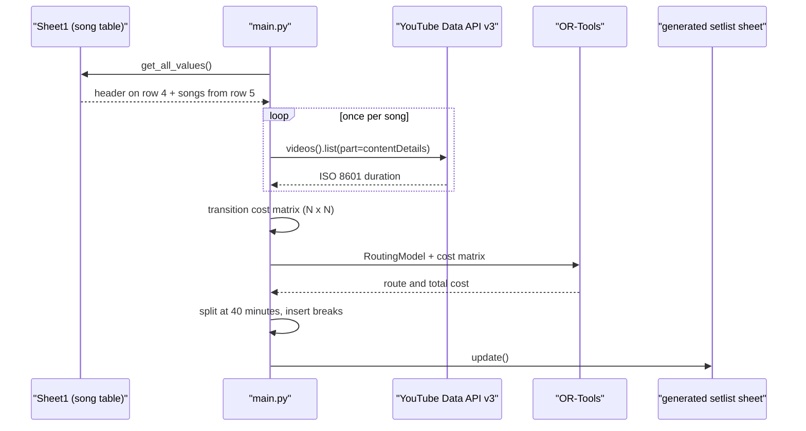

## Song order comes with more constraints than it looks

A band's setlist is not chosen by energy alone. In a band where members switch instruments between songs, every adjacent pair can require a transition: rebuilding the drum kit, swapping guitars, re-dialing pedals. Stage time is fixed, and somewhere in the middle there has to be a break.

**SetlistAutomation** treats the ordering as an optimization problem. It reads a song table from Google Sheets, solves a traveling salesman problem (TSP) with OR-Tools to minimize transition cost, pulls each song's length from the YouTube Data API v3, inserts breaks wherever the set passes 40 minutes, and writes the result back to another sheet.

This post walks through the repository: how transition cost becomes a matrix, how the OR-Tools model is configured, and where breaks actually go.

## Architecture

The repository contains three scripts with different jobs.

- `main.py`: reads from Google Sheets and writes the result to a separate sheet; the production path
- `local_main.py`: reads a local Excel file and uses fixed song lengths for quick experiments
- `local_main_youtube.py`: the local path plus YouTube durations and look-ahead break placement

The flow in `main.py` looks like this.



Figure 1: How SetlistAutomation processes a sheet

Responsibilities split three ways:

- **Input**: row 4 is the header, row 5 onward is song data, and only rows whose status is `成立` ("confirmed") survive the filter.
- **Optimization**: part assignments are diffed pairwise into an N×N cost matrix, and the TSP picks the order.
- **Post-processing**: song lengths accumulate until the block passes 40 minutes, a break is inserted there, and effective cost plus total time are summarized.

`pyproject.toml` lists the stack: Python 3.12 or newer, OR-Tools 9.12, gspread, google-api-python-client, pandas, and isodate. Run it with `uv run python main.py`.

## Technology choices

| Question | Chosen | Alternative | Why |
|---|---|---|---|
| Choosing the order | OR-Tools RoutingModel (TSP) | Brute force over permutations, greedy | Does not degrade into permutation search; takes the cost matrix as-is |
| Search | PATH_CHEAPEST_ARC + GUIDED_LOCAL_SEARCH | First solution only | A first solution alone tends to stop at a local optimum; improvement is a few lines |
| Input | Google Sheets via gspread | CSV, Excel | Everyone edits the same table; service-account auth is enough |
| Song length | YouTube Data API v3 | Manual entry | Pasting a URL yields a minutes estimate |
| Output | Write to a separate sheet | Print to stdout | The running order is shareable and the input sheet stays intact |

## Core implementation

### 1. Transition cost is the maximum involved part cost

Part weights live at the top of `main.py`. Drums are 5, guitars 3, bass and keys 2, vocals, chorus, and misc 1.

```python
# main.py (settings block)
part_costs = {
    'Dr': 5, 'Gt1': 3, 'Gt2': 3, 'Ba': 2, 'Key': 2, 'Vo': 1, 'Cho': 1, 'Other': 1,
}
```

The cost of moving from song A to song B is the **maximum** weight among the parts that change, not the sum.

```python
# local_main_youtube.py (calculate_transition_cost)
    all_roles = set(members1.keys()) | set(members2.keys())

    for role in all_roles:
        member1 = members1.get(role)
        member2 = members2.get(role)
        if member1 != member2:  # member differs (None included)
            cost = costs_dict.get(role, 0)  # undefined parts cost 0
            max_cost = max(max_cost, cost)
            if role == "Dr" and cost > 0:  # a Dr change counts as a drum swap
                is_drum_change = True

    return max_cost, is_drum_change
```

The maximum is deliberate, because transitions happen in parallel. While the drummer rebuilds the kit, someone else can already swap a bass. The heaviest task sets the pace, so swapping three parts at once does not cost more than swapping the drums alone. Comparing `None` (empty slot) against a name also counts as a change, which correctly captures songs where a part drops out or joins.

A dash or a blank becomes `None`, and annotations like `(譲渡可)` ("transferable") are stripped from member names. Without that normalization, the same player would register as a different person and inflate the cost.

### 2. One vehicle, depot at zero

Songs are nodes, transition costs are edge weights, and the running order is a TSP. `solve_tsp` passes the cost matrix straight in as a distance matrix.

```python
# local_main_youtube.py (solve_tsp)
    transit_callback_index = routing.RegisterTransitCallback(distance_callback)
    routing.SetArcCostEvaluatorOfAllVehicles(transit_callback_index)

    search_parameters = pywrapcp.DefaultRoutingSearchParameters()
    search_parameters.time_limit.FromSeconds(60)  # time limit
    search_parameters.first_solution_strategy = (
        routing_enums_pb2.FirstSolutionStrategy.PATH_CHEAPEST_ARC  # first solution
    )
    search_parameters.local_search_metaheuristic = (
        routing_enums_pb2.LocalSearchMetaheuristic.GUIDED_LOCAL_SEARCH  # search
    )
```

With `num_vehicles = 1` and `depot = 0`, song zero is pinned as the start. PATH_CHEAPEST_ARC builds an initial route and GUIDED_LOCAL_SEARCH improves it. In combinatorial optimization, that improvement phase is usually what separates a usable answer from a locally stuck one. `local_main_youtube.py` caps the search at 60 seconds; `main.py` leaves the time limit commented out and runs on defaults.

The route is read back with the leading depot removed. A setlist is a line, not a loop, so the cost of returning from the last song to the first is not added to the reported total.

### 3. Turning YouTube durations into minutes

Song lengths come from `videos().list`. The API returns `contentDetails.duration` as an ISO 8601 string such as `PT4M32S`, so the script parses it with `isodate`, converts to seconds, and divides by 60.

```python
# local_main_youtube.py (get_youtube_duration)
        request = youtube.videos().list(part="contentDetails", id=video_id)
        response = request.execute()

        if response["items"]:
            duration_iso = response["items"][0]["contentDetails"]["duration"]
            duration_timedelta = isodate.parse_duration(duration_iso)
            duration_minutes = duration_timedelta.total_seconds() / 60.0
            return duration_minutes
```

Video IDs are extracted from `watch?v=`, `youtu.be/`, `/embed/`, or a bare 11-character ID. When a lookup fails, the exception is caught and `DEFAULT_DURATION_MINUTES` (5.0) is used instead of aborting. A 403 prints a warning that the quota may be exhausted or the key invalid. Carrying on with defaults beats refusing to produce a setlist because one URL was wrong.

### 4. Breaks go where a transition cost disappears

Break insertion happens after the TSP. In `main.py`, if the current block plus the next song exceeds 40 minutes, a break goes in front of that song, and the transition at that boundary is counted as zero. The swap can happen during the break.

```python
# main.py (Step 4-6, break insertion)
            if current_block_time > 0 and current_block_time + duration_to > play_time_limit:
                 is_break_time = True
                 ...
            actual_cost_for_transition = 0 if is_break_time else transition_cost
```

`local_main_youtube.py` goes further. Even when the block is about to pass 40 minutes, if a drum change appears within the next three songs, it allows up to 10 minutes of overrun and moves the break to just before that drum change.

```python
# local_main_youtube.py (create_detailed_setlist_with_breaks)
            if (
                current_block_time > 0
                and estimated_time_after_current_song > play_time_limit
            ):
                ...
                effective_cost = 0  # the transition after a break costs zero
```

A drum swap is the heaviest transition in the model. Hiding it inside a 15-minute break removes it from the total and keeps the show moving. Treating the time limit as soft by a bounded amount is what creates room to hide the heaviest swap.

## Quality and performance

The repository contains no benchmarks, so here is only what the code supports.

- Cost matrix construction is an N×N double loop and grows predictably with song count.
- `local_main_youtube.py` sets a 60-second search limit, so runtime stays bounded as the set grows.
- The YouTube API is called once per song; failures fall back to the default length, so one bad URL does not stop the run.
- Output lands in one sheet in `main.py`, with a summary block beside the table (effective cost, estimated total live time, break count); `local_main_youtube.py` splits the result and the summary into two sheets.

When a set grows large enough that the 60-second cap cuts the search short, the next levers are tuning that limit or exploiting sparsity in the cost matrix.

## Pitfalls

- **The opener is fixed**: `depot = 0` also means "start at song zero." The first row of the sheet is locked in as the opener, so changing it means reordering rows or introducing a dummy depot. On top of that, the solver optimizes a closed tour that returns to the depot, while the reported total omits the return arc. The objective and the displayed number are not the same quantity.
- **The max rule has a blind spot**: a drum-and-bass change costs 5, and a drum-only change also costs 5. Stacking cheap swaps is free, so the optimizer minimizes heavy swaps but never counts how many swaps happen in total.
- **README drift**: the README describes `main.py`, with data starting on row 5 and only confirmed songs included. `local_main.py` and `local_main_youtube.py` use `DATA_START_ROW = 8` and accept three statuses (confirmed, one member short, recruiting). Which script you run changes how the sheet is read.

## Takeaways

SetlistAutomation reduces to one idea: put the constraints in a matrix, let the solver order the songs, and add the time constraints afterwards.

- Once transition cost is an N×N matrix, ordering is a standard TSP input.
- Stage time and breaks do not belong in the TSP; inserting them after the solve is simpler, because ordering and breaking optimize different things.
- External API values should degrade to defaults rather than halt the run.
- Searching for a place where cost can vanish (a break) lowers the total without changing the order.

Making transition cost a weight is the one step that turns setlist drafting from a manual argument into a repeatable calculation.

## Related posts

- [Three constraints of setlist planning, and how each was removed](/en/post/20261115setlist-automation-solution/)
- [Generating a band setlist with OR-Tools TSP (in Japanese)](/post/setlist-automation/)

---

**Need help building optimization or automation tooling?**

I take on technical consulting and development support.

[Hire me on Coconala](https://coconala.com/users/1993863)
