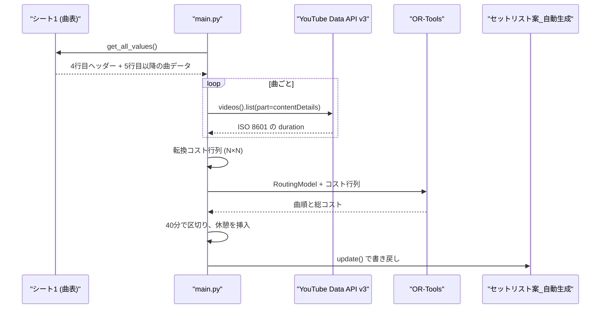

## 曲順決めには、思ったより制約が多い

バンドのセットリストは「盛り上がり順」だけで決められるものではありません。メンバーが曲ごとにパートを持ち替えるバンドでは、隣り合う曲で担当が変わると転換が発生します。ドラムならセットの組み替え、ギターなら持ち替えと音作り。持ち時間は決まっていて、途中には休憩も必要です。

**SetlistAutomation** は、この曲順決めを最適化問題として解く Python スクリプトです。Google スプレッドシートの曲表を読み、OR-Tools の巡回セールスマン問題（TSP）で転換コストが最小になる順序を求め、YouTube Data API v3 で各曲の演奏時間を取得し、40分を超える箇所に休憩を挟んで結果をシートに書き戻します。

この記事では、リポジトリの実装を追いながら「転換コストをどう行列にするか」「TSP をどう設定するか」「休憩をどこに置くか」を整理します。

## 全体構成

リポジトリには役割の違う3本のスクリプトがあります。

- `main.py`: Google スプレッドシートから読み、結果を別シートに書き戻す本番用
- `local_main.py`: 手元の Excel を読み、曲長は固定値で試すローカル版
- `local_main_youtube.py`: ローカル版に YouTube からの曲長取得と、休憩位置の先読みを足した版

`main.py` の流れは次のとおりです。



図1: SetlistAutomation の処理構成

責務は3つに分かれています。

- **入力**: 4行目をヘッダー、5行目以降を曲データとして読み、`ステータス` が `成立` の行だけを残す
- **最適化**: パート構成の差分から N×N の転換コスト行列を作り、TSP で曲順を決める
- **後処理**: 曲長を積み上げて40分を超える位置に休憩を挿入し、実質コストと合計時間を集計する

依存関係は `pyproject.toml` にまとまっており、Python 3.12 以上、OR-Tools 9.12、gspread、google-api-python-client、pandas、isodate を使います。実行は `uv run python main.py` です。

## 技術選定

| 論点 | 採用 | 代替案 | 採用理由 |
|---|---|---|---|
| 曲順の決定 | OR-Tools の RoutingModel（TSP） | 全順列の総当たり、貪欲法 | 曲数が増えても総当たりにならない。遷移コストをそのまま行列で渡せる |
| 探索 | PATH_CHEAPEST_ARC + GUIDED_LOCAL_SEARCH | 初期解のみ | 初期解だけで終わると局所解で止まる。改善フェーズを数行で足せる |
| 入力 | Google スプレッドシート（gspread） | CSV、Excel | メンバー全員が同じ表を編集できる。サービスアカウントで認証できる |
| 曲長 | YouTube Data API v3 | 手入力 | URL を貼るだけで分単位の見積もりが揃う |
| 出力 | 別シートへの書き戻し | 標準出力のみ | 演奏順をそのまま共有できる。入力シートを壊さない |

## 実装の核

### 1. 転換コストは「交代したパートの最大値」で決める

パートごとの重みは `main.py` の冒頭で定義されています。ドラムが5、ギターが3、ベースとキーボードが2、ボーカル・コーラス・その他が1です。

```python
# main.py（設定項目）
part_costs = {
    'Dr': 5, 'Gt1': 3, 'Gt2': 3, 'Ba': 2, 'Key': 2, 'Vo': 1, 'Cho': 1, 'Other': 1,
}
```

曲 A から曲 B への遷移コストは、交代したパートの重みの**最大値**です。合計ではありません。

```python
# local_main_youtube.py（calculate_transition_cost）
    all_roles = set(members1.keys()) | set(members2.keys())

    for role in all_roles:
        member1 = members1.get(role)
        member2 = members2.get(role)
        if member1 != member2:  # メンバーが異なる場合 (Noneも含む)
            cost = costs_dict.get(role, 0)  # 定義されてないパートはコスト0
            max_cost = max(max_cost, cost)
            if role == "Dr" and cost > 0:  # Drパートでコストがあれば交代とみなす
                is_drum_change = True

    return max_cost, is_drum_change
```

最大値にしているのは、転換が並行作業だからです。ドラムを組み替えている間にベースも持ち替えられます。律速になるのは一番重い作業なので、複数パートが同時に変わってもコストは増えません。`None`（欠番）と名前の比較も「交代」に含まれるため、パートが抜ける曲や入る曲も正しく差として拾えます。

`-` や空欄は不参加として `None` に正規化され、`(譲渡可)` のような注記はメンバー名から除去されます。表記揺れをここで吸収しておかないと、同じ人の交代が「別人への交代」としてカウントされてしまいます。

### 2. TSP はデポ0・1台で解く

曲をノード、遷移コストをエッジの重みとみなせば、曲順決めは TSP そのものです。`solve_tsp` はコスト行列をそのまま距離行列として渡します。

```python
# local_main_youtube.py（solve_tsp）
    transit_callback_index = routing.RegisterTransitCallback(distance_callback)
    routing.SetArcCostEvaluatorOfAllVehicles(transit_callback_index)

    search_parameters = pywrapcp.DefaultRoutingSearchParameters()
    search_parameters.time_limit.FromSeconds(60)  # タイムリミット設定
    search_parameters.first_solution_strategy = (
        routing_enums_pb2.FirstSolutionStrategy.PATH_CHEAPEST_ARC  # 初期解戦略
    )
    search_parameters.local_search_metaheuristic = (
        routing_enums_pb2.LocalSearchMetaheuristic.GUIDED_LOCAL_SEARCH  # 探索戦略
    )
```

`num_vehicles = 1`、`depot = 0` で、0番の曲を出発点に固定します。初期解を PATH_CHEAPEST_ARC で作り、GUIDED_LOCAL_SEARCH で改善します。局所解に嵌まりやすい組み合わせ最適化では、この改善フェーズの有無が結果を大きく変えます。`local_main_youtube.py` は60秒で打ち切りますが、`main.py` では時間制限がコメントアウトされており、既定の動作で解いています。

解からは先頭のデポを除いて曲順を取り出します。セットリストは巡回ではなく一列なので、最後の曲から1曲目に戻るコストは集計に含めていません。

### 3. YouTube の duration を分に直す

曲長は YouTube Data API v3 の `videos().list` で取得します。返る `contentDetails.duration` は `PT4M32S` のような ISO 8601 形式なので、`isodate` でパースして秒にし、60で割って分にします。

```python
# local_main_youtube.py（get_youtube_duration）
        request = youtube.videos().list(part="contentDetails", id=video_id)
        response = request.execute()

        if response["items"]:
            duration_iso = response["items"][0]["contentDetails"]["duration"]
            duration_timedelta = isodate.parse_duration(duration_iso)
            duration_minutes = duration_timedelta.total_seconds() / 60.0
            return duration_minutes
```

動画IDは `watch?v=`、`youtu.be/`、`/embed/`、11文字のID直書きの4通りから抽出します。取得に失敗した場合は例外を握って `DEFAULT_DURATION_MINUTES`（5.0分）を返し、処理は止めません。403 が返ったときは「クォータ制限かキー無効の可能性」と警告を出します。1曲の失敗でセットリスト全体が作れなくなるより、既定値で最後まで走らせるほうが実用的です。

### 4. 休憩は「転換コストが消える位置」に置く

休憩の挿入は TSP の後処理です。`main.py` は、現在のブロック時間に次の曲の長さを足して40分を超えるなら、その曲の前に休憩を入れます。このとき、その境目の転換コストは0として集計します。入れ替えは休憩中にできるからです。

```python
# main.py（Step 4-6 休憩挿入）
            if current_block_time > 0 and current_block_time + duration_to > play_time_limit:
                 is_break_time = True
                 ...
            actual_cost_for_transition = 0 if is_break_time else transition_cost
```

`local_main_youtube.py` はさらに踏み込みます。40分を超えそうでも、3曲先までにドラム交代があれば、10分の超過を許してそこまで演奏を続け、ドラム交代の直前に休憩をずらします。

```python
# local_main_youtube.py（create_detailed_setlist_with_breaks）
            if (
                current_block_time > 0
                and estimated_time_after_current_song > play_time_limit
            ):
                ...
                effective_cost = 0  # ★ 休憩明けの転換コストはゼロになる
```

ドラム交代は最も重い転換です。それを15分の休憩で吸収できれば、転換コストの合計は下がり、演奏も止まりません。時間の上限を絶対の制約にせず、少しだけ緩めて「重い転換を休憩に隠す」余地を残した設計です。

## 品質と性能

リポジトリにはベンチマークの数値がありません。そのため、実装から言えることだけを書きます。

- コスト行列の計算は N×N の二重ループで、曲数に対して素直に増える
- TSP は `local_main_youtube.py` で60秒の時間上限を設定しており、曲数が増えても実行時間は読める
- YouTube API の呼び出しは曲数ぶん。失敗時は既定値に落ちるため、1曲のエラーが全体を止めない
- `main.py` は結果とサマリー（実質総転換コスト、推定合計ライブ時間、休憩回数）を1シートに横並びで書き出す。`local_main_youtube.py` は「セットリスト案」と「サマリー」の2シートに分ける

曲数が増えて60秒の上限で打ち切られるようになったら、時間上限の調整か、コスト行列の疎行列化を検討する領域です。

## つまずいた点

- **1曲目が固定される**: `depot = 0` は「0番の曲から始める」という意味でもあります。表の1行目がオープナーに固定されるので、変えたいときは行を入れ替えるか、ダミーのデポを置く必要があります。加えて、ソルバーはデポに戻る閉路として解くため、目的関数には復路のコストが含まれます。表示する総コストは復路を足していないので、この2つは一致しません。
- **最大値ルールの副作用**: ドラムとベースが同時に変わる遷移も、ドラムだけが変わる遷移もコスト5です。軽い交代がいくつ重なってもコストが増えないため、最適化されるのは「重い交代の回数」だけで、交代の総数は評価していません。
- **README と実装のずれ**: README は `main.py` を前提に「5行目以降がデータ」「対象は成立のみ」と説明しています。一方 `local_main.py` と `local_main_youtube.py` は `DATA_START_ROW = 8`、対象ステータスは「成立」「あと一人」「募集中」です。どちらのスクリプトを動かすかで表の読み方が変わるので、実行前の確認が要ります。

## まとめ

SetlistAutomation の設計は「制約を行列に落とし、順序はソルバーに任せ、時間の制約は後処理で足す」に集約されています。

- 転換コストを N×N の行列にできれば、曲順は TSP の標準的な入力になる
- 持ち時間や休憩は TSP の制約に入れず、解いた後に挿入するほうが素直（曲順と休憩では目的が違う）
- 外部 API の値は失敗時に既定値へ落とし、全体を止めない
- コストを消せる位置（休憩）を探すと、同じ曲順でも合計コストを下げられる

「転換コストを重みにする」という一手間だけで、曲順決めは手作業から再現可能な計算に変わります。

## 関連記事

- [セットリスト編成の3つの制約をどう外したか — 転換コスト・持ち時間・休憩位置](/post/20261115setlist-automation-solution/)
- [バンドのセットリストをAIで自動生成！OR-Tools TSPで転換コストを最小化する方法](/post/setlist-automation/)

---

**最適化・自動化ツールの開発でお困りのことはありませんか？**

技術相談や開発サポートを承っています。お気軽にご相談ください。

[ココナラで開発相談を依頼する](https://coconala.com/users/1117897)
