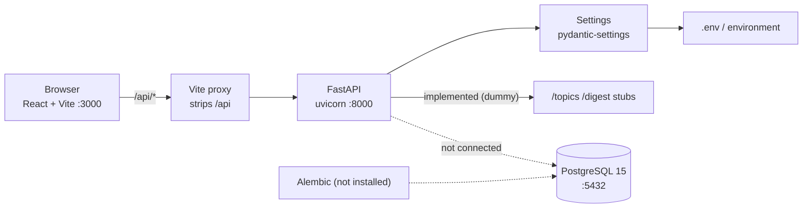

## Build the container before the contents

Reading an entire X timeline is not realistic, but you still want to know what people said about a topic today. TopicDigestX is a web app that takes keywords, collects related posts, and returns a digest summarized by an LLM.

What runs today is only the container. Collection through the X API, LLM summarization, and async task processing are not implemented, and the README says so plainly: the backend skeleton is done, and the X API client, LLM integration, and async processing are planned. This post covers how that skeleton — FastAPI, PostgreSQL, and an Alembic layer that is planned but not yet present — is put together, and where it currently stops.

## Architecture

Three containers and the configuration between them.



Figure 1: TopicDigestX components and their current state (dotted lines are unimplemented)

The split is narrow:

- **Browser**: React 19 with Vite. Only requests starting with `/api` are forwarded to the backend.
- **FastAPI**: port 8000. Routes, configuration loading, and stub endpoints for topics.
- **PostgreSQL 15**: port 5432. The container starts, but nothing reads or writes it yet.

The `db` service in `docker-compose.yml` has a `pg_isready` health check (`interval: 5s`, `retries: 5`).

## Technology choices

| Question | Chosen | Alternative | Why |
|---|---|---|---|
| API | FastAPI 0.115 | Flask | OpenAPI is generated from type hints, and `Depends` injects settings and sessions |
| Configuration | pydantic-settings | Reading `os.environ` directly | Types and defaults live in one place, and `.env` and real env vars look the same |
| ORM | SQLAlchemy (`declarative_base`) | Hand-written SQL | Models stay Python classes, which Alembic autogenerate can consume |
| Migrations | Alembic (planned, not installed) | `Base.metadata.create_all()` | Keeps a history; `create_all` cannot alter an existing table |

## Core implementation

### 1. Configuration lives in Pydantic Settings

`Settings` in `backend/main.py` folds environment variables and `.env` into one type.

```python
# backend/main.py
class Settings(BaseSettings):
    x_bearer_token: str = "default_bearer_token"
    openai_api_key: str = "default_openai_key"
    database_url: str = "sqlite:///./test.db"
    secret_key: str = "default_secret"
    llm_model_name: str = "gpt-3.5-turbo"

    model_config = SettingsConfigDict(env_file='../.env', env_file_encoding='utf-8', extra='ignore')
```

Because of `extra='ignore'`, an unknown key in `.env` does not stop startup. `get_settings()` is wrapped in `@lru_cache()` and injected with `Depends`, so the file is not re-read on every request.

The `/config` endpoint returns only `database_url_type` (the type name) and `llm_model_name`. The point is to have a debugging endpoint that cannot leak a connection string or a key.

### 2. Sessions stay inside database.py

```python
# backend/database.py
engine = create_engine(SQLALCHEMY_DATABASE_URL, pool_pre_ping=True)
SessionLocal = sessionmaker(autocommit=False, autoflush=False, bind=engine)
Base = declarative_base()

def get_db():
    db = SessionLocal()
    try:
        yield db
    finally:
        db.close()
```

`pool_pre_ping=True` is insurance against holding a connection that died when the database restarted. Making `get_db` a generator means `close()` runs as soon as the `Depends` scope ends.

### 3. One table, shaped so Alembic can take over

The first model is `Topic` alone. Keywords are a single `Text` column rather than a second table.

```python
# backend/model.py
class Topic(Base):
    __tablename__ = "topics"

    id = Column(Integer, primary_key=True, index=True)
    name = Column(String, index=True, nullable=False)
    keywords = Column(Text, nullable=True)
    created_at = Column(DateTime, server_default=func.now())
    updated_at = Column(DateTime, server_default=func.now(), onupdate=func.now())
```

`server_default=func.now()` puts the default on the database side, so it does not depend on the application clock. If migrations will create the table, defining these columns in database terms up front avoids a later `ALTER` just to add a default.

Alembic, however, is still on the README's planned list: there is no `alembic.ini` and no `versions/` directory. Nothing creates the table yet, and `/topics` returns hard-coded JSON.

### 4. Route everything through /api with the Vite proxy

```ts
// frontend/vite.config.ts
proxy: {
  '/api': {
    target: 'http://backend:8000',
    changeOrigin: true,
    rewrite: (path) => path.replace(/^\/api/, ''),
  },
},
```

The browser only ever sees `localhost:3000`, so no CORS configuration is needed. `App.tsx` calls `/api/`, the proxy rewrites it to `/`, and the request lands on the backend root.

## Quality and performance

There are no benchmarks, load tests, or automated tests yet (there is no `tests/` directory). The only quality claims available are structural.

| Concern | Implementation | Effect |
|---|---|---|
| Dropped connections | `pool_pre_ping=True` | Avoids reusing a connection that died |
| Config reads | `@lru_cache()` | `.env` is not re-read per request |
| Secrets | `/config` exposes only a type name and model name | No connection string or key in a response |

I am not quoting performance numbers because the repository records none. Cost only becomes interesting once collection and summarization exist, and that is the right place to measure.

## Pitfalls

- **SQLAlchemy is missing from the dependencies**: `backend/pyproject.toml` lists fastapi, uvicorn, pydantic-settings, and psycopg2-binary, but not SQLAlchemy or Alembic, even though `database.py` and `model.py` import them. Neither appears in `uv.lock`, so `database.py` fails at import time today. The containers start; the database layer does not.
- **Inconsistent import style**: `backend/model.py` uses a relative import (`from .database import Base`), while `backend/database.py` uses an absolute one (`from main import Settings`). Under `uvicorn main:app`, `main` is not a package, so `model.py` needs `from database import Base`.
- **The `.env` path depends on the working directory**: `env_file='../.env'` resolves against the current directory. In Compose, `backend/` is mounted at `/app` with `WORKDIR /app`, so that path points at `/`. The app still starts because the real values arrive as environment variables injected by `env_file: .env`, but local runs and containers behave differently.

## Takeaways

- Split settings, sessions, and models, and you know where to touch when a feature arrives.
- Dependency and import consistency breaks before the code does; check `pyproject.toml` against the imports.
- If Alembic is coming, push defaults to the database side (`server_default`) early.

Today the app starts, reads configuration, and answers with stubs. Nothing writes to the database yet. The next steps are adding SQLAlchemy and Alembic, creating the first revision under `versions/`, and replacing `/topics` with real data.

## Related posts

- [Cutting the Cost of Knowing What Is Trending on X](/en/post/20261115topic-digestx-solution/)
- [Summarizing an X timeline automatically: designing a topic digest system with FastAPI and an LLM (in Japanese)](/post/topic-digestx/)

---

**Building an information pipeline or an LLM summarizer of your own?**

I take on technical consulting and development support.

[Hire me on Coconala](https://coconala.com/users/1117897)
