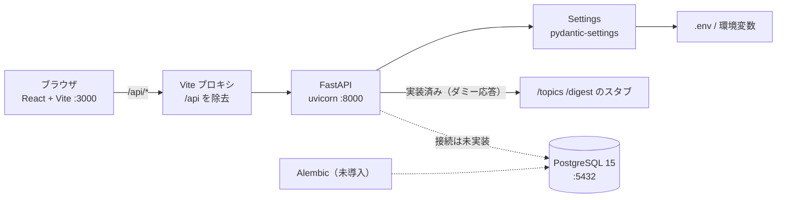

## ダイジェスト生成の「器」を先に固める

X のタイムラインを全部読むのは無理でも、関心のあるテーマで「今日はどんな話が出たか」だけは押さえたい。TopicDigestX は、キーワードを登録すると関連投稿を集め、LLM で要約したダイジェストを返す Web アプリです。

ただし、動いているのは器の部分だけです。X API からの収集、LLM による要約、非同期タスク処理は未実装で、README にも「バックエンドの基本構造は完成。X API 連携・LLM 統合・非同期タスク処理は実装予定」とあります。この記事では、その器——FastAPI・PostgreSQL・Alembic を前提にした基盤をどう組み、どこまで動くのかを実装から整理します。

## 全体構成

登場するのは3つのコンテナと、つなぐ設定だけです。



図1: TopicDigestX の構成と実装状況（点線は未実装）

役割は次のとおりです。

- **ブラウザ**: React 19 + Vite。`/api` で始まるリクエストだけをバックエンドへ流します
- **FastAPI**: 8000 番。ルート、設定の読み込み、トピック関連のスタブ
- **PostgreSQL 15**: 5432 番。コンテナは起動しますが、アプリからの読み書きはこれからです

`docker-compose.yml` の db には `pg_isready` のヘルスチェック（`interval: 5s` / `retries: 5`）があります。

## 技術選定

| 論点 | 採用 | 代替案 | 採用理由 |
|---|---|---|---|
| API | FastAPI 0.115 | Flask | 型ヒントから OpenAPI が自動生成され、`Depends` で設定とセッションを差し込める |
| 設定管理 | pydantic-settings | `os.environ` を直接読む | 型と既定値を1か所に集約でき、`.env` と環境変数を同じ形で扱える |
| ORM | SQLAlchemy（`declarative_base`） | SQL 直書き | モデルをクラスで持ち、Alembic の自動生成に乗せられる |
| マイグレーション | Alembic（未導入・予定） | `Base.metadata.create_all()` | 変更履歴を残せる。`create_all` は既存テーブルの変更に追従できない |

## 実装の核

### 1. 設定は Pydantic Settings に集約する

`backend/main.py` の `Settings` が、環境変数と `.env` を1つの型にまとめています。

```python
# backend/main.py
class Settings(BaseSettings):
    x_bearer_token: str = "default_bearer_token"
    openai_api_key: str = "default_openai_key"
    database_url: str = "sqlite:///./test.db"
    secret_key: str = "default_secret"
    llm_model_name: str = "gpt-3.5-turbo"

    model_config = SettingsConfigDict(env_file='../.env', env_file_encoding='utf-8', extra='ignore')
```

`extra='ignore'` があるので、`.env` に知らないキーが増えても起動は止まりません。`@lru_cache()` 付きの `get_settings()` を `Depends` で注入し、リクエストごとの読み直しを避けています。

`/config` は `database_url_type`（型名）と `llm_model_name` だけを返します。確認用の口から接続文字列や鍵を漏らさない線引きです。

### 2. セッションは database.py に閉じる

```python
# backend/database.py
engine = create_engine(SQLALCHEMY_DATABASE_URL, pool_pre_ping=True)
SessionLocal = sessionmaker(autocommit=False, autoflush=False, bind=engine)
Base = declarative_base()

def get_db():
    db = SessionLocal()
    try:
        yield db
    finally:
        db.close()
```

`pool_pre_ping=True` は、DB の再起動で死んだ接続を掴み続けないための保険です。`get_db` をジェネレータにすると、`Depends` のスコープを抜けた時点で `close()` が呼ばれます。

### 3. モデルは1テーブルから、Alembic を前提にした形で

最初のモデルは `Topic` だけです。キーワードは別テーブルにせず、`Text` にまとめています。

```python
# backend/model.py
class Topic(Base):
    __tablename__ = "topics"

    id = Column(Integer, primary_key=True, index=True)
    name = Column(String, index=True, nullable=False)
    keywords = Column(Text, nullable=True)
    created_at = Column(DateTime, server_default=func.now())
    updated_at = Column(DateTime, server_default=func.now(), onupdate=func.now())
```

`server_default=func.now()` は DB 側の `now()` を既定値にする指定で、アプリの時計に依存しません。マイグレーション前提なら、DB 側の定義を最初から入れておくほうが、後から `ALTER` で足す手間が減ります。

ただし Alembic は README の「実装予定」に挙がっている段階で、`alembic.ini` も `versions/` もまだありません。テーブルを作る手段は無く、`/topics` はスタブのダミー JSON を返します。

### 4. コンテナ間は Vite のプロキシで /api に寄せる

```ts
// frontend/vite.config.ts
proxy: {
  '/api': {
    target: 'http://backend:8000',
    changeOrigin: true,
    rewrite: (path) => path.replace(/^\/api/, ''),
  },
},
```

ブラウザから見たオリジンは `localhost:3000` だけになり、CORS を書かずに済みます。`App.tsx` は `/api/` を叩き、プロキシが `/` に書き換えてバックエンドへ届けます。

## 品質と性能

ベンチマーク、負荷試験、自動テストはまだありません（`tests/` も未作成です）。品質として語れるのは構成上の備えだけです。

| 観点 | 実装 | 効果 |
|---|---|---|
| 接続断 | `pool_pre_ping=True` | 再起動後の死んだ接続を掴まない |
| 設定の読み込み | `@lru_cache()` | リクエストごとに `.env` を読み直さない |
| 機密情報 | `/config` は型名とモデル名のみ | 接続文字列や鍵をレスポンスに出さない |

性能の数値はリポジトリに記録がないため書きません。重さが問題になるのは収集と要約を入れてからで、計測もそこで行います。

## つまずいた点

- **依存関係に SQLAlchemy が無い**: `backend/pyproject.toml` の依存は fastapi / uvicorn / pydantic-settings / psycopg2-binary などで、`database.py` と `model.py` が import する SQLAlchemy も Alembic も入っていません。`uv.lock` にも見当たらず、現状 `database.py` は import の時点で失敗します。コンテナは起動しても DB 層は動きません。
- **相対 import のずれ**: `backend/model.py` は `from .database import Base` と相対 import で書き、`backend/database.py` は `from main import Settings` と絶対 import で書いています。`uvicorn main:app` では `main` がパッケージではないため、`model.py` 側は `from database import Base` に揃える必要があります。
- **`.env` のパスが作業ディレクトリ依存**: `env_file='../.env'` は起動時の CWD からの相対パスです。Compose では `WORKDIR /app` に `backend/` がマウントされるため、この指定は `/` を指します。実際の値は `env_file: .env` の環境変数から読まれるので起動はしますが、ローカルとコンテナで挙動が変わります。

## まとめ

- 設定・セッション・モデルを分けて置くと、機能を足すときに触る場所が決まる
- 依存と import の整合はコードより先に壊れる。`pyproject.toml` と import を突き合わせる
- Alembic を入れる前提なら、モデルの既定値は DB 側（`server_default`）に寄せておく

現状は「起動して設定とダミー応答を返す」までで、DB に書き込む経路はありません。次は SQLAlchemy と Alembic の依存追加、`versions/` の初回リビジョン、`/topics` の実データ化です。

## 関連記事

- [タイムラインを読む時間を削る — TopicDigestX が狙う「話題把握コスト」の下げ方](/post/20261115topic-digestx-solution/)
- [Xのタイムラインを自動要約！FastAPI + LLMで作るトピックダイジェストシステムの設計](/post/topic-digestx/)

---

**X の情報収集や LLM 要約の仕組みづくりでお困りのことはありませんか？**

技術相談や開発サポートを承っています。お気軽にご相談ください。

[ココナラで開発相談を依頼する](https://coconala.com/users/1117897)
