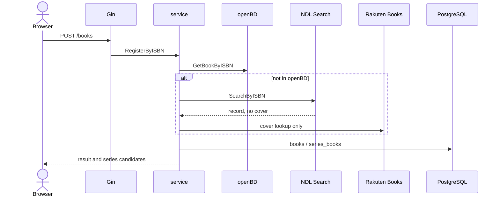

## Making "is the next volume out yet?" something nobody has to check

Sequel tracking looks like a minor feature until you break down the requirements. The bibliographic data comes in pieces. For a book whose ISBN you already know, openBD answers. Finding a book when you do not know the ISBN is the job of NDL Search and Rakuten Books. Cover images only Rakuten has. Even a single "look up this book" operation has three different places to ask.

tsuzukan folds those three sources behind one interface and builds series detection and new-release checks on top. The backend is Go 1.26 (per `go.mod`) with Gin, the frontend is React 19 with TypeScript and Vite, the database is PostgreSQL, and authentication is Firebase Auth.

This post walks through the architecture, the technology choices, the core implementation, and CI/CD, quoting the repository.

## Architecture

The layers are Handler → Service → Repository, and every dependency is wired in `cmd/server/main.go`. A constructor that is missing a required dependency stops the server there, so nothing starts half-wired.



Figure 1: Resolving bibliographic data at registration

The responsibilities are deliberately narrow:

- **openBD**: records for a known ISBN. It is the source of record; fields it filled are never overwritten.
- **NDL Search**: discovery by title, author, or ISBN. No API key, so it is asked first.
- **Rakuten Books**: the fallback for what NDL does not hold, and the only practical source of cover images.
- **Service**: series detection, ownership decisions, new-release checks.
- **Repository**: PostgreSQL. Bibliographic data is a shared catalogue; user state lives in per-user tables.

The key point is treating the three sources as three distinct responsibilities: records, discovery, covers. Expecting one API to do all three means an outage there takes down search, the release check, and covers at once. That is exactly what happened while the app relied on Rakuten alone.

## Technology choices

| Question | Chosen | Alternative | Why |
|---|---|---|---|
| Language | Go 1.26 + Gin | Node.js + Express | Much of the work is sequential external calls; concurrency and types belong in the language |
| Frontend | React 19 + TanStack Query | Server-side rendering | The app is authenticated screens; cache invalidation is decided per screen |
| Auth | Firebase Auth (JWT) | Home-grown sessions | No password storage. The middleware only resolves the UID to a `user_id` |
| Records | openBD | Rakuten Books only | Fast direct ISBN lookup, no API key |
| Discovery | NDL → Rakuten fallback | Rakuten only | Avoids one outage stopping search, release checks, and volume backfill together |

## Core implementation

### 1. openBD is the source of record; discovery fills the gaps

The entry point in `internal/service/book_lookup.go` is a short function.

```go
// internal/service/book_lookup.go
func (s *BookService) lookupBookInfo(isbn string) (*client.BookInfo, error) {
	info, openBDErr := s.openBDClient.GetBookByISBN(isbn)
	if openBDErr == nil {
		return s.enrichFromDiscovery(isbn, info), nil
	}
	return s.lookupBookInfoFromDiscovery(isbn, openBDErr)
}
```

Even when openBD answers, the result goes through `enrichFromDiscovery`. Two gaps justify the extra call, and both come from measurement: openBD almost never carries a cover (2 of 100 probed, per `docs/book-metadata-sources.md`), and some publishers register bare work titles with an empty volume field. Fields openBD filled are left alone.

### 2. Discovery separates "no such book" from "could not ask"

`FallbackDiscoveryClient` in `internal/client/discovery.go` asks NDL, then Rakuten, and stops at the first non-empty answer.

```go
// internal/client/discovery.go (excerpt from FallbackDiscoveryClient.try)
for _, source := range c.sources {
	books, err := search(source.Client)
	if err != nil {
		if firstErr == nil {
			firstErr = fmt.Errorf("%s: %w", source.Name, err)
		}
		continue
	}
	if len(books) > 0 {
		return books, nil
	}
	answered = true
}
if answered {
	return nil, nil
}
return nil, fmt.Errorf("all discovery sources failed: %w", firstErr)
```

If `answered` is set, the call returns an empty result even when the other source is down. That branch exists so "asked, not catalogued" does not become a 500. Only when no source could be asked at all does it return an error.

Putting NDL first is based on measurements recorded in `cmd/server/main.go`: it held 97% of a 100-book sample and returned 91% of already-owned volumes when asked by series name.

### 3. Series detection is a table of regular expressions

The code that pulls a series name and volume number out of a title lives in `internal/transform/text.go`. The table is the implementation.

```go
// internal/transform/text.go (excerpt from reVolumePatterns)
{regexp.MustCompile(`(.+?)\s*[\(（](` + digits + `+)[\)）].*$`), false}, // Title (1)
{regexp.MustCompile(`(.+?)\s*第(` + digits + `+)巻.*$`), true},          // Title 第1巻
{regexp.MustCompile(`(.+?)\s*(` + digits + `+)巻.*$`), true},           // Title 1巻
{regexp.MustCompile(`(?i)(.+?)\s*vol\.?\s*(` + digits + `+).*$`), true}, // Title Vol.1
{regexp.MustCompile(`(.+?)\s+#(` + digits + `+).*$`), true},             // Title #1
```

The second column says whether the pattern has an explicit volume marker. When an unmarked pattern captures a number that is implausibly large, it is a year rather than a volume, so the candidate is dropped and the next pattern runs. The table order is what lets `(1)` and `第1巻` resolve to the same volume.

Before matching, the code strips publisher labels such as `(ビッグガンガンコミックス)` and wave-dash taglines. Without that, a volume carrying a tagline would get the whole marketing title as its series name and never match its siblings.

### 4. The release check leans on a cache and on a "do not search" mode

`checkSingleSeriesNew` in `internal/service/release.go` checks the cache first. The default expiry is 24 hours (`RAKUTEN_CACHE_EXPIRY`).

```go
// internal/service/release.go (excerpt from checkSingleSeriesNew)
if !forceRefresh && series.LastRakutenSearchAt != nil {
	timeSinceLastSearch := time.Since(*series.LastRakutenSearchAt)
	if timeSinceLastSearch < s.cacheExpiry {
		result.cached = true
		return result
	}
}
```

There is a second path that makes no external call at all: series with `detection_mode = 'manual'`. Works whose volumes share no title — 綾辻行人's 館シリーズ, 森博嗣's S&M series — cannot be found by title or author search; an author search returns their other series too. So the volumes the user linked *are* the definition, and every linked volume they do not own is reported. The code comment puts it plainly: external data cannot decide this. openBD and NDL carry the imprint in their series field; of 100 sampled books, 0 carried the work's name.

Special and limited editions returning under separate ISBNs for the same volume are handled by sorting regular editions first and then dropping volume numbers already linked to the series.

## Quality and performance

CI runs on GitHub Actions. `ci.yml` (pull requests) and `deploy.yml` (main) both call the reusable `test.yml`. Previously two workflows each carried their own copy of the suite, and they had drifted: lint present in one and absent in the other, PostgreSQL 13 versus 16, no Node version pinned on one side. After consolidating, the measured wall clock went from 8m18s to 5m02s (`docs/docker-ci-optimization.md`).

| Item | Before | After |
|---|---|---|
| CI wall clock | 8m18s | 5m02s |
| golangci-lint install + run | 88s + 104s | 32s |
| Frontend | serial | parallel (1m25s) |

External calls are trimmed too. openBD supports comma-separated batch lookups and returned 120 ISBNs in one request in 0.09s. `fetch-volumes` batches by 100 instead of paying 500ms per book serially. Rakuten calls are spaced by `RAKUTEN_REQUEST_DELAY` (500ms by default), and the release check caches for 24 hours.

Deployment does not build on the VPS. The image is built locally and shipped with `docker save | ssh docker load`. On 2026-09-29 a full build on the production host caused swap thrashing under memory pressure and took the service down for about 15 minutes. A push to main therefore only runs tests; deployment is a single script.

## Pitfalls

- **A gap in migration numbering**: `test.yml` checks that migration numbers form an unbroken 1..N sequence. It exists because `000028` reached main before `000027`, and golang-migrate only applies files numbered above the current version — it never complains about a missing one. The check verifies the sequence, the up/down pairing, and duplicates.
- **ISBN-10 leaking in**: Rakuten Books sometimes returns ISBN-10 for older titles. Stored without normalisation, the same volume became two cards, one at 10 digits and one at 13 (7 cases in production). Normalisation now happens in the client and again on write, and migration `000040` merged the existing rows.
- **Cover lookup order**: NDL retired its cover service on 2026-03-31 and returns empty image URLs. Because discovery stops at NDL's answer, the release check could not reach a cover at all. A dedicated Rakuten client is now passed straight to the release service for covers (production backfill not yet run, per `docs/new-release-covers.md`).

## Takeaways

- Treat records, discovery, and covers as separate responsibilities. Folding them into one API makes that API's outage everyone's outage.
- Distinguish "no result" from "could not ask" in the return values. Do not turn the former into a 500.
- Keep matching logic in a table, so order and exceptions are readable in one place.
- Reduce external calls with caches and with paths that make no call at all. Not calling is faster and removes a failure mode.

The same shape applies to any tool that reconciles data across external catalogues.

## Related posts

- [Preventing missed sequels by design: giving up on remembering at the bookstore](/en/post/20261115tsuzukan-solution/)
- [Never miss the next volume again: a Go + React sequel tracker (in Japanese)](/post/tsuzukan/)

---

**Working on a design that has to combine several external APIs, or building with Go and React?**

I take on technical consulting and development support.

[Hire me on Coconala](https://coconala.com/users/1117897)
