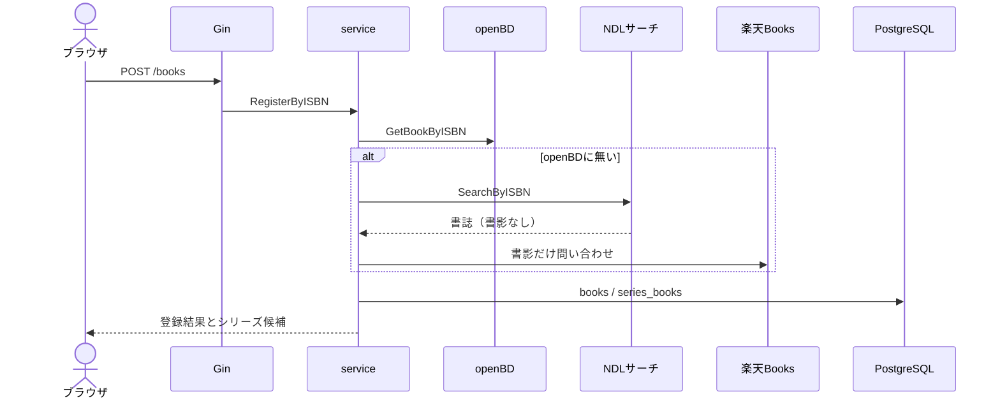

## 続刊が出たかを、人が見に行かない形にする

「続刊管理」は、機能としては地味です。しかし要件を分解すると、外部データの性質がばらばらなことに気づきます。ISBN が分かっている本の書誌は openBD が返します。ISBN が分からない本を探すのは NDLサーチと楽天Books の仕事です。書影は楽天しか持っていません。同じ「本を引く」という操作でも、聞き先が3つに分かれます。

tsuzukan は、この3系統を1つのインターフェースに畳み、その上にシリーズ判定と新刊チェックを載せたWebアプリです。バックエンドは Go 1.26（`go.mod`）+ Gin、フロントエンドは React 19 + TypeScript + Vite、DB は PostgreSQL、認証は Firebase Auth です。

この記事では、全体構成、技術選定、実装の核、CI/CD の順に、リポジトリのコードを引きながら整理します。

## 全体構成

層は Handler → Service → Repository の3層で、依存はすべて `cmd/server/main.go` で組み立てます。コンストラクタは必須の依存が欠けていればそこで起動を止めるので、足りないまま動き出すことはありません。



図1: 書籍登録時の書誌解決

役割は次のように分けています。

- **openBD**: ISBN が確定している本の書誌。記録の正とし、埋まったフィールドは上書きしない
- **NDLサーチ**: タイトル・著者・ISBN からの探索。APIキー不要なので最初に聞く
- **楽天Books**: NDL が持たない本のフォールバックと、書影の唯一の供給元
- **Service**: シリーズ判定、所有判定、新刊チェック
- **Repository**: PostgreSQL。書誌は共有カタログ、ユーザーの状態は per-user 表

3系統を「書誌」「探索」「書影」という別の責務として扱うのが要点です。1つのAPIに全部を期待すると、そのAPIが落ちたときに検索も新刊チェックも書影も同時に止まります。実際、楽天だけに頼っていた時期はそうなっていました。

## 技術選定

| 論点 | 採用 | 代替案 | 採用理由 |
|---|---|---|---|
| 言語 | Go 1.26 + Gin | Node.js + Express | 外部APIを直列に叩く処理が多く、並行制御と型を言語側で持てる |
| フロント | React 19 + TanStack Query | サーバーサイドレンダリング | 認証後の画面が中心で、キャッシュ無効化の単位を画面ごとに決めたかった |
| 認証 | Firebase Auth (JWT) | 自前のセッション | パスワード管理を持たずに済む。UID を user_id に解決するだけで済む |
| 書誌 | openBD | 楽天Booksのみ | ISBN 直引きが速く、APIキーが不要 |
| 探索 | NDL → 楽天のフォールバック | 楽天のみ | 楽天の障害が検索・新刊チェック・巻補完を同時に止める構造を避ける |

## 実装の核

### 1. 書誌は openBD を正とし、足りない分だけ探索で埋める

`internal/service/book_lookup.go` の入口は短い関数です。

```go
// internal/service/book_lookup.go
func (s *BookService) lookupBookInfo(isbn string) (*client.BookInfo, error) {
	info, openBDErr := s.openBDClient.GetBookByISBN(isbn)
	if openBDErr == nil {
		return s.enrichFromDiscovery(isbn, info), nil
	}
	return s.lookupBookInfoFromDiscovery(isbn, openBDErr)
}
```

openBD が答えた場合も `enrichFromDiscovery` を通します。理由は2つあり、どちらも実測に基づきます。書影は openBD にはほぼ無く（100冊の調査で2冊、`docs/book-metadata-sources.md`）、巻数が空のまま登録される出版社があるためです。埋まったフィールドは上書きしません。

### 2. 探索は「答えが無い」と「聞けなかった」を区別する

`internal/client/discovery.go` の `FallbackDiscoveryClient` は、NDL → 楽天の順に聞き、最初に中身のある結果を返したところで止まります。

```go
// internal/client/discovery.go（FallbackDiscoveryClient.try より抜粋）
for _, source := range c.sources {
	books, err := search(source.Client)
	if err != nil {
		if firstErr == nil {
			firstErr = fmt.Errorf("%s: %w", source.Name, err)
		}
		continue
	}
	if len(books) > 0 {
		return books, nil
	}
	answered = true
}
if answered {
	return nil, nil
}
return nil, fmt.Errorf("all discovery sources failed: %w", firstErr)
```

`answered` が立っていれば、片方が落ちていても空の結果を返します。「聞いたが無かった」を 500 に変えないための分岐です。全滅したときだけエラーになります。

NDL を先に置く判断は、`cmd/server/main.go` のコメントにある実測に基づきます。100冊のサンプルで NDL が97%を持ち、シリーズ名で聞いたときに所有済み巻の91%を返しました。

### 3. シリーズ判定は正規表現の表で持つ

タイトルからシリーズ名と巻数を取り出す処理は `internal/transform/text.go` にあります。パターンを並べた表が本体です。

```go
// internal/transform/text.go（reVolumePatterns より抜粋）
{regexp.MustCompile(`(.+?)\s*[\(（](` + digits + `+)[\)）].*$`), false}, // Title (1)
{regexp.MustCompile(`(.+?)\s*第(` + digits + `+)巻.*$`), true},          // Title 第1巻
{regexp.MustCompile(`(.+?)\s*(` + digits + `+)巻.*$`), true},           // Title 1巻
{regexp.MustCompile(`(?i)(.+?)\s*vol\.?\s*(` + digits + `+).*$`), true}, // Title Vol.1
{regexp.MustCompile(`(.+?)\s+#(` + digits + `+).*$`), true},             // Title #1
```

2列目は「巻数であることを明示する記号があるか」です。`false` のパターンで取れた数が大きすぎる場合、それは巻数ではなく年号なので、その候補を捨てて次のパターンに進みます。`(1)` と `第1巻` が同じ巻数を指すことを、表の順序で吸収しています。

判定の前に、出版社ラベル `(ビッグガンガンコミックス)` や波ダッシュの副題 `～…～` を落とします。これをしないと、副題付きの巻だけシリーズ名が販促タイトル全体になり、兄弟の巻と一致しません。

### 4. 新刊チェックはキャッシュと「探さない」モードで外部呼び出しを抑える

`internal/service/release.go` の `checkSingleSeriesNew` は、まずキャッシュを見ます。既定は24時間（`RAKUTEN_CACHE_EXPIRY`）です。

```go
// internal/service/release.go（checkSingleSeriesNew より抜粋）
if !forceRefresh && series.LastRakutenSearchAt != nil {
	timeSinceLastSearch := time.Since(*series.LastRakutenSearchAt)
	if timeSinceLastSearch < s.cacheExpiry {
		result.cached = true
		return result
	}
}
```

外部に問い合わせない経路ももう1つあります。`detection_mode = 'manual'` のシリーズです。巻のタイトルが共通しない作品（館シリーズ、S&Mシリーズなど）は、タイトル検索でも著者検索でも正しく引けません。そこでユーザーが紐付けた巻を定義とし、未所有の巻をそのまま新刊として返します。コードのコメントにも「外部データでは決められない」と書いてあります。openBD と NDL のシリーズ項目はレーベル名で、100冊のサンプルで作品名を持っていたのは0冊でした。

同じ巻の特装版・限定版が別ISBNで返る問題は、通常版を先に並べたうえで、既に紐付いた巻数を落とすことで処理しています。

## 品質と性能

CI は GitHub Actions で、`ci.yml`（PR）と `deploy.yml`（main）が `test.yml` を再利用して呼びます。以前は同じスイートを2つのワークフローが別々に持ち、lint の有無、PostgreSQL のバージョン（13 と16）、Node の指定が食い違っていました。統合後の実測は 8分18秒 → 5分02秒です（`docs/docker-ci-optimization.md`）。

| 項目 | 変更前 | 変更後 |
|---|---|---|
| CI 全体（壁時計） | 8分18秒 | 5分02秒 |
| golangci-lint 導入 + 実行 | 88秒 + 104秒 | 32秒 |
| フロントエンド | 直列 | 並列（1分25秒） |

外部APIの呼び出しも絞っています。openBD はカンマ区切りの一括取得に対応していて、120冊を1リクエスト・0.09秒で返しました。`fetch-volumes` は100冊単位でまとめ、1冊ずつ500ms待つ直列取得を避けます。楽天への呼び出しは `RAKUTEN_REQUEST_DELAY`（既定500ms）で間隔を空け、新刊チェックは24時間キャッシュします。

デプロイは VPS 上でビルドしません。手元でイメージを作り、`docker save | ssh docker load` で差し替えます。2026-09-29、本番ホストでのフルビルドがメモリ逼迫でスワップスラッシングを起こし、約15分ダウンしたためです。main への push ではテストだけを回し、デプロイはスクリプトに一本化しています。

## つまずいた点

- **マイグレーション番号の欠番**: `test.yml` に番号の連番検査があります。実際に、`000028` だけが先に main へ入り、`000027` が後から merge されて適用されない事故が起きました。golang-migrate は現在の版より大きいファイルを順に当てるだけで、欠番を咎めません。検査は `1..N` の連番、up/down の対応、重複を見ます。
- **ISBN-10 の混入**: 楽天Books は古い本に ISBN-10 を返すことがあります。正規化を通さず保存した結果、同じ巻が10桁と13桁で2枚のカードになりました（本番7件）。クライアント側と書き込み側の両方で13桁に寄せ、migration `000040` で既存行を統合しています。
- **書影の取得順**: NDL は書影サービスを2026-03-31に終了しており、画像URLを空で返します。探索が NDL で止まるため、新刊チェックは構造的に書影へ到達できませんでした。書影専用に楽天クライアントを直接渡す経路を足しています（本番データのバックフィルは未実施、`docs/new-release-covers.md`）。

## まとめ

- 書誌・探索・書影は別の責務として扱い、聞き先を分ける。1つのAPIに寄せると、その障害が全機能に伝播する
- 「答えが無い」と「聞けなかった」を戻り値で区別する。前者を 500 にしない
- 判定ロジックは正規表現の表として持ち、順序と例外を表の中で表現する
- 外部呼び出しはキャッシュと「呼ばない経路」で減らす。呼ばない設計は、速いだけでなく障害点も減る

同じ形は、外部カタログを突き合わせるツールなら分野を問わず流用できます。

## 関連記事

- [続刊の買い忘れを仕組みで防ぐ — 「本屋に行くたび思い出す」をやめた記録の持ち方](/post/20261115tsuzukan-solution/)
- [漫画の続刊を買い忘れない！Go + Reactで作った続刊管理Webアプリ「tsuzukan」](/post/tsuzukan/)

---

**外部APIを複数束ねる設計や、Go + React の開発でお困りのことはありませんか？**

技術相談や開発サポートを承っています。お気軽にご相談ください。

[ココナラで開発相談を依頼する](https://coconala.com/users/1993863)
