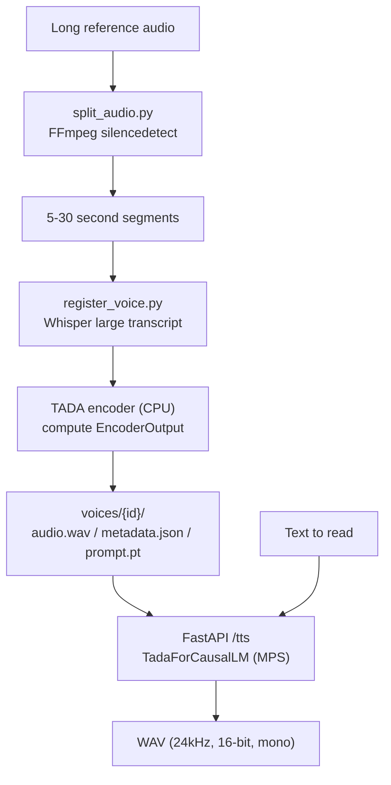

## Where a voice-clone TTS gets stuck

"I want to read any text aloud in my own voice." That is the whole requirement, and there are three places where it usually breaks: preparing the reference audio, fitting the model into memory, and serializing generation requests.

This repository (`tts`) answers each of those with a division of labour. Voice registration happens in a CLI, reading aloud happens in a FastAPI server, audio is cut with FFmpeg, and transcription is done by Whisper. The model is HumeAI's **TADA (Text-Acoustic Dual Alignment) 3B-ML**.

This post walks through the actual file layout and code to explain how the pipeline is split and why. The target reader is someone who wants a Japanese reading voice on a local machine, specifically an Apple Silicon Mac.

## Architecture

The system has two phases, registration and generation, and they share exactly one thing: the `voices/` directory.



Figure 1: The registration phase (upstream, CLI) and the generation phase (downstream, server)

Responsibilities are narrow on purpose:

- **Preprocessing (`tools/split_audio.py`)**: FFmpeg `silencedetect` cuts long audio into 5-30 second pieces.
- **Registration (`tools/register_voice.py`)**: Whisper transcribes, then the TADA encoder produces `prompt.pt`.
- **Generation (`server/`)**: loads `prompt.pt`, synthesizes with TADA 3B-ML, returns WAV.

Keeping registration and generation in separate processes is the core decision. The server holds only TADA 3B-ML in memory. Whisper (about 3GB) and the encoder (about 1GB) load sequentially in the CLI and are freed before the next one starts. Holding all three at once does not fit on a Mac.

## Technology choices

| Question | Chosen | Alternative | Why |
|---|---|---|---|
| Voice model | TADA 3B-ML | A trained TTS model | Takes voice identity from a short reference; supports Japanese |
| Transcription | Whisper large (CLI only) | Manual transcript only | A transcript is mandatory, and typing it by hand is not realistic |
| Server | FastAPI + uvicorn | Flask | `asyncio.to_thread` can move inference off the event loop directly |
| Audio splitting | FFmpeg `silencedetect` | Reading waveforms with librosa | Memory stays flat on long recordings |
| Prompt storage | Precomputed `prompt.pt` | Encode on every request | The encoder does not run during generation |

TADA was chosen because one encode of a reference-audio and transcript pair is enough to generate from text afterwards. That "precomputable unit" is what makes the server design possible at all.

## Core implementation

### 1. Registration finishes in the CLI, and the encoder runs on CPU

`encode_voice` in `tools/register_voice.py` turns reference audio into an `EncoderOutput`.

```python
# tools/register_voice.py (encode_voice)
encoder = Encoder.from_pretrained(CODEC_NAME, language=LANGUAGE)
# Use ungated tokenizer (identical vocab) to avoid Llama gated repo requirement
encoder._aligner.tokenizer = AutoTokenizer.from_pretrained("unsloth/Llama-3.2-1B")
encoder = encoder.to(device)

audio, sample_rate = torchaudio.load(str(audio_path))
audio = audio.mean(dim=0, keepdim=True)
audio = audio / audio.abs().max()
audio = audio.to(device)

prompt = encoder(audio, text=[transcript], sample_rate=sample_rate)
```

The caller passes `device="cpu"`. Encoding long audio on MPS runs out of memory, and registration is a batch job where waiting is acceptable, so the work is pushed to CPU. Stereo is averaged to mono and peak-normalized before it reaches the encoder.

What gets saved is a dictionary of tensors moved back to CPU: `token_values`, `token_positions`, `audio_len`, `text_tokens`, `text_tokens_len`, `sample_rate`, and `text`. Not the waveform itself, but the representation the model consumes.

### 2. Generation is serialized with a lock and a thread

`server/app/routers/tts.py` wraps inference in an `asyncio.Lock` and hands it to `asyncio.to_thread`.

```python
# server/app/routers/tts.py
_inference_lock = asyncio.Lock()

@router.post("/tts")
async def generate_speech(req: TTSRequest) -> Response:
    if not req.text.strip():
        raise HTTPException(status_code=422, detail="text must not be empty")

    async with _inference_lock:
        wav_bytes = await asyncio.to_thread(
            get_tts_service().generate,
            voice_id=req.voice_id,
            text=req.text,
            speed=req.speed,
        )
```

TADA inference is heavy GPU (MPS) work and is not safe to run concurrently. The lock keeps it to one at a time, and `to_thread` keeps the event loop responsive. Without those two lines, even the health check stops answering while a generation is running.

### 3. Store `prompt.pt` on CPU, move it at generation time

`server/app/services/tts_service.py` moves the loaded tensors to the model's device before rebuilding the `EncoderOutput`.

```python
# server/app/services/tts_service.py (_reconstruct_encoder_output)
def _to(v: Any) -> Any:
    return v.to(device) if isinstance(v, torch.Tensor) else v

return EncoderOutput(
    audio=None,
    audio_len=_to(data["audio_len"]),
    text=data["text"],
    text_tokens=_to(data["text_tokens"]),
    text_tokens_len=_to(data["text_tokens_len"]),
    token_positions=_to(data["token_positions"]),
    token_values=_to(data["token_values"]),
    sample_rate=data["sample_rate"],
)
```

Tensors read by `torch.load` live on CPU. Passing them straight to an MPS model fails on a device mismatch, so they are moved explicitly here. `audio=None` is deliberate: generation does not need the reference waveform once `token_values` and `token_positions` exist.

Generation uses `num_transition_steps=5`, and `speed`, when supplied, becomes `InferenceOptions.speed_up_factor`. The output is clamped to `[-1.0, 1.0]`, quantized to 16-bit PCM, and written to WAV bytes with `torchaudio.save`.

### 4. Long audio is cut at the middle of each silence

`tools/split_audio.py` parses `silencedetect` output with regular expressions and uses the midpoint of each silent interval as a split point.

```python
# tools/split_audio.py (split_at_silences)
split_points = [0.0]
for s in silences:
    mid = (s["start"] + s["end"]) / 2
    split_points.append(mid)
split_points.append(total_duration)
```

The midpoint avoids clipping the attack or the decay of a phrase. Output is forced to `-ar 24000 -ac 1` so it matches the server's sample rate. Segments shorter than five seconds are dropped, and a manifest is written to `segments.json`.

## Quality and performance

The numbers recorded in the repository are these.

| Item | Value | Source |
|---|---|---|
| Model size | about 6GB (MPS) | README |
| Whisper large | about 3GB | README |
| TADA encoder | about 1GB | README |
| Output audio | 24kHz / 16-bit / mono | README, `server/app/config.py` |
| Recommended reference length | 5-30 seconds | README |

`server/tests/` holds 20 tests (`test_api.py` 8, `test_tts_service.py` 5, `test_voice_store.py` 7), and `PLAN.md` records every phase as complete.

Latency figures are not recorded in the repository, so any statement here has to be qualitative. Because the encoder never runs during generation, the second and later requests do not pay encoding cost. The model loads once, at server startup.

## Pitfalls

- **Encoder sequence limit**: the encoder caps sequence length at 8192. Reference audio longer than 30 seconds fails, which is why splitting comes first. The README states the 5-30 second recommendation explicitly.
- **Gated Llama repo**: TADA's aligner uses a Llama 3.2 tokenizer, but the upstream repo is gated and requires accepting terms. The code swaps in `unsloth/Llama-3.2-1B`, which has an identical vocabulary. Only the tokenizer is replaced, never the weights.
- **`lm_head` crash on MPS**: long inputs crashed the `lm_head` forward pass on MPS, and `PLAN.md` records a patch that also moves those weights to CPU. A related issue, prompt tensors staying on CPU during generation, is handled by the `_to()` helper above.
- **Plan and code disagree**: `PLAN.md` describes a `services/model_manager.py` that would own model lifecycle and the lock. No such file exists; the lock lives in `server/app/routers/tts.py`. Read the implementation as the source of truth.

## Takeaways

Three things from this build are reusable.

- **Split heavy models at the precomputable boundary**: pushing reference encoding into a CLI leaves the server with a single 3B model to hold.
- **Separate processes separate memory peaks**: never loading Whisper and the encoder together keeps the design stable even when models are swapped.
- **Guard inference with a lock and a thread**: the minimum pattern for putting heavy inference behind an async framework.

The shape is not specific to TADA. "Register offline and heavily, generate online and lightly" describes many voice and vision models, and it is a useful axis when deciding where to cut a pipeline.

## Related posts

- [Reading aloud in my own voice: voice-clone TTS from 30 seconds of reference audio](/en/post/20261115tts-solution/)
- [Learning a voice for text-to-speech: a Japanese voice-clone TTS with TADA (in Japanese)](/post/tts/)
- [Splitting stream recordings automatically with FFmpeg silencedetect (in Japanese)](/post/jam-slicer/)

---

**Building a speech synthesis or TTS pipeline?**

I take on technical consulting and development support.

[Hire me on Coconala](https://coconala.com/users/1117897)
