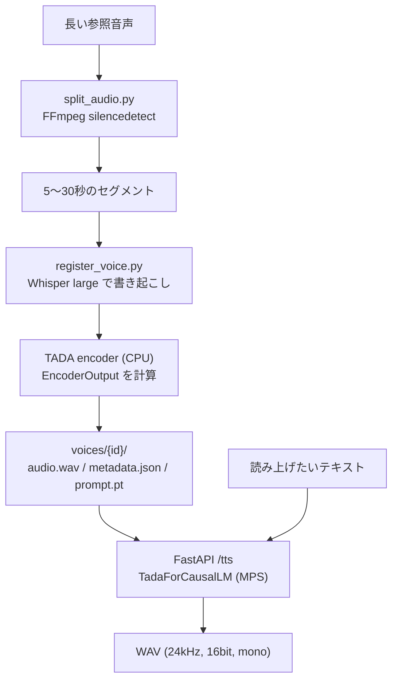

## 参照音声から声を作るまでに、どこで詰まるか

「自分の声で、任意のテキストを読み上げたい」。ボイスクローンTTSの要求はこれに尽きますが、実際に作り始めると詰まる場所が3つあります。参照音声の前処理、モデルのメモリ、そして生成リクエストの直列化です。

このリポジトリ（`tts`）は、その3つを分担で解いた構成になっています。音声の登録は CLI、読み上げは FastAPI サーバー、音声の切り出しは FFmpeg、書き起こしは Whisper。モデルは HumeAI の **TADA（Text-Acoustic Dual Alignment）3B-ML** です。

この記事では、実際のファイル構成とコードを引きながら、パイプラインの分け方とその理由を整理します。対象は、ローカル環境（Apple Silicon の Mac）で自分の声の読み上げを作りたい人です。

## 全体構成

処理は「登録」と「生成」の2つのフェーズに分かれ、共有するのは `voices/` ディレクトリだけです。



図1: 登録フェーズ（上流・CLI）と生成フェーズ（下流・サーバー）

責務は次のように割り切っています。

- **前処理（`tools/split_audio.py`）**: FFmpeg の `silencedetect` で長い音声を 5〜30 秒に刻む
- **登録（`tools/register_voice.py`）**: Whisper で書き起こし、TADA encoder で `prompt.pt` を作る
- **生成（`server/`）**: `prompt.pt` を読み込み、TADA 3B-ML で音声を合成して WAV を返す

登録と生成を別プロセスにしたことが、この構成の中心です。サーバーは TADA 3B-ML だけをメモリに載せ、Whisper（約3GB）と encoder（約1GB）は CLI 側で順番に読み込んで解放します。3つを同時に載せると Mac のメモリが足りなくなるためです。

## 技術選定

| 論点 | 採用 | 代替案 | 採用理由 |
|---|---|---|---|
| 音声モデル | TADA 3B-ML | 学習ベースのTTS | 参照音声だけで声質を渡せ、日本語に対応している |
| 書き起こし | Whisper large（CLIのみ） | 手入力のみ | 参照音声の書き起こしが必須で、手入力は現実的でない |
| サーバー | FastAPI + uvicorn | Flask | 推論をスレッドに逃がす `asyncio.to_thread` をそのまま書ける |
| 音声分割 | FFmpeg `silencedetect` | librosa で波形を読む | 長い音声でもメモリ使用量が増えない |
| プロンプト | `prompt.pt` に事前計算して保存 | リクエストごとに encode | 生成のたびに encoder を動かさない |

TADA を選んだ理由は、参照音声とテキストのペアを1回 encode すれば、以降はテキストだけで生成できる点です。この「事前計算できる単位」が、後述するサーバー設計をそのまま可能にしています。

## 実装の核

### 1. 登録はCLIで完結させ、encoder は CPU で回す

`tools/register_voice.py` の `encode_voice` が、参照音声を `EncoderOutput` に変換します。

```python
# tools/register_voice.py（encode_voice）
encoder = Encoder.from_pretrained(CODEC_NAME, language=LANGUAGE)
# Use ungated tokenizer (identical vocab) to avoid Llama gated repo requirement
encoder._aligner.tokenizer = AutoTokenizer.from_pretrained("unsloth/Llama-3.2-1B")
encoder = encoder.to(device)

audio, sample_rate = torchaudio.load(str(audio_path))
audio = audio.mean(dim=0, keepdim=True)
audio = audio / audio.abs().max()
audio = audio.to(device)

prompt = encoder(audio, text=[transcript], sample_rate=sample_rate)
```

呼び出し側は `device="cpu"` を渡しています。MPS で長い音声を encode すると OOM になるためで、登録は時間がかかってもよい処理なので CPU に寄せています。ステレオは mean でモノラルにし、ピークで正規化してから encoder に渡します。

保存されるのはテンソルを CPU に戻した辞書です。`torch.save` の対象は `token_values`、`token_positions`、`audio_len`、`text_tokens`、`text_tokens_len`、`sample_rate`、`text` の7つ。WAV そのものではなく、モデルに渡す前の表現を保存している点が重要です。

### 2. 生成はロックとスレッドで直列化する

`server/app/routers/tts.py` は、推論を `asyncio.Lock` で囲み、`asyncio.to_thread` で別スレッドに逃がします。

```python
# server/app/routers/tts.py
_inference_lock = asyncio.Lock()

@router.post("/tts")
async def generate_speech(req: TTSRequest) -> Response:
    if not req.text.strip():
        raise HTTPException(status_code=422, detail="text must not be empty")

    async with _inference_lock:
        wav_bytes = await asyncio.to_thread(
            get_tts_service().generate,
            voice_id=req.voice_id,
            text=req.text,
            speed=req.speed,
        )
```

TADA の推論は GPU（MPS）を使う重い処理で、同時に走らせると安全ではありません。ロックで1本に絞り、`to_thread` でイベントループを止めないようにしています。この2行がないと、生成中はヘルスチェックすら返らなくなります。

### 3. `prompt.pt` はCPUに置き、生成時にデバイスへ移す

`server/app/services/tts_service.py` は、読み込んだテンソルをモデルのデバイスに移してから `EncoderOutput` を組み直します。

```python
# server/app/services/tts_service.py（_reconstruct_encoder_output）
def _to(v: Any) -> Any:
    return v.to(device) if isinstance(v, torch.Tensor) else v

return EncoderOutput(
    audio=None,
    audio_len=_to(data["audio_len"]),
    text=data["text"],
    text_tokens=_to(data["text_tokens"]),
    text_tokens_len=_to(data["text_tokens_len"]),
    token_positions=_to(data["token_positions"]),
    token_values=_to(data["token_values"]),
    sample_rate=data["sample_rate"],
)
```

`torch.load` で読んだテンソルは CPU 上にあります。MPS のモデルにそのまま渡すとデバイス不一致で落ちるため、ここで明示的に移しています。`audio=None` を渡しているのは、生成時には参照音声の波形そのものが不要で、`token_values` と `token_positions` があれば足りるからです。

生成は `num_transition_steps=5`、`speed` が指定されていれば `InferenceOptions.speed_up_factor` に渡します。最後に `clamp(-1.0, 1.0)` して 16bit PCM に量子化し、`torchaudio.save` で WAV バイト列にしています。

### 4. 長い音声は無音の中央で刻む

`tools/split_audio.py` は `silencedetect` の出力を正規表現で拾い、無音区間の中点を分割点にします。

```python
# tools/split_audio.py（split_at_silences）
split_points = [0.0]
for s in silences:
    mid = (s["start"] + s["end"]) / 2
    split_points.append(mid)
split_points.append(total_duration)
```

中点を使うのは、無音の立ち上がりや減衰を切り落とさないためです。出力は `-ar 24000 -ac 1` で、サーバーのサンプルレートと揃えています。5秒未満のセグメントは捨て、`segments.json` にマニフェストを残します。

## 品質と性能

リポジトリ内に記録されている数値は次のとおりです。

| 項目 | 値 | 出典 |
|---|---|---|
| モデルサイズ | 約6GB（MPS） | README |
| Whisper large | 約3GB | README |
| TADA encoder | 約1GB | README |
| 出力音声 | 24kHz / 16bit / mono | README・`server/app/config.py` |
| 参照音声の推奨長 | 5〜30秒 | README |

テストは `server/tests/` に20件（`test_api.py` 8件、`test_tts_service.py` 5件、`test_voice_store.py` 7件）あり、`PLAN.md` では全フェーズ完了として記録されています。

速度の実測値はリポジトリに残っていないため定性になりますが、生成のたびに encoder を動かさない設計なので、2回目以降のリクエストは encode の時間を含みません。モデルのロードはサーバー起動時の1回だけです。

## つまずいた点

- **encoder のシーケンス長上限**: encoder はシーケンス長の上限が 8192 で、それを超える入力は扱えません。30秒を超える参照音声をそのまま渡すとエラーになるため、先に分割する前提になっています。README にも「5〜30秒が推奨」と明記されています。
- **Llama の gated repo**: TADA の aligner は Llama 3.2 系のトークナイザを使いますが、本体のリポジトリは gated で取得に同意が必要です。語彙が同一の `unsloth/Llama-3.2-1B` に差し替えて回避しています。差し替えているのはトークナイザだけで、モデルの重みではありません。
- **MPS での `lm_head` クラッシュ**: 長い入力で MPS の `lm_head` forward が落ちるため、`PLAN.md` には重みも CPU に移すパッチを当てたと記録されています。あわせて、`prompt.pt` のテンソルが CPU のまま生成に渡る問題も、上の `_to()` で解消しています。
- **設計メモと実装の差**: `PLAN.md` には `services/model_manager.py` にモデル管理とロックを置く構想がありますが、実際のファイルには存在せず、ロックは `server/app/routers/tts.py` が持っています。実装を正として読む必要があります。

## まとめ

この構成で再利用できる知見は3つです。

- **重いモデルは「事前計算できる単位」で切る**: 参照音声の encode を CLI に追い出したことで、サーバーは 3B モデル1つだけを載せればよくなりました。
- **プロセスを分けるとメモリのピークを分けられる**: Whisper と encoder を同時にロードしない設計は、モデルを差し替えても同じ形で使えます。
- **推論はロックとスレッドで守る**: 非同期フレームワークに重い推論を載せるときの最小限の型として、そのまま流用できます。

TADA に限らず、「登録はオフラインで重く、生成はオンラインで軽く」という形のモデルは多いので、パイプラインの分割単位を決める際の参考になるはずです。

## 関連記事

- [自分の声で読み上げたい — 参照音声30秒から始めるボイスクローンTTS](/post/20261115tts-solution/)
- [声を学習してテキスト読み上げ！TADAで作る日本語ボイスクローンTTSシステム](/post/tts/)
- [配信録画を自動で分割！FFmpegのsilencedetectで作る動画分割Webアプリ](/post/jam-slicer/)

---

**音声合成・TTS のパイプライン構築でお困りのことはありませんか？**

技術相談や開発サポートを承っています。お気軽にご相談ください。

[ココナラで開発相談を依頼する](https://coconala.com/users/1993863)
