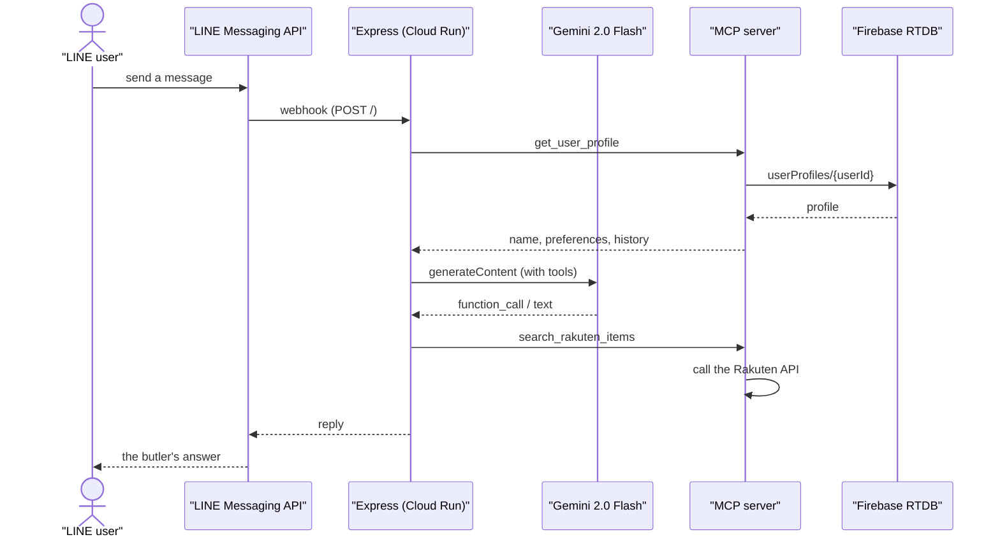

## A butler bot that talks on LINE

**Turtle Butler** is a LINE bot that answers as a calm, polite butler speaking Kansai dialect. It remembers names and preferences, and when the conversation calls for it, recommends products from Rakuten.

The stack is Node.js 20 with TypeScript and Express, Gemini 2.0 Flash for the conversation, Firebase Realtime Database for memory, and the Rakuten item search API for products. User profiles and product search live in separate services that speak the Model Context Protocol (MCP). Everything runs on Cloud Run.

This post follows one LINE message from webhook to reply, and looks at three pieces: how the prompt is assembled, how product search is delegated to the model, and how the MCP services are deployed.

## Architecture

The request flow looks like this.



Figure 1: One request through turtle-buttler

Responsibilities are narrow:

- **Conversation**: Gemini. The persona lives in a prompt (`src/prompts.ts`), so no character logic is scattered through the code.
- **Memory**: `apps/user-profile-service/src/index.ts` reads and writes `userProfiles/{userId}` in RTDB.
- **Product search**: `apps/rakuten-server/src/index.ts` calls the Rakuten API and normalizes the response.
- **No local state**: Cloud Run instances come and go, so conversation state must live outside the process.

The main app is essentially `src/kame_buttler.ts`. Its Express app accepts LINE webhooks on POST `/`, and anything that is not a LINE payload goes to `handleNonLineRequest`, which returns a fixed JSON body with status 200.

## Technology choices

| Question | Chosen | Alternative | Why |
|---|---|---|---|
| Response generation | Gemini 2.0 Flash | Canned replies, other LLMs | Function calling comes with the same API, and the persona is a prompt swap |
| Memory | Firebase RTDB via a service | In-process memory | Instances scale out and vanish, so state has to be external |
| Service calls | MCP over HTTP | Plain HTTP, gRPC | Tool names and argument checks stay on the server side; a stdio client can replace HTTP later |
| Product suggestions | Gemini function calling | Regex keyword extraction | The model decides *when* a recommendation fits |
| Hosting | Cloud Run | Lambda, a VPS | Scales within the webhook's patience and injects secrets from Secret Manager |

## Core implementation

### 1. Fold persona and state into one prompt

`src/prompts.ts` keeps two things apart: the stable persona (`BASE_SYSTEM_PROMPT`) and the per-request user facts (`USER_INFO_PROMPT_TEMPLATE`). `createGeminiPayload` in `src/kame_buttler.ts` joins them on every turn.

```ts
// src/kame_buttler.ts (createGeminiPayload)
const recentChatHistory = chatHistory.slice(-2); // last two messages only
const history = recentChatHistory.flatMap(chat => [
  { "role": "user", "parts": [{ "text": chat.message }] },
  { "role": "model", "parts": [{ "text": chat.response }] }
]);

const userInfoPrompt = USER_INFO_PROMPT_TEMPLATE
  .replace('${userName}', userName)
  .replace('${favoriteFood}', favoriteFood)
  .replace('${recentTopics}', recentTopics.join("、"))
  .replace('${sentiment}', userInfo.sentiment || "普通");

const sys_prompt = BASE_SYSTEM_PROMPT + userInfoPrompt
  + `\n\nこれまでの会話の要約:\n${chatSummary}\n\n【重要】直近のユーザーメッセージに対してのみ応答し、過去の発言への言及は避けてください。`;
```

The constraint goes at the **end** of the prompt, not the start. The persona block is long, and anything written before it is easy for the model to blur into background. A long persona also blurs the focus of the conversation by itself.

Trimming history to two messages follows the same logic. Everything older is compressed into `chatSummary` plus `recentTopics`, which holds at most five entries. Passing the full log pulls the reply toward old topics and away from the message that just arrived.

### 2. Let the model decide when to recommend

Product suggestions are not an `if` statement. `createGeminiPayload` attaches `tools`, and `search_rakuten_items` is only called when the model decides it is relevant.

```ts
// src/kame_buttler.ts (tools inside createGeminiPayload)
"tools": [{
  "function_declarations": [{
    "name": "search_rakuten_items",
    "description": "楽天で商品を検索し、商品リンクを取得します。",
    "parameters": {
      "type": "object",
      "properties": {
        "keyword": { "type": "string", "description": "検索キーワード" },
        "hits": {
          "type": "number",
          "description": "取得する商品の数（最大30）",
          "minimum": 1, "maximum": 30
        }
      },
      "required": ["keyword"]
    }
  }]
}]
```

*When* to use it is described in the prompt's product-suggestion section as three conditions. The schema states the limits, and `apps/rakuten-server/src/index.ts` enforces them with `Math.min(args.hits || 5, 30)`. Splitting what the model may decide from what the server guarantees means prompt edits cannot break the API contract.

### 3. Wrap the MCP servers in Express for Cloud Run

Both services instantiate the MCP SDK `Server`, but the transport is Express over HTTP rather than stdio.

```ts
// apps/user-profile-service/src/index.ts
app.post('/get_user_profile', async (req, res) => {
  try {
    const result = await this.handleGetUserProfile(req.body);
    res.json(result);
  } catch (error: unknown) {
    // McpError becomes 400, anything else 500
  }
});

app.post('/update_user_profile', async (req, res) => { /* same shape */ });
```

On the caller side, `callMcpTool` tries a global `use_mcp_tool` first and falls back to POSTing to `USER_PROFILE_SERVICE_URL` or `RAKUTEN_SERVER_URL`.

```ts
// src/kame_buttler.ts (callMcpTool and its fallback)
async function callMcpTool(server_name: string, tool_name: string, args: any) {
  try {
    if (typeof use_mcp_tool !== 'undefined') {
      return await use_mcp_tool(server_name, tool_name, args);
    }
  } catch (error) { /* undefined: fall through */ }
  return await use_mcp_tool_fallback(server_name, tool_name, args);
}
```

On Cloud Run each service gets its own HTTPS endpoint, so this shape is the natural one. `infrastructure/scripts/deploy_mcp_services.sh` reads both URLs after deployment and stores them as the `USER_PROFILE_SERVICE_URL` and `RAKUTEN_SERVER_URL` secrets. The app only reads environment variables, so no URL is hard-coded.

## Quality and performance

Testing is split into three tiers. The counts below come from the files in the repository.

| Tier | File | Tests | External deps |
|---|---|---|---|
| Unit | `src/unit.test.ts` | 27 | none |
| Integration | `src/simple-integration.test.ts` | 23 | mocked |
| E2E | `src/e2e.test.ts` | 9 | real APIs |
| MCP services | `apps/*/src/index.test.ts` | 7 and 5 | mocked |

The README states target runtimes per tier (under 1 second for unit, under 10 for integration, under 30 for E2E) and says E2E should skip itself when the APIs are unavailable. `src/e2e.test.ts` matches that: it calls `this.skip()` when `GEMINI_API_KEY` is missing, and temporarily deletes `process.env.NODE_ENV` when it needs to exercise the production path.

The code also avoids leaving the process during tests. With `NODE_ENV=test`, `replyToLine` is skipped and RTDB is replaced by an in-memory `Map` called `testUserInfoStore`. The tool fallback returns canned data for the same reason, so a conversation can be replayed without hitting a billed API.

On latency, the README claims "under 2 seconds for typical interactions". That is a target, not a measurement, and the repository contains no benchmark results. What the design does control is prompt size: two messages of history plus a rolling summary keeps input tokens flat as a conversation grows.

## Pitfalls

- **stdio does not survive Cloud Run.** The code imports `CallToolRequestSchema` and friends, but the tools are actually published as Express POST routes. The "MCP servers" use the SDK's types and error codes while talking HTTP. The caller has the same split: `use_mcp_tool` does not exist in the Node runtime, so the fallback path is always the one taken. The README's Recent Updates notes a fix for argument passing and JSON parsing in exactly that HTTP fallback.
- **The function-call round trip stops halfway.** When `getGeminiResponse` sees a `function_call`, it returns the tool result as a `tool_code` JSON blob. Nothing sends that back to Gemini as a `functionResponse` for a second generation pass, so a reply produced through the tool never passes through the butler persona. This is the first thing worth fixing.
- **Async ordering.** `handleLineRequest` calls `saveUserInfoHandler` and only afterwards `analyzeUserSentiment`, so the sentiment for a message is persisted one turn late. The webhook's 200 is also sent after `handleLineRequest` finishes, which means a slow Gemini or MCP round trip delays the webhook response. Comments in the code additionally flag that the name and food handlers each send their own reply, which can produce a double reply.

## Takeaways

turtle-buttler comes down to four placements: persona in a prompt, state outside the process, judgement in the model, execution on the server.

- Keep the persona in one constant and concatenate only what changes per request.
- Let the model decide whether to recommend; take URLs and prices from an API response.
- Expose MCP over HTTP on Cloud Run and keep a fallback on the caller side.
- Split tests by tier, and gate only the ones that touch real APIs on environment variables.

The same shape fits any bot that pairs a character with external data. The one thing to design up front is the return trip from tool result back into the persona, because skipping it is exactly how a JSON blob ends up in a chat window.

## Related posts

- [Balancing character and product recommendations on LINE](/en/post/20261115turtle-buttler-solution/)
- [Fixing a LINE bot's user retention problem with MCP integration (in Japanese)](/post/20250711turtle-buttler/)

---

**Working on a LINE bot or an LLM integration?**

I take on technical consulting and development support.

[Hire me on Coconala](https://coconala.com/users/1117897)
