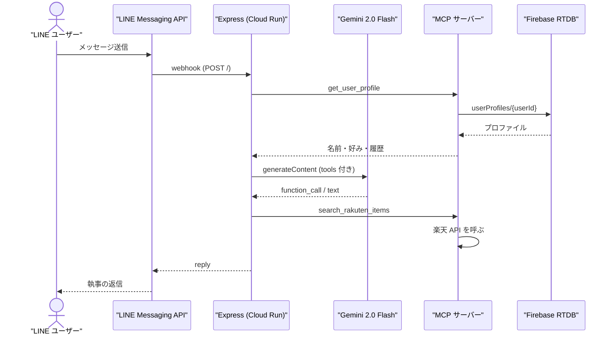

## 関西弁の執事と話す LINE ボット

**Turtle Butler（カメ執事）** は、LINE の友だちとして動く会話ボットです。落ち着いた関西弁の執事として振る舞い、相手の名前や好みを覚え、話の流れに合わせて楽天の商品を勧めます。

構成は Node.js 20 + TypeScript + Express、対話生成は Gemini 2.0 Flash、記憶は Firebase Realtime Database、商品検索は楽天の商品検索 API です。ユーザー情報と商品検索は別サービスに切り出し、MCP（Model Context Protocol）の作法でやり取りしています。ホスティングは Cloud Run です。

この記事では、1つの LINE メッセージが届いてから返信が返るまでに何が起きるかを追いながら、プロンプト合成・関数呼び出し・MCP の載せ方という3点を、リポジトリのコードとともに整理します。

## 全体構成

処理の流れは次のとおりです。



図1: turtle-buttler の1リクエストの流れ

責務は次のように分かれています。

- **会話の生成**: Gemini。人格はプロンプト（`src/prompts.ts`）で与え、コード側にキャラクターの分岐を書かない
- **記憶**: `apps/user-profile-service/src/index.ts` が RTDB の `userProfiles/{userId}` を読み書きする
- **商品検索**: `apps/rakuten-server/src/index.ts` が楽天の商品検索 API を叩き、結果を正規化して返す
- **状態を持たない**: Cloud Run のインスタンスは増減し、プロセスも消える。会話の状態は必ず外部に置く

メインアプリは `src/kame_buttler.ts` の1ファイルが中心で、Express の POST `/` が LINE の webhook を受ける入口です。LINE 以外からのリクエストは `handleNonLineRequest` に流れ、200 と固定の JSON を返します。

## 技術選定

| 論点 | 採用 | 代替案 | 採用理由 |
|---|---|---|---|
| 対話生成 | Gemini 2.0 Flash | 固定応答 / 他の LLM | 関数呼び出しを同じ API で扱える。人格はプロンプトだけで差し替えられる |
| 記憶 | Firebase RTDB + 専用サービス | プロセス内メモリ | インスタンスが分散しプロセスも消えるため、状態は外部に置く必要がある |
| サービス間通信 | MCP（HTTP 経由） | 直接 HTTP / gRPC | ツール名と引数の検証をサーバー側に寄せられる。将来 stdio の MCP クライアントにも移せる |
| 商品提案 | Gemini の function calling | キーワードを正規表現で抽出 | 「いつ提案するか」の判断をモデルに任せられる |
| ホスティング | Cloud Run | Lambda / VPS | webhook の待ち時間内でスケールし、秘密情報を Secret Manager から注入できる |

## 実装の核

### 1. 人格と状態を1つのプロンプトに畳む

`src/prompts.ts` は、変わらない人格（`BASE_SYSTEM_PROMPT`）と、毎回変わるユーザー情報（`USER_INFO_PROMPT_TEMPLATE`）を別々に持っています。リクエストのたびに `src/kame_buttler.ts` の `createGeminiPayload` が両者を連結します。

```ts
// src/kame_buttler.ts（createGeminiPayload）
const recentChatHistory = chatHistory.slice(-2); // 直近2メッセージのみ
const history = recentChatHistory.flatMap(chat => [
  { "role": "user", "parts": [{ "text": chat.message }] },
  { "role": "model", "parts": [{ "text": chat.response }] }
]);

const userInfoPrompt = USER_INFO_PROMPT_TEMPLATE
  .replace('${userName}', userName)
  .replace('${favoriteFood}', favoriteFood)
  .replace('${recentTopics}', recentTopics.join("、"))
  .replace('${sentiment}', userInfo.sentiment || "普通");

const sys_prompt = BASE_SYSTEM_PROMPT + userInfoPrompt
  + `\n\nこれまでの会話の要約:\n${chatSummary}\n\n【重要】直近のユーザーメッセージに対してのみ応答し、過去の発言への言及は避けてください。`;
```

ポイントは、プロンプトの**最後**に「今のメッセージだけに応答する」という制約を置いていることです。人格の定義が長いので、制約を先頭に書くと後半のユーザー情報に埋もれます。長い人格プロンプトは、それ自体が会話の焦点をぼかすためです。

履歴を直近2件に切っているのも同じ理由です。残りは `chatSummary`（要約）と `recentTopics`（直近5件）に圧縮して渡します。生のログを全部渡すと、過去の話題に引っ張られて今の一言への返事が薄くなります。

### 2. 提案するかどうかはモデルに決めさせる

商品提案は、コードの分岐ではなく関数呼び出しで実現しています。`createGeminiPayload` がリクエストに `tools` を載せ、モデルが「必要だ」と判断したときだけ `search_rakuten_items` が呼ばれます。

```ts
// src/kame_buttler.ts（createGeminiPayload の tools）
"tools": [{
  "function_declarations": [{
    "name": "search_rakuten_items",
    "description": "楽天で商品を検索し、商品リンクを取得します。",
    "parameters": {
      "type": "object",
      "properties": {
        "keyword": { "type": "string", "description": "検索キーワード" },
        "hits": {
          "type": "number",
          "description": "取得する商品の数（最大30）",
          "minimum": 1, "maximum": 30
        }
      },
      "required": ["keyword"]
    }
  }]
}]
```

「いつ使うか」はプロンプトの【商品提案の振る舞い】に3条件で書いてあります。引数の上限はスキーマで示し、実際の丸めは受け側の `apps/rakuten-server/src/index.ts` が `Math.min(args.hits || 5, 30)` で行います。モデルに任せる部分と、サーバーが保証する部分を分けておくと、プロンプトを直しても壊れません。

### 3. MCP サーバーを Express で包んで Cloud Run に載せる

2つのサービスは MCP SDK の `Server` インスタンスを作りますが、通信は stdio ではなく Express の HTTP エンドポイントです。

```ts
// apps/user-profile-service/src/index.ts
app.post('/get_user_profile', async (req, res) => {
  try {
    const result = await this.handleGetUserProfile(req.body);
    res.json(result);
  } catch (error: unknown) {
    // McpError なら 400、それ以外は 500
  }
});

app.post('/update_user_profile', async (req, res) => { /* 同じ形 */ });
```

呼び出し側は `callMcpTool` がグローバルの `use_mcp_tool` を試し、無ければ `USER_PROFILE_SERVICE_URL` / `RAKUTEN_SERVER_URL` に POST する二段構えです。

```ts
// src/kame_buttler.ts（callMcpTool とフォールバック）
async function callMcpTool(server_name: string, tool_name: string, args: any) {
  try {
    if (typeof use_mcp_tool !== 'undefined') {
      return await use_mcp_tool(server_name, tool_name, args);
    }
  } catch (error) { /* 未定義ならフォールバックへ */ }
  return await use_mcp_tool_fallback(server_name, tool_name, args);
}
```

Cloud Run では各サービスが独立した HTTPS のエンドポイントを持つので、この形が素直です。`infrastructure/scripts/deploy_mcp_services.sh` はデプロイ後に各サービスの URL を取得し、Secret Manager の `USER_PROFILE_SERVICE_URL` と `RAKUTEN_SERVER_URL` に保存します。アプリ側はその環境変数を読むだけなので、URL をコードに埋めずに済みます。

## 品質と性能

テストは3層に分かれています。加えて、各 MCP サービスにも単体テストがあります。件数はリポジトリの実ファイルから数えたものです。

| 層 | ファイル | テスト数 | 外部依存 |
|---|---|---|---|
| 単体 | `src/unit.test.ts` | 27 | なし |
| 統合 | `src/simple-integration.test.ts` | 23 | モック |
| E2E | `src/e2e.test.ts` | 9 | 実 API |
| MCP サービス | `apps/*/src/index.test.ts` | 7 と 5 | モック |

README には各層の目標時間（単体 1 秒未満、統合 10 秒未満、E2E 30 秒未満）と、API が使えないときに E2E を自動でスキップする方針が書かれています。実際に `src/e2e.test.ts` は `GEMINI_API_KEY` などが無ければ `this.skip()` で各テストを飛ばし、本番経路を通すときは `process.env.NODE_ENV` を一時的に削除しています。

テスト時に外部へ出ない工夫も入っています。`NODE_ENV=test` では `replyToLine` を呼ばず、RTDB の代わりに `testUserInfoStore` という `Map` を使います。MCP ツールも `use_mcp_tool_fallback` がテスト用のモックを返すため、課金のある API を叩かずに会話の流れを検証できます。

レイテンシについては、README に「通常のやり取りで2秒未満」という記載がありますが、これは目標値で、実測の記録はリポジトリにありません。設計として効くのはプロンプトの長さです。履歴を2件に切り、長期の文脈を要約に畳むことで、ターンが増えても入力トークンが増えません。

## つまずいた点

- **MCP の stdio が Cloud Run で使えない**: コードは `CallToolRequestSchema` などを import していますが、実際のツール公開は Express の POST です。結果として「MCP サーバー」は SDK の型とエラーコードを使いつつ、通信は HTTP になります。呼び出し側も `use_mcp_tool` が存在しないため、常にフォールバック経路を通ります。README の Recent Updates にも、HTTP フォールバックでの引数受け渡しと JSON パースの修正が記録されています。
- **関数呼び出しの往復が1回で終わる**: `getGeminiResponse` は `function_call` を受けると、ツールの結果を `tool_code` という JSON にして返します。その結果を `functionResponse` として Gemini に返し、執事の口調で文章を作り直す往復は実装されていません。現状、ツールが呼ばれたときの返信は人格を通りません。ここは次に直すべき点です。
- **非同期処理の順序**: `handleLineRequest` は `saveUserInfoHandler` で保存した**後**に `analyzeUserSentiment` を呼びます。その発言の感情は次のリクエストで保存されるため、1ターン遅れます。また webhook への 200 は `handleLineRequest` の完了後に返すため、Gemini と MCP の往復が長引くと応答が遅れます。コード内のコメントにも、名前更新と好み更新がそれぞれ返信を送ることで二重応答になりうる、という留保が残っています。

## まとめ

turtle-buttler の設計は「人格はプロンプト、状態は外部、判断はモデル、実行はサーバー」に集約されています。

- 人格は1つの定数にまとめ、変わる情報だけをリクエスト時に連結する
- 提案の可否はモデルに任せ、URL や価格などの事実は API の応答から取る
- Cloud Run では MCP を HTTP に開き、呼び出し側にフォールバックを用意する
- テストは層で分け、外部 API に依存するテストだけを環境変数で切り離す

同じ形は、LINE に限らず「人格を持つ対話 + 外部データ」の組み合わせにそのまま使えます。逆に、ツールの結果を人格に戻す往復を省くと、今回のように JSON がそのまま出てしまうので、そこだけは最初に設計しておくのが安全です。

## 関連記事

- [LINE でキャラクター性と商品提案を両立させる — カメ執事の設計メモ](/post/20261115turtle-buttler-solution/)
- [LINEボットのユーザー獲得苦戦問題をMCP連携で解決 - turtle-buttler開発事例](/post/20250711turtle-buttler/)

---

**LINE ボットや LLM 連携の設計でお困りのことはありませんか？**

技術相談や開発サポートを承っています。お気軽にご相談ください。

[ココナラで開発相談を依頼する](https://coconala.com/users/1993863)
