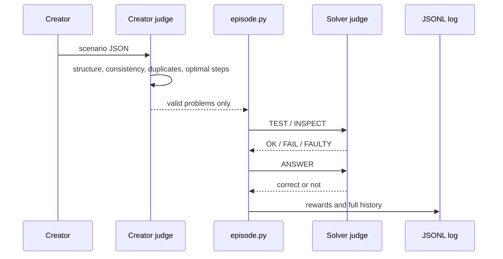

## Teaching a small model to think again

Small LLMs tend to commit to the first answer they produce. They do not re-collect observations, do not remember which candidates have already been ruled out, and answer from the first hunch. The starting question behind this repository is whether that one part — thinking by trial and error — can be strengthened with post-training alone.

**umigame_GAN** is the testbed built to answer it. The target is an already instruction-tuned model (Qwen3-4B-Instruct-2507-4bit), extended with LoRA rather than trained from scratch. The model is split into four roles that compete with each other and are updated in turn. It is the generator/discriminator relationship from GANs, moved into text episodes.

This post covers the loop that runs the four roles, how the rewards are placed, and the comparison design that decides whether an effect can actually be claimed.

## Architecture

There are four roles. The creator writes problems, the creator judge scores their quality, the solver works on them, and the solver judge decides correctness and plays the host during an episode. No domain-specific logic lives in the loop; the domain hides behind a `Domain` interface.



Figure 1: One co-evolution round

The first domain implemented is not the turtle soup puzzle but troubleshooting. A single fault hides inside a dependency DAG: `TEST X` returns OK when X and everything it depends on is healthy, and `INSPECT X` reports whether X itself is broken. Observations are deterministic, so both judges can be written in code. That separates "does the co-evolution machinery run" from "does the LLM judge wobble".

Turtle soup remains in the plan as the eventual domain, but it is not implemented at this point.

## Technology choices

| Question | Chosen | Alternative | Why |
|---|---|---|---|
| Inference and training | MLX + mlx-lm LoRA | CUDA / API calls | A 4B model fits on one local Mac (M4 Pro, 48GB) |
| First domain | Troubleshooting on a dependency DAG | Turtle soup | Judges can be code; correctness is mechanical |
| Judges | Fixed code (not trained) | Learned LLM judges | Establish reproducibility first, compare learned judges later |
| Role abstraction | `Policy.generate(batch of conversations)` | One class per role | The four roles interchange: MLX, API, scripted replies |
| Comparison basis | A0/B/C/D matched on wall-clock time | Matched update counts | Generation and rejection costs differ per condition |

## Core implementation

### 1. Pin the order of a round

`run_round` in `src/coevo/round.py` keeps create → judge → play → reward in a single place.

```python
# src/coevo/round.py (run_round)
valid = [r for r in records if r.judgment is not None and r.judgment.valid]
batch = [r.problem for r in valid for _ in range(samples_per_problem)]
episodes = run_episodes(domain, batch, solver, max_turns, solver_judge=sj) if batch else []

for k, r in enumerate(valid):
    r.episodes = episodes[k * samples_per_problem : (k + 1) * samples_per_problem]
    r.solve_rate = sum(e.solved for e in r.episodes) / samples_per_problem
    r.creator_reward = creator_reward(r.solve_rate, valid=True)
```

Problems that fail judgment never reach the solver. Each valid problem is solved `samples_per_problem` times, and that solve rate becomes the creator's reward. Only judged problems become learning signal, so a broken problem cannot corrupt the solver.

### 2. Run episodes in lockstep

`src/coevo/episode.py` advances every live episode one turn at a time. Because generation is batched, the loop calls the model once per turn for all active episodes instead of once per episode.

```python
# src/coevo/episode.py (run_episodes)
for _ in range(max_turns):
    if not active:
        break
    replies = solver.generate([episodes[i].messages for i in active])
    ...
    try:
        action = domain.parse_action(reply)
    except ParseError:
        ep.format_errors += 1
        ep.messages.append({"role": "user", "content": domain.format_error_message})
        still_active.append(i)
        continue
```

A format error consumes a turn. Retrying silently would make the turn-count metric meaningless. The episode ends the moment the solver emits `ANSWER`; the rest continue on the next turn.

### 3. Split the reward into difficulty and steps

The two roles get differently shaped rewards (`src/coevo/rewards.py`).

```python
# src/coevo/rewards.py
def creator_reward(p_hat: float, valid: bool, repetition_penalty: float = 0.0) -> float:
    if not valid:
        return 0.0
    return max(0.0, 1.0 - 2.0 * abs(p_hat - 0.5) - repetition_penalty)
```

The creator is penalised when a problem is too easy or too hard, and peaks at a 0.5 solve rate. That is the R-Zero style difficulty reward. The solver gets full credit up to `free_turns=5`, then loses 0.02 per extra turn with a floor of 0.1. Because solving always beats not solving, shortening the episode and getting the answer right pull in the same direction.

### 4. Keep LoRA and the comparison conditions fixed

The SFT configuration is pinned in `configs/sft_ts_oracle_4b.yaml`.

```yaml
# configs/sft_ts_oracle_4b.yaml
fine_tune_type: lora
num_layers: 16
batch_size: 4
learning_rate: 1.0e-5
max_seq_length: 2048
lora_parameters:
  rank: 16
  scale: 20.0
```

Rank starts at 16. A comment in the file records why: rank 64 collapsed in a GRPO run on Wordle on the same Mac.

There are four conditions. A0 is the no-extra-training baseline, B trains on a frozen set of 512 procedurally generated problems, C keeps sampling from an untrained creator, and D is the co-evolution. The solver's initial weights, the judges, the rewards, the solver update rule, and the generation length cap are held constant, and conditions are compared on wall-clock training time. Condition C exists to separate "using LLM-generated data" from "updating the creator".

## Quality and performance

Solve rates on the 50-problem validation set, three trials each:

| Stage | Solve rate |
|---|---|
| A0 (SFT initial weights) | 80.0% |
| 10 updates on the fixed set (40 of 512 problems) | 89.3% (+9.3pt, 95% CI +3.3 to +16.0pt) |
| One alternating cycle | 87.3% |

On the 200-problem final evaluation with three seeds, co-evolution (D@15) came in at −2.8pt [−4.8, −0.9] against the fixed set (B@37), Holm p=0.007. The per-seed signs did not agree (−3.8 / −4.8 / +0.2), so the pre-registered condition — all three seeds pointing the same way — was not met. The effect of co-evolution is recorded as unconfirmed.

Everything runs on one local Mac. In the MLX measurements, prompt processing ran at about 600 tok/s for the 4B model and about 1,650 tok/s for 1.7B. Training targets under 32GB of memory; when usage approaches 36GB, the runner stops admitting new episodes and checkpoints instead.

## Pitfalls

- **A one-token prompt mismatch**: if the chat template is applied differently at training and inference time, the model starts repeating special tokens and the output collapses. Both sides now call `encode_prompt` from `src/coevo/mlx_policy.py`, and a test asserts the token sequences match.
- **The creator's initial hash**: the creator's LoRA initialises its A matrices randomly per seed, so the hash of all parameters differs per seed (the B matrices start at zero, so the represented function is identical). The runner passed seed 50101's expected value to every seed and halted. The actual requirement is that C and D under the same seed start from the same initial creator, so the runner now starts without an expected hash.
- **Four trials do not settle difficulty**: re-measuring 28 generated problems with 16 trials put 23 of them in a Wilson interval that straddled the classification boundary. Near the boundary, the easy/hard label is not stable without extra trials.

## Takeaways

- Pushing the domain out of the loop lets you validate the machinery first on a domain whose judges are code
- Place reward on difficulty (creator) and on step count (solver), not just on solved/not solved
- Match conditions on wall-clock time rather than update count, because generation and rejection costs differ

Even a 4B LoRA fits on one machine for running episodes, designing rewards, and comparing conditions. Deciding whether an effect can honestly be claimed turned out to be heavier work than the implementation.

## Related posts

- [How to train a small LLM that answers before it thinks — four roles, and a comparison design](/en/post/20261115umigame-gan-solution/)

---

**Need help with post-training or evaluation design for LLMs?**

I take on technical consulting and development support.

[Hire me on Coconala](https://coconala.com/users/1117897)
