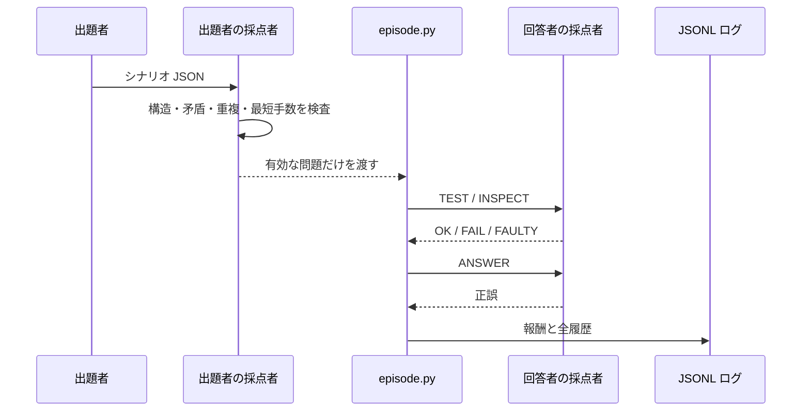

## 小型モデルに「考え直す」力を足す

小型LLMは、答えを一つ思いつくと、そのまま押し切ってしまう傾向があります。観測を集め直したり、消えた候補を思い出したりせず、最初の直感で回答して外す。この「試行錯誤して考える」部分だけを事後学習で伸ばせないか、というのがこのリポジトリの出発点です。

**umigame_GAN** は、その仮説を検証するための実験基盤です。対象は学習済みの Instruct モデル（Qwen3-4B-Instruct-2507-4bit）で、ゼロから鍛えるのではなく LoRA で小さく足します。モデルを4つの役割に分け、互いに競わせながら交互に更新します。GAN の生成器と識別器の関係を、テキストの対局に持ち込んだ形です。

この記事では、4役割を回すループ、報酬の置き方、そして「効果があったと言えるか」を判定するための比較設計を、リポジトリの実装から整理します。

## 全体構成

役割は4つです。出題者（Creator）が問題を作り、出題者の採点者（Creator Judge）がその質を判定し、回答者（Solver）が解き、回答者の採点者（Solver Judge）が正誤の判定と対局中の進行役を担います。共進化のループには題材固有のロジックを書かず、題材は `Domain` インターフェースの裏に隠します。



図1: 1ラウンドの流れ

最初に実装した題材はウミガメのスープではなく、トラブルシューティングです。部品の依存関係（DAG）の中に故障が1つ隠れていて、`TEST X` は X とその依存先がすべて正常なら OK、`INSPECT X` は X 自身が壊れているかを返します。観測が決定的なので、2人の採点者をコードで書けます。共進化の仕組みが動くかどうかを、LLM 審判のぶれから切り離して確かめられるわけです。

ウミガメのスープは最終的な題材として計画に残っていますが、この記事の時点では未実装です。

## 技術選定

| 論点 | 採用 | 代替案 | 採用理由 |
|---|---|---|---|
| 推論と学習の基盤 | MLX + mlx-lm の LoRA | CUDA / API 呼び出し | Mac ローカル（M4 Pro / 48GB）だけで 4B を回しきれる |
| 最初の題材 | 依存 DAG のトラブルシューティング | ウミガメのスープ | 採点者をコードで書ける。正誤が機械的に決まる |
| 採点者 | 固定コード（学習しない） | 学習する LLM 審判 | まず土台の再現性を取り、学習する条件は後から比較する |
| 役割の抽象 | `Policy.generate(会話のバッチ)` | 役割ごとの専用クラス | 4役を同じ形で扱い、MLX・API・固定応答を差し替えられる |
| 比較の基準 | 実時間をそろえた A0/B/C/D | 更新回数をそろえる | 生成と却下の費用が条件で違うため |

## 実装の核

### 1. 1ラウンドの順序を固定する

`src/coevo/round.py` の `run_round` は、出題 → 採点 → 対局 → 報酬の順序を1箇所に閉じ込めています。

```python
# src/coevo/round.py（run_round）
valid = [r for r in records if r.judgment is not None and r.judgment.valid]
batch = [r.problem for r in valid for _ in range(samples_per_problem)]
episodes = run_episodes(domain, batch, solver, max_turns, solver_judge=sj) if batch else []

for k, r in enumerate(valid):
    r.episodes = episodes[k * samples_per_problem : (k + 1) * samples_per_problem]
    r.solve_rate = sum(e.solved for e in r.episodes) / samples_per_problem
    r.creator_reward = creator_reward(r.solve_rate, valid=True)
```

無効と判定された問題は回答者に渡しません。有効な問題だけを `samples_per_problem` 回ずつ解かせ、その解決率がそのまま出題者の報酬になります。採点を通った問題だけが学習信号になるので、壊れた問題で回答者が壊れることはありません。

### 2. 対局は1ターンずつ同期させる

`src/coevo/episode.py` は、複数の対局を1ターンずつ交互に進めます。バッチ生成を使うため、対局ごとにモデルを呼ぶのではなく、そのターンに生きている全対局をまとめて1回で生成します。

```python
# src/coevo/episode.py（run_episodes）
for _ in range(max_turns):
    if not active:
        break
    replies = solver.generate([episodes[i].messages for i in active])
    ...
    try:
        action = domain.parse_action(reply)
    except ParseError:
        ep.format_errors += 1
        ep.messages.append({"role": "user", "content": domain.format_error_message})
        still_active.append(i)
        continue
```

形式エラーも1ターンを消費します。黙ってやり直させると、手数の指標が意味を失うためです。`ANSWER` を出した時点でその対局は終わり、残りは次のターンに進みます。

### 3. 報酬を難易度と手数に分ける

出題者と回答者では、報酬の形を変えています（`src/coevo/rewards.py`）。

```python
# src/coevo/rewards.py
def creator_reward(p_hat: float, valid: bool, repetition_penalty: float = 0.0) -> float:
    if not valid:
        return 0.0
    return max(0.0, 1.0 - 2.0 * abs(p_hat - 0.5) - repetition_penalty)
```

出題者は、解けすぎても難しすぎても報酬が下がり、解決率0.5で最大になります。R-Zero 型の難易度報酬です。回答者側は `free_turns=5` まで満点、以降は1手ごとに0.02ずつ減点し、下限0.1を置いています。解いた方が必ず得になる床があるので、手数を縮める方向と正解する方向が同時に効きます。

### 4. LoRA と比較条件をそろえる

SFT の設定は `configs/sft_ts_oracle_4b.yaml` に固定しています。

```yaml
# configs/sft_ts_oracle_4b.yaml
fine_tune_type: lora
num_layers: 16
batch_size: 4
learning_rate: 1.0e-5
max_seq_length: 2048
lora_parameters:
  rank: 16
  scale: 20.0
```

rank は 16 から始めています。設定ファイルのコメントに、rank 64 は Mac で Wordle の GRPO を回した報告で崩壊したため、という理由が残っています。

比較条件は4つです。A0 は追加学習なしの基準、B は手続き的に生成して凍結した固定512問、C は未学習の出題者から生成し続ける条件、D が共進化です。回答者の初期重み、採点者、報酬、回答者の更新処理、生成長の上限をそろえ、学習に使った実時間で比較します。C を挟むことで、「LLM が作ったデータを使う効果」と「出題者を更新する効果」を分けられます。

## 品質と性能

調整用の50問×3試行での推移です。

| 段階 | 解決率 |
|---|---|
| A0（SFT 初期値） | 80.0% |
| 固定問題集で10更新（512問のうち40問を使用） | 89.3%（+9.3pt、95%区間 +3.3〜+16.0pt） |
| 交互更新1サイクル | 87.3% |

最終評価200問・3seedでは、共進化（D@15）は固定問題集（B@37）に対して −2.8pt［−4.8, −0.9］（Holm p=0.007）でした。ただし seed ごとの符号はそろわず（−3.8 / −4.8 / +0.2）、事前に決めた「3seed の符号がそろう」という条件を満たさないため、共進化の効果は未確認と記録しています。

計算資源は Mac ローカルのみです。MLX の実測では、プロンプト処理が 4B で約600 tok/s、1.7B で約1,650 tok/s。学習中はメモリ 32GB 以内を目標にし、36GB に近づいたら新しい対局の投入を止めて保存する規則にしています。

## つまずいた点

- **プロンプトの1トークン差**: 学習時と推論時でチャットテンプレートの整形がずれると、特殊トークンを繰り返して出力が壊れます。`src/coevo/mlx_policy.py` の `encode_prompt` を SFT 側でも使う形に統一し、トークン列が一致することをテストで確かめました。
- **出題者の初期ハッシュ**: 出題者の LoRA は A行列が seed で乱数初期化されるため、全パラメータのハッシュが seed ごとに変わります（B行列は0から始まるので、表す関数は同じ）。ランナーが seed 50101 の期待値を全 seed に渡して停止しました。守るべき条件は「同じ seed の C と D が同じ初期出題者から始まる」ことなので、期待値なしで起動するよう直しています。
- **4試行では難易度が決まらない**: 生成した28問を16試行で測り直すと、23問は Wilson 区間が分類境界をまたぎました。境界付近は試行を追加しないと、易しい／難しいの判断が安定しません。

## まとめ

- ループから題材を追い出すと、採点者をコードにできる題材で先に土台を検証できる
- 報酬は「解けたか」だけでなく、難易度（出題者）と手数（回答者）に分けて置く
- 比較は更新回数ではなく実時間でそろえる。生成と却下の費用が条件で違うため

4B の LoRA でも、対局を回して報酬を設計し、条件をそろえて比べるところまでは1台で到達できます。そのうえで「効果があったと言えるか」を厳しく判定する設計の部分が、実装以上に重い作業でした。

## 関連記事

- [「考える前に答える」小型LLMをどう鍛えるか — 4役割の共進化と評価設計](/post/20261115umigame-gan-solution/)

---

**LLM の事後学習や評価設計の相談を承ります**

技術相談や開発サポートを承っています。お気軽にご相談ください。

[ココナラで開発相談を依頼する](https://coconala.com/users/1993863)
