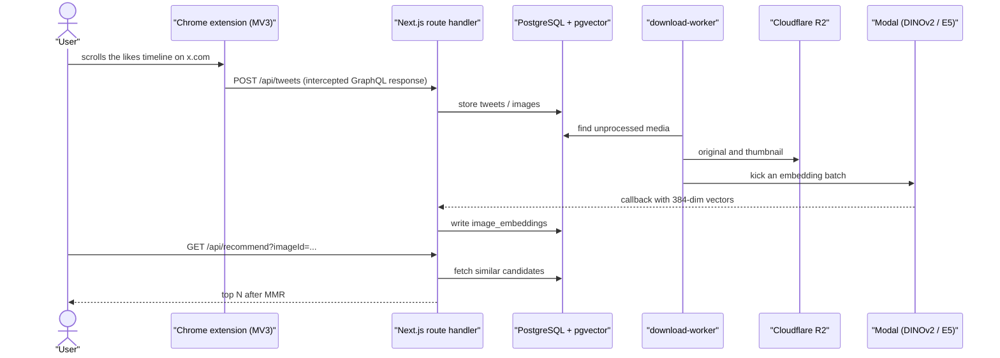

## Likes pile up but stay out of reach

Images you like on X disappear into the timeline, and X offers no way to search by what an image looks like. **Refav Gallery** (repository name `x-fav-gallery`) exists to close that gap between collecting and looking again.

The pieces are a **Chrome extension (Manifest V3)** that reads the X page, a **Next.js 16** app serving the gallery and API, **PostgreSQL 16 + pgvector** for similarity search, **DINOv2 on a Modal T4 GPU** for embeddings, and a **React Native + Expo** app for the same gallery on a phone. This post follows the connections using code and measurements from the repository.

## Architecture

Data moves along two paths: capture, which runs while the user browses X, and rediscovery, which runs when a Lightbox opens.



Figure 1: From capture to similar-image recommendations

Responsibilities stay narrow:

- **Capture**: the extension reads the GraphQL responses X issues itself and never calls the X API.
- **Storage and delivery**: Next.js holds metadata; image bytes come from R2 through the CDN.
- **Embedding**: only inference runs on Modal; the VPS stays CPU-only.
- **Rediscovery**: pgvector supplies candidates, and an application-side MMR pass reorders them.

The VPS holds no model and runs no GPU inference (light image work such as thumbnails stays on its CPU), and the gallery keeps working when the GPU is down.

## Technology choices

| Question | Chosen | Alternative | Why |
|---|---|---|---|
| Getting likes | Passive interception in an MV3 extension | Scheduled sync through the X API | Avoids per-call billing and captures what the user opens |
| Vector search | pgvector (HNSW, cosine) | A separate vector database | Joins and permission filters stay in one SQL statement |
| Image embedding | DINOv2-small (384 dims) | CLIP plus VLM captions | Visual similarity is enough for rediscovery |
| Diversity | MMR (λ = 0.7) | Plain similarity order | Stops one artist's run of images from filling the Lightbox |
| Image delivery | R2 + CDN | Serving through Next.js | Keeps image bandwidth off the app server |

## Core implementation

### 1. Capture by reading X's own traffic

`manifest.json` declares a content script with `world: "MAIN"` and `run_at: "document_start"`. The MAIN world shares the page's JavaScript environment, so it can replace `XMLHttpRequest` and read GraphQL responses from the side.

```ts
// chrome-extension/src/content/graphql-interceptor.ts
XMLHttpRequest.prototype.open = function (
  this: XhrWithUrl,
  method: string,
  url: string | URL,
  async?: boolean,
  // …username / password omitted
): void {
  try {
    this.__xfgCollectionKind = matchGraphqlCollection(typeof url === 'string' ? url : url.href)
  } catch {
    /* noop */
  }
  originalOpen.call(this, method, url, async ?? true)
}
```

`matchGraphqlCollection` only identifies Likes or Bookmarks requests; the response body is never modified. The captured body goes through `postMessage` to a bridge in the isolated world, which sends batches to `/api/tweets`.

A **replay ring buffer** makes this reliable. The interceptor starts at `document_start`, but the bridge starts at `document_idle`, so the interceptor keeps the last 50 bodies (`REPLAY_BUFFER_CAP = 50`) and resends them when the bridge asks. X fetches likes with XMLHttpRequest, so patching `fetch` alone captures nothing; both transports are patched, and the decision lives in a transport-independent helper.

### 2. Embed on Modal with the model baked into the image

Embeddings come from the `Embedder` class in `scripts/python/modal_pipeline.py`. The `@app.cls` container loads the model once and reuses it.

```python
# scripts/python/modal_pipeline.py
@app.cls(
    gpu=EMBEDDER_GPU_TYPE,          # "T4" in pipeline_config.json
    image=embedder_image,
    timeout=600,
    scaledown_window=EMBEDDER_SCALEDOWN_WINDOW,   # 60 seconds
)
class Embedder:
    """DINOv2 embedding (batched). The model is loaded once in @modal.enter."""

    @modal.enter()
    def load(self):
        import sys
        sys.path.insert(0, "/app")
        from extract_dinov2_embedding import load_model
        self.model = load_model()
```

`embed()` takes `{id: base64-pickled tensor}` and returns `{id: 384-dim vector}`. Batch size is 16 and the scaledown window is 60 seconds in `pipeline_config.json`. Downloading weights on each cold start makes latency unpredictable, so DINOv2 is baked into the image at build time (`_bake_dinov2()`). Text uses a parallel stack, `multilingual-e5-small`, also 384 dimensions at batch 32, and lands in `text_embeddings`.

### 3. Let pgvector search, but make the planner pick HNSW

`search_similar_images` in `db/init/functions/recommendations.sql` pulls the target vector into a plpgsql variable, then orders by distance.

```sql
-- db/init/functions/recommendations.sql
SELECT embedding INTO v_target
FROM image_embeddings
WHERE image_embeddings.image_id = p_image_id
LIMIT 1;

RETURN QUERY
SELECT
  ie.image_id,
  (1 - (ie.embedding <=> v_target))::float AS similarity
FROM image_embeddings ie
WHERE ie.image_id != p_image_id
  AND (1 - (ie.embedding <=> v_target)) >= p_threshold
ORDER BY ie.embedding <=> v_target ASC
LIMIT p_limit;
```

`<=>` is pgvector's cosine distance operator. Written as `ORDER BY embedding <=> v_target`, the planner chooses an Index Scan on `idx_image_embeddings_hnsw_cosine` (HNSW, `vector_cosine_ops`). Other shapes lose it: a `WITH target AS (SELECT embedding ...)` subquery, or `ORDER BY (1 - (embedding <=> target)) DESC`, makes the planner treat the right-hand side as a row column rather than a constant and fall back to a sequential scan. `docs/operations/query-tuning-notes.md` records which shapes keep HNSW.

Candidates are collected differently by collection size. `recommend_similar_candidates` runs exact KNN inside the user's own collection at 20,000 likes or fewer, and switches to the global HNSW index above that, raising `hnsw.ef_search` to the over-fetch size.

```sql
-- db/init/functions/recommendations.sql (recommend_similar_candidates)
IF p_user_id IS NOT NULL AND v_collection_size <= p_exact_knn_threshold THEN
  -- small to medium: exact KNN within the user's collection
  -- skipping global HNSW keeps other users' images out of the candidate window
ELSE
  -- large or p_user_id NULL: global HNSW (post-filtering happens in the caller)
  PERFORM set_config('hnsw.ef_search', p_overfetch::text, true);
END IF;
```

The obvious reading is "exact while small, fast when large". It also solves a subtler problem: other users' images occupying the candidate window, because global HNSW returns nearest images across everyone. The 20,000 threshold is an initial value from production-clone measurements; a comment in the SQL records that exact KNN takes about 0.9 s even at 150k likes, while large users get 12 ms from HNSW with post-filtering.

### 4. Get diversity from MMR

Pure similarity order produces rows of the same artist in the same style, so the API over-fetches and applies MMR (Maximal Marginal Relevance).

```ts
// web/src/lib/mmr.ts
const maxSim =
  selected.length === 0
    ? 0
    : Math.max(...selected.map((s) => approximateSimilarity(candidate, s)))

const mmrScore = lambda * candidate.score - (1 - lambda) * maxSim
```

λ defaults to `DEFAULT_LAMBDA = 0.7` in `web/src/lib/config/recommendation.ts`. Bounds come from `CANDIDATE_MULTIPLIER = 10` and `MAX_CANDIDATES = 200`: a request for 10 results fetches up to 100 (10x) and picks 10 with diversity in mind. `approximateSimilarity` returns 0.9 for the same author and otherwise derives similarity from the score gap. With more candidates the loop approaches a quadratic comparison, so a coarse similarity keeps that cost out of API latency.

## Quality and performance

These measurements come from the repository; some are local and some production, and the sources say which.

First, search:

| Metric | Value | Source |
|---|---|---|
| `search_similar_images` before/after HNSW | 142 ms → 1.3 ms (~100x) | `docs/operations/query-tuning-notes.md` |
| HNSW index size | 112 MB (vector(384), ~58k rows) | same |
| Index build time | 75 s → 9 s (`maintenance_work_mem` 64 MB → 512 MB) | same |

Then the API and rendering:

| Metric | Value | Source |
|---|---|---|
| `get_simple_recommendations` | 78 ms (local, with `user_id`) | same |
| Collection-size count for a ~190k-like user | 92.8 ms / 11,842 buffers → 18.3 ms / 208 buffers | comment in `recommendations.sql` |
| First gallery render query | ~1.1 s → 0.45–0.64 s (md5 removed) | `docs/PROJECT_STATUS.md` |

Caveat: these numbers do not share one condition. The 142 ms → 1.3 ms figure is production, the 78 ms is local, and `query-tuning-notes.md` warns the two differ by orders of magnitude, so any number copied from the repository should travel with its context.

The decision that does the most work is **keeping heavy processing off the synchronous path**. Embedding runs in asynchronous workers; the request-time API only searches stored vectors and applies MMR. If the GPU is unavailable, similarity search still works for images that already have embeddings.

## Pitfalls

- **The planner will not choose HNSW for every shape.** Passing the target through a subquery, or rewriting as `ORDER BY (1 - (embedding <=> target)) DESC`, yields a sequential scan because `<=>` no longer has a constant on one side.
- **A worker that warmed recommendations was evicting the gallery's working set.** `prewarm-worker` called `pg_prewarm()` on four vector relations every three minutes, and those four matched the top four by buffer occupancy exactly. Turning it off is not a fix: recommendation reads regress to 0.9–2.1 s on cold reads.
- **"Liked at" was not the like time.** `user_liked_tweets.liked_at` held the import timestamp: 81% of users with 100+ likes had it NULL, and 16% had a spread under one day. Ranking moved to `tweets.posted_at`.

## Takeaways

- **Capture through interception, not an API.** It avoids billing and records what the user actually opened.
- **Keep inference off the app server.** Bake the model into a Modal container and leave the VPS CPU-only.
- **Finish vector search inside SQL.** Permission filters and metadata joins belong in the same statement as distance ordering.
- **Apply diversity after retrieval.** Over-fetch, then rerank with a cheap approximate similarity.

pgvector's HNSW index is **used or skipped depending on how the query is written**, so checking for an Index Scan with EXPLAIN early saves a lot of later performance work.

## Related posts

- [When your likes get buried: designing capture and rediscovery for X favorites](/en/post/20261115x-fav-gallery-solution/)
- [Turning X likes into an asset: image recommendations with a Chrome extension, pgvector, and DINOv2](/post/x-fav-gellery/) (Japanese)

---

**Working on a personal project with similarity search or a vector database?**

I take on technical consulting and development support.

[Hire me on Coconala](https://coconala.com/users/1117897)
