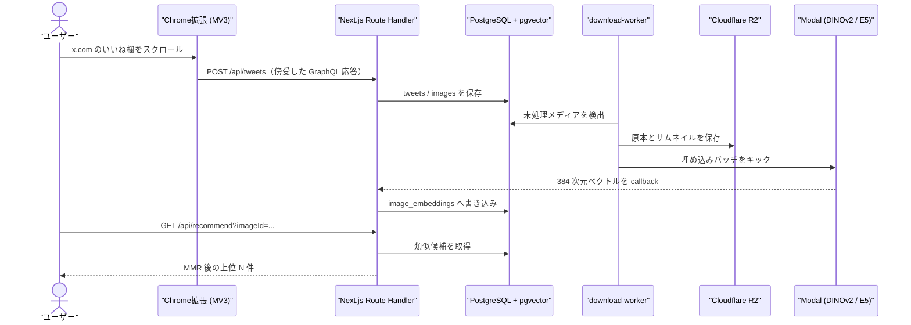

## いいねは集まるのに、見返せない

X でいいねを押した画像は、時間が経つとタイムラインの彼方に消えます。あとから「あの絵をもう一度見たい」と思っても、X の画面では画像の内容から探せません。この「集めたのに見返せない」状態を解くために作っているのが **Refav Gallery**（リポジトリ名 `x-fav-gallery`）です。

構成は、X の画面を読む **Chrome 拡張（Manifest V3）**、閲覧と API を担う **Next.js 16**、類似検索のための **PostgreSQL 16 + pgvector**、画像埋め込みを作る **DINOv2（Modal の T4 GPU）**、そして同じギャラリーをスマートフォンで見るための **React Native + Expo** です。この記事では、これら4つの層がどうつながっているかを、実際のコードとリポジトリに残っている計測値で整理します。

対象読者は、個人開発で「収集したコンテンツを後から引き出す」仕組みを作りたい人と、pgvector で類似検索を組むときの実務的な勘所を知りたい人です。

## 全体構成

データは「取り込み」と「再発見」の2本の流れに分かれます。取り込みはユーザーが X を眺めている間に走り、再発見は Lightbox を開いた瞬間に走ります。



図1: 取り込みから類似レコメンドまでの流れ

責務は次のように割り切っています。

- **取り込み**: 拡張は X が自分で発行した GraphQL 応答を読むだけで、X API を叩かない
- **保存と配信**: Next.js がメタデータを持ち、画像本体は Cloudflare R2 + CDN から直接返す
- **埋め込み**: 重い推論だけを Modal の GPU に逃がし、VPS は CPU のまま保つ
- **再発見**: pgvector で候補を取り、アプリ層の MMR で並べ替えて返す

この分担により、VPS 側はモデルの保持も GPU 推論もしません（サムネイル生成のような軽い画像処理は VPS の CPU で行います）。GPU が落ちている間も、ギャラリーの一覧表示は動き続けます。

## 技術選定

| 論点 | 採用 | 代替案 | 採用理由 |
|---|---|---|---|
| いいねの取得 | MV3 拡張で通信を passive 傍受 | X API の定期 sync | API 従量課金を避けつつ、ユーザーが実際に開いた範囲を取れる |
| ベクトル検索 | pgvector（HNSW / cosine） | 外部のベクトルDB | メタデータとの結合と権限フィルタを1つの SQL で済ませたい |
| 画像埋め込み | DINOv2-small（384次元） | CLIP + VLM キャプション | 類似画像の再発見が目的なら、視覚特徴だけで足りる |
| 多様性 | MMR（λ=0.7） | 類似度順にそのまま返す | 同じ絵柄の連投で Lightbox が埋まるのを防ぐ |
| 画像配信 | R2 + CDN | Next.js 経由で配信 | アプリサーバーに画像の帯域を持たせない |

## 実装の核

### 1. 取り込みは X の通信を「読むだけ」で行う

Chrome 拡張は `manifest.json` で `world: "MAIN"`、`run_at: "document_start"` の content script を x.com に差し込みます。MAIN world ではページと同じ JavaScript 環境で動けるので、`XMLHttpRequest` を差し替えて GraphQL の応答を横から読めます。

```ts
// chrome-extension/src/content/graphql-interceptor.ts
XMLHttpRequest.prototype.open = function (
  this: XhrWithUrl,
  method: string,
  url: string | URL,
  async?: boolean,
  // …（username / password は省略）
): void {
  try {
    this.__xfgCollectionKind = matchGraphqlCollection(typeof url === 'string' ? url : url.href)
  } catch {
    /* noop */
  }
  originalOpen.call(this, method, url, async ?? true)
}
```

`matchGraphqlCollection` が Likes / Bookmarks の URL かどうかだけを判定し、レスポンス本文は改変しません。読んだ本文は `postMessage` で isolated world の bridge に渡し、そこから `/api/tweets` へバッチ送信します。

実装で効いているのが**リングバッファによる replay** です。interceptor は `document_start` で動きますが、bridge 側の content script は `document_idle` で起動します。その隙間に取れた最初のページを取りこぼさないよう、捕捉済みの本文を最大50件（`REPLAY_BUFFER_CAP = 50`）だけ保持し、bridge からの再送要求に応じて吐き直します。

なお、X は Likes を XMLHttpRequest で取得するため、`fetch` だけを patch しても取れません。そこで両方を patch し、判定は transport に依存しない `matchGraphqlCollection` に寄せています。

### 2. 埋め込みは Modal の T4 で、モデルをイメージに焼く

画像の埋め込みは `scripts/python/modal_pipeline.py` の `Embedder` クラスが担当します。`@app.cls` のコンテナは初回起動時にモデルを読み込み、以降は同じコンテナで使い回します。

```python
# scripts/python/modal_pipeline.py
@app.cls(
    gpu=EMBEDDER_GPU_TYPE,          # pipeline_config.json では "T4"
    image=embedder_image,
    timeout=600,
    scaledown_window=EMBEDDER_SCALEDOWN_WINDOW,   # 60 秒
)
class Embedder:
    """DINOv2 embedding (バッチ)。モデルは @modal.enter で 1 回ロード。"""

    @modal.enter()
    def load(self):
        import sys
        sys.path.insert(0, "/app")
        from extract_dinov2_embedding import load_model
        self.model = load_model()
```

`embed()` は `{id: base64-pickled tensor}` を受け取り、`{id: 384次元ベクトル}` を返します。バッチサイズは `pipeline_config.json` で 16、`scaledown_window` は 60 秒です。コンテナ起動のたびにモデルをダウンロードすると待ち時間が読めなくなるため、DINOv2 の重みはビルド時にイメージへ焼き込んでいます（`_bake_dinov2()`）。

同じスタックに、テキストと記事のための `multilingual-e5-small`（こちらも384次元、バッチ32）が並びます。画像は視覚、テキストは言語で別のモデルを使い、`image_embeddings` と `text_embeddings` に分けて保存します。

### 3. 類似検索は pgvector、ただしプランナに HNSW を選ばせる

`db/init/functions/recommendations.sql` の `search_similar_images` は、対象画像のベクトルを plpgsql 変数に取り出してから距離順に並べます。

```sql
-- db/init/functions/recommendations.sql
SELECT embedding INTO v_target
FROM image_embeddings
WHERE image_embeddings.image_id = p_image_id
LIMIT 1;

RETURN QUERY
SELECT
  ie.image_id,
  (1 - (ie.embedding <=> v_target))::float AS similarity
FROM image_embeddings ie
WHERE ie.image_id != p_image_id
  AND (1 - (ie.embedding <=> v_target)) >= p_threshold
ORDER BY ie.embedding <=> v_target ASC
LIMIT p_limit;
```

`<=>` は pgvector のコサイン距離演算子です。`ORDER BY embedding <=> v_target` の形にすると、`idx_image_embeddings_hnsw_cosine`（HNSW、`vector_cosine_ops`）の Index Scan が選ばれます。

重要なのは、**この形を崩すと HNSW が使われない**ことです。`WITH target AS (SELECT embedding ...)` のサブクエリ形式や、`ORDER BY (1 - (embedding <=> target)) DESC` の形にすると、planner は定数比較と見なせず Seq Scan に落ちます。リポジトリの `docs/operations/query-tuning-notes.md` には、この条件がクエリ形式ごとに表で残っています。

候補の集め方はユーザーのコレクション規模で分岐します。`recommend_similar_candidates` は、対象ユーザーのいいね件数が2万件以下ならユーザーのコレクション内で exact KNN を回し、それを超える場合はグローバル HNSW に切り替えたうえで `hnsw.ef_search` を over-fetch サイズまで引き上げます。

```sql
-- db/init/functions/recommendations.sql（recommend_similar_candidates）
IF p_user_id IS NOT NULL AND v_collection_size <= p_exact_knn_threshold THEN
  -- 小〜中規模: user コレクション内 exact KNN
  -- グローバル HNSW を経由しないので他人の画像に候補窓を占拠されない
ELSE
  -- 大規模 or p_user_id NULL: グローバル HNSW（後置フィルタは呼び出し側）
  PERFORM set_config('hnsw.ef_search', p_overfetch::text, true);
END IF;
```

この分岐は「小さいうちは正確に、大きくなったら速く」という素直な設計に見えますが、実際には**他人の画像が候補枠を埋める**という別の問題への対処でもあります。グローバル HNSW は全ユーザーの画像から近い順に返すため、コレクションが小さいユーザーでは欲しい候補が窓の外に押し出されます。閾値2万件は本番クローンの計測に基づく初期値です。SQL のコメントには、exact KNN が15万件のいいねでも約0.9秒かかる一方、大規模ユーザーは HNSW と後置フィルタで 12ms になると記録されています。

### 4. 多様性は MMR で確保する

類似度順にそのまま返すと、同じ作家の同じタッチの絵が並びます。そこで候補を多めに取り、アプリ層で MMR（Maximal Marginal Relevance）をかけます。

```ts
// web/src/lib/mmr.ts
const maxSim =
  selected.length === 0
    ? 0
    : Math.max(...selected.map((s) => approximateSimilarity(candidate, s)))

const mmrScore = lambda * candidate.score - (1 - lambda) * maxSim
```

λ は `web/src/lib/config/recommendation.ts` の `DEFAULT_LAMBDA = 0.7` です。候補数は `CANDIDATE_MULTIPLIER = 10` と `MAX_CANDIDATES = 200` で決まり、表示件数の10倍（上限200件）を取ってから、多様性を考慮して必要件数を選びます。

`approximateSimilarity` は埋め込みを再度引かず、同作者なら 0.9、それ以外はスコア差から近似します。候補が増えると総当たりに近い比較になるため、厳密なベクトル距離を使うと API のレイテンシに乗ってしまいます。ここは「多様性のための粗い類似度」と割り切るのが正解でした。

## 品質と性能

リポジトリに残っている計測値です。数値はいずれも各ドキュメント・SQL コメントの記述で、環境はローカル計測と本番実測が混在しています。

まず検索まわりです。

| 項目 | 値 | 出典 |
|---|---|---|
| HNSW 導入前後の `search_similar_images` | 142 ms → 1.3 ms（約100倍） | `docs/operations/query-tuning-notes.md` |
| HNSW インデックスサイズ | 112 MB（vector(384)、約5.8万行） | 同上 |
| インデックス構築時間 | 75 秒 → 9 秒（`maintenance_work_mem` 64MB → 512MB） | 同上 |

次に API と表示です。

| 項目 | 値 | 出典 |
|---|---|---|
| `get_simple_recommendations` | 78 ms（ローカル、`user_id` 指定） | 同上 |
| いいね約19万件のユーザーでの件数取得 | 92.8 ms / 11,842 buffers → 18.3 ms / 208 buffers | `recommendations.sql` のコメント |
| ギャラリー初回表示の SQL | 約1.1 秒 → 0.45〜0.64 秒（md5 除去） | `docs/PROJECT_STATUS.md` |

読み方として注意したいのは、この表の数値がすべて同じ条件ではないことです。142 ms → 1.3 ms は本番実測、78 ms はローカル計測で、本番とは桁が違うと `query-tuning-notes.md` 自身が断っています。記事や社内資料に転記するときは、条件を一緒に持っていく必要があります。

設計として効いているのは、**重い処理を同期パスから外す**という一点です。埋め込み生成は非同期の worker に流し、閲覧時の API は「保存済みベクトルの検索」と「MMR」だけを行います。GPU が止まっていても、既に埋め込みが済んでいる画像の類似検索は動きます。

## つまずいた点

- **planner は書き方で HNSW を選ばない**: サブクエリ経由で対象ベクトルを渡すと、`<=>` の片側が定数と見なされず Seq Scan になります。`ORDER BY (1 - (embedding <=> target)) DESC` のような変形も同様です。plpgsql 変数に `SELECT INTO` してから距離順に並べる、という形を守る必要があります。
- **レコメンドを温める worker が、ギャラリーの作業セットを押し出していた**: ベクトル用の4リレーションを3分ごとに `pg_prewarm()` する `prewarm-worker` が、buffer 占有上位4つと完全一致しました。受動的な LRU 競合ではなく、能動的な追い出しです。ただし止めるとレコメンドが cold read で 0.9〜2.1 秒に退行するため、単純に無効化はできません。
- **「いいねした日時」が取れていなかった**: `user_liked_tweets.liked_at` は本来のいいね時刻ではなく取り込み時刻でした。100件以上持つユーザーの81%が全 NULL、16%が広がり1日未満で、時間軸のランキングに使えません。最終的には `tweets.posted_at` に軸を移しています。カラム名から意味を推測すると踏むタイプの落とし穴でした。

## まとめ

Refav Gallery の構成は、次の4つに集約できます。

- **取り込みは API ではなく通信の傍受**。課金を避けつつ、ユーザーが見た範囲をそのまま取れる
- **推論は GPU に集約する**。Modal のコンテナにモデルを焼き、VPS は CPU のまま保つ
- **ベクトル検索は SQL の中で完結させる**。権限フィルタとメタデータ結合を同じクエリに置ける
- **多様性は取得後にかける**。候補を多めに取り、軽い近似類似度で MMR する

この形は、画像に限らず「集めたものを後から引き出す」ツールに広く流用できます。特に、pgvector の HNSW は**クエリの書き方で使われたり使われなかったりする**ので、EXPLAIN で Index Scan を確認する習慣を先に作っておくと、後の性能問題をかなり減らせます。

## 関連記事

- [Xの「いいね」が埋もれる問題を、取り込みと再発見の設計で解く](/post/20261115x-fav-gallery-solution/)
- [Xのいいねを資産化！Chrome拡張 + pgvector + DINOv2で作る画像レコメンドシステム](/post/x-fav-gellery/)

---

**類似検索やベクトルDBを使った個人開発のご相談はありませんか？**

技術相談や開発サポートを承っています。お気軽にご相談ください。

[ココナラで開発相談を依頼する](https://coconala.com/users/1117897)
