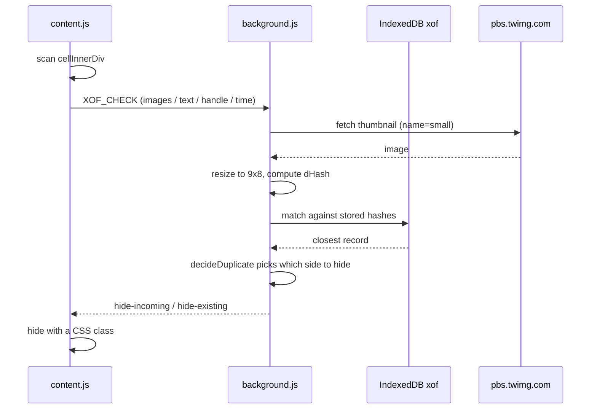

## Judging "the same image" inside the browser

The same picture keeps showing up in an X timeline from different accounts. Reposts are easy to spot, but an account that saves an image and posts it as its own is not, at least not while you are scrolling.

**X Original Filter** is a Chrome extension that hides these non-original posts in the timeline. It runs on Manifest V3, and every decision happens locally in the browser. There is no external API and no account connection; the only host it fetches from is `pbs.twimg.com`.

This post walks through the implementation: a 64-bit dHash scored with Hamming distance, an IndexedDB record of what was seen first, and a rule that decides the original by post time rather than by arrival order.

## Architecture

The DOM scan and the visibility changes live in the content script. Image fetching, hashing, and matching live in the service worker.



Figure 1: The decision flow in X Original Filter

The responsibilities are narrow on purpose:

- **content.js**: watches `data-testid="cellInnerDiv"` and extracts the text, image URLs, timestamp, and handle.
- **background.js**: fetches images, computes dHash, and compares them against stored records.
- **lib.js**: holds the DOM-free functions (hash, text normalization, duplicate decision).

The same `src/lib.js` loads through `manifest.json`'s `js` array for the content script and through `importScripts` for the worker. Tests load it with `vm.runInThisContext`, so the logic is verifiable without a DOM.

## Technology choices

| Question | Chosen | Alternative | Why |
|---|---|---|---|
| Image hash | 64-bit dHash | pHash / exact match | Built from a resize and gradients, with no external library |
| Matching | Hamming distance (default 5) | Cosine similarity | Two 64-bit XORs and popcounts are enough |
| Storage | IndexedDB `xof` | `chrome.storage` | Thousands of hashes need keyed lookups |
| Settings | `chrome.storage.sync` | A server | Syncs across devices and sends nothing out |
| Text detection | NFKC + FNV-1a | Similarity scoring | Exact matching keeps the check cheap |

dHash wins because the decision fits in 64 bits. pHash tolerates rotation and light cropping better, but it is more code. This extension only needs to catch the case where the same image is reposted as-is, and the README lists weakness against cropping as a known limitation.

## Core implementation

### 1. Build dHash from a 9x8 thumbnail

`dHash` in `src/lib.js` turns the horizontal brightness gradient of a 9x8 image into one bit per comparison, giving 8x8 = 64 bits.

```js
// src/lib.js (dHash)
var g1 = (data[i1] * 299 + data[i1 + 1] * 587 + data[i1 + 2] * 114) / 1000;
var g2 = (data[i2] * 299 + data[i2 + 1] * 587 + data[i2 + 2] * 114) / 1000;
byte = (byte << 1) | (g1 > g2 ? 1 : 0);
```

The width is 9 so that eight comparisons fit in a row. The result is 16 hex characters, which doubles as an IndexedDB key.

Fetching happens in the service worker. `hashUrl` in `src/background.js` rewrites the URL to `name=small`, fetches it, and redraws it at 9x8 with `OffscreenCanvas`.

```js
// src/background.js (hashUrl)
const canvas = new OffscreenCanvas(9, 8);
const ctx = canvas.getContext('2d', { willReadFrequently: true });
ctx.imageSmoothingEnabled = true;
ctx.drawImage(bitmap, 0, 0, 9, 8);
hash = X.dHash(ctx.getImageData(0, 0, 9, 8));
```

Full-resolution images can exceed 1 MB, so `toSmallImageUrl` in `src/lib.js` pins `name=small` on the URL. The hash is cached per URL in the `urlhash` store.

### 2. The original is the earlier timestamp, not the earlier sighting

The heart of the extension is `decideDuplicate` in `src/lib.js`. Because the timeline arrives newest first, the first sighting is not necessarily the original.

```js
// src/lib.js (decideDuplicate; whitelist check omitted)
if (existing.handle && incoming.handle && existing.handle === incoming.handle) {
  return 'none';
}

var tEx = Number(existing.time) || 0;
var tIn = Number(incoming.time) || 0;
if (tEx && tIn) {
  if (tIn < tEx) return 'hide-existing';
  if (tIn > tEx) return 'hide-incoming';
  return 'none';
}
return 'hide-incoming';
```

There are three stages. A whitelisted (original) author wins first, a repost by the same handle is ignored, and otherwise the earlier `time[datetime]` is treated as the original. When the newer sighting turns out to be older, the function returns `hide-existing`, replaces the record, and hides the copy already on screen. That is why arrival order does not matter.

If timestamps are missing, the first sighting is kept as the original, and identical timestamps are left alone. Leaving something visible is safer than hiding it by mistake.

### 3. Serialize the checks and cap the records

The service worker handles several posts at once. If two copies of an image arrive together, "which came first" gets ambiguous, so `XOF_CHECK` messages are pushed through a single promise chain.

```js
// src/background.js
function serialize(fn) {
  const run = chain.then(fn, fn);
  chain = run.catch(() => {});
  return run;
}
```

Matching is `findClosest`, a scan over an in-memory `Map` that stops at distance 0. Records are read from IndexedDB once at startup and served from memory afterwards. `MAX_ITEMS` is 6000: when the count exceeds it, the oldest records by `seenAt` are dropped, and the URL cache is cleared wholesale at 8000 entries.

### 4. Hide with a CSS class only

`src/content.js` never removes a node. It adds `xof-hidden`. X recycles timeline cells through virtual scrolling, so removing DOM would break rendering.

```js
// src/content.js (hide)
cell.dataset.xofHiddenKind = kind;
if (settings.collapseInsteadOfHide) {
  cell.classList.add('xof-collapsed');
  ensureBadge(cell, kind);
} else {
  cell.classList.add('xof-hidden');
}
```

With `collapseInsteadOfHide` enabled, `xof-collapsed` in `src/content.css` (`max-height: 44px`) leaves a thin strip that expands on click. The default is a full hide. When a recycled cell changes its `tweetId`, `backfill` re-checks it after a 700 ms debounce.

## Quality and performance

The repository records no benchmark numbers, so what can be said is structural.

- Hashing decodes one 9x8 thumbnail per URL and caches the result.
- The only network traffic is the image fetch from `pbs.twimg.com`; no verdict is ever sent anywhere.
- Stored records stay bounded at 6000 entries, so long sessions do not grow storage without limit.

Tests are `npm test` with 27 unit tests, plus an end-to-end run that loads the extension into a full Chromium through Playwright. It never touches X; a local page imitates X's DOM and checks three cases: a repost, a duplicate image, and a copy that appears before the original.

```bash
npm test          # pure-logic unit tests (27 cases)
npm run test:e2e  # end-to-end in a real Chromium
```

## Pitfalls

- **Arrival order is not post order**: treating the first sighting as the original hides the wrong side, because timelines stream newest first. Comparing timestamps and correcting after the fact was the biggest design change.
- **Numeric tweet IDs break attribute selectors**: `[data-xof-tweet-id="123..."]` never matches, because `CSS.escape` escapes the leading digit. `src/content.js` scans `[data-xof-tweet-id]` cells and compares `dataset` instead.
- **The queue falls behind**: fast scrolling outruns processing. `MAX_QUEUE` is 300; overflowing cells are marked done and skipped. Showing something that should be hidden is treated as the cheaper mistake.

## Takeaways

- Duplicate image detection fits in a small amount of code with a 9x8 dHash and Hamming distance.
- Pick the original by timestamp, not by arrival order.
- Hide with CSS classes only, so virtual scrolling keeps working.
- Cap the stored records and serialize the checks, so concurrent posts cannot race the verdict.

The same shape applies to any site that rebuilds its DOM constantly and needs duplicate detection plus hiding. Keeping the decision in pure functions makes most of it testable without a browser.

## Related posts

- [When the timeline fills up with reposts and copies: designing a filter that only changes what you see](/en/post/20261115x-original-filter-solution/)

---

**Working on duplicate detection or a browser extension?**

I take on technical consulting and development support.

[Hire me on Coconala](https://coconala.com/users/1993863)
