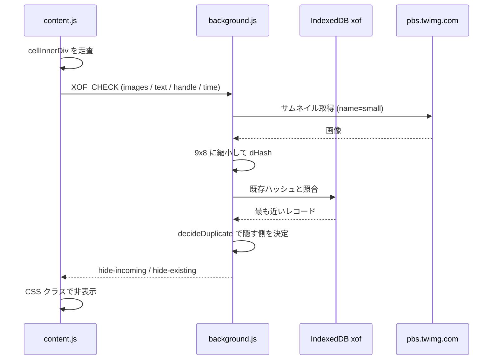

## タイムラインの「同じ画像」をブラウザだけで判定する

X のタイムラインには、同じ画像が別アカウントから何度も流れてきます。リポストはまだ分かりますが、画像を保存して自分の投稿として出し直すものは、スクロールだけでは区別できません。

**X Original Filter** は、こうした「オリジナルでない投稿」を非表示にする Chrome 拡張です。Manifest V3 で動作し、判定はすべてブラウザ内で完結します。外部 API もアカウント連携も使わず、画像の取得先は `pbs.twimg.com` だけです。

本記事では、dHash とハミング距離で重複画像を判定し、投稿時刻から原本を決めるまでの実装を整理します。

## 全体構成

DOM の走査と表示の制御は content script、画像の取得・ハッシュ計算・照合は service worker が担当します。



図1: X Original Filter の判定フロー

役割の分割は次のとおりです。

- **content.js**: `data-testid="cellInnerDiv"` を監視し、本文・画像 URL・時刻・ハンドルを取り出す
- **background.js**: 画像を取得して dHash を計算し、IndexedDB の記録と突き合わせる
- **lib.js**: DOM に依存しない純粋関数（ハッシュ、テキスト正規化、判定）をまとめる

`src/lib.js` は content script では `manifest.json` の `js` 配列で、service worker では `importScripts` で読まれます。Node のテストからも `vm.runInThisContext` で読めるので、DOM 無しで検証できます。

## 技術選定

| 論点 | 採用 | 代替案 | 採用理由 |
|---|---|---|---|
| 画像ハッシュ | 64bit dHash | pHash / 完全一致 | 縮小と勾配だけで作れて、外部ライブラリが不要 |
| 照合 | ハミング距離（既定 5） | コサイン類似度 | 64bit の XOR と popcount だけで済む |
| 記録先 | IndexedDB `xof` | `chrome.storage` | 数千件のハッシュをキーで引きたい |
| 設定 | `chrome.storage.sync` | サーバー保存 | 端末をまたげて、外部送信が無い |
| テキスト判定 | NFKC + FNV-1a | 類似度計算 | 完全一致系に割り切り、判定を軽く保つ |

dHash を選んだのは、判定に使う情報を 64bit に落とせるからです。pHash は回転やトリミングに強い代わりに実装が大きくなります。トリミングへの弱さは README の既知の制限に書いています。

## 実装の核

### 1. dHash は 9x8 の縮小画像から作る

`src/lib.js` の `dHash` は、9x8 に縮小した画像の横方向の輝度差を 1bit にして、8x8 = 64bit を作ります。

```js
// src/lib.js（dHash）
var g1 = (data[i1] * 299 + data[i1 + 1] * 587 + data[i1 + 2] * 114) / 1000;
var g2 = (data[i2] * 299 + data[i2 + 1] * 587 + data[i2 + 2] * 114) / 1000;
byte = (byte << 1) | (g1 > g2 ? 1 : 0);
```

幅を 9 にするのは、8 列ぶんの比較を作るためです。出力は 16 進 16 文字で、IndexedDB のキーにそのまま使えます。

取得は service worker 側です。`src/background.js` の `hashUrl` が URL を `name=small` に寄せて `fetch` し、`OffscreenCanvas` で 9x8 に描き直します。

```js
// src/background.js（hashUrl）
const canvas = new OffscreenCanvas(9, 8);
const ctx = canvas.getContext('2d', { willReadFrequently: true });
ctx.imageSmoothingEnabled = true;
ctx.drawImage(bitmap, 0, 0, 9, 8);
hash = X.dHash(ctx.getImageData(0, 0, 9, 8));
```

元解像度は 1MB を超えることがあるため、`src/lib.js` の `toSmallImageUrl` が URL に `name=small` を立て、結果は `urlhash` ストアにキャッシュします。

### 2. 原本は「先に見た方」ではなく「投稿時刻が早い方」

中心は `src/lib.js` の `decideDuplicate` です。タイムラインは新しい順に流れてくるので、最初に見た投稿が原本とは限りません。

```js
// src/lib.js（decideDuplicate、ホワイトリスト判定は省略）
if (existing.handle && incoming.handle && existing.handle === incoming.handle) {
  return 'none';
}

var tEx = Number(existing.time) || 0;
var tIn = Number(incoming.time) || 0;
if (tEx && tIn) {
  if (tIn < tEx) return 'hide-existing';
  if (tIn > tEx) return 'hide-incoming';
  return 'none';
}
return 'hide-incoming';
```

判定は3段階です。ホワイトリスト（原作家）を優先し、同一ハンドルの再掲は対象外にし、最後に `time[datetime]` で早い方を原本とします。新しく見た方が古ければ `hide-existing` を返し、記録を差し替えて、表示済みの転載側を隠し直します。

時刻が取れない場合は「先に見た方」を原本とし、同刻は判定不能として何もしません。誤って隠すより、出しっぱなしの方が安全という判断です。

### 3. 照合は直列化し、記録は上限つきで剪定する

service worker は複数の投稿を並行して処理するため、同じ画像が同時に届くと「どちらが先か」がぶれます。`XOF_CHECK` は Promise チェーンで直列化しています。

```js
// src/background.js
function serialize(fn) {
  const run = chain.then(fn, fn);
  chain = run.catch(() => {});
  return run;
}
```

照合はメモリ上の `Map` を総当たりする `findClosest` で、距離 0 で打ち切ります。記録は起動時に IndexedDB から一度だけ読みます。`MAX_ITEMS` は 6000 件で、超えれば `seenAt` の古い順に捨て、URL キャッシュは 8000 件で丸ごと消します。

### 4. 隠すのは CSS クラスだけ

`src/content.js` は要素を削除せず、`xof-hidden` を付けるだけです。タイムラインはセルを仮想スクロールで再利用するため、DOM から抜くと表示が壊れます。

```js
// src/content.js（hide）
cell.dataset.xofHiddenKind = kind;
if (settings.collapseInsteadOfHide) {
  cell.classList.add('xof-collapsed');
  ensureBadge(cell, kind);
} else {
  cell.classList.add('xof-hidden');
}
```

`collapseInsteadOfHide` を有効にすると `xof-collapsed`（`max-height: 44px`）で細い帯だけ残し、クリックで復帰できます。既定は完全非表示です。セルが再利用されて `tweetId` が変わった場合は、`backfill` が 700ms のデバウンスで再判定します。

## 品質と性能

リポジトリにベンチマークの数値は記録されていません。性能面で言えるのは構造の話です。

- デコードは 9x8 の縮小1回で、結果は URL 単位でキャッシュされる
- 通信は `pbs.twimg.com` への画像取得のみで、判定結果を送る先は無い
- 記録は 6000 件で頭打ちになり、閲覧を続けても増え続けない

テストは `npm test` の 27 件と、Playwright のフル Chromium で拡張を実際に読み込む E2E があります。E2E は X に接続せず、DOM を模したローカルページでリポスト・重複画像・「先に見た方が転載」の3ケースを検証します。

```bash
npm test          # 純粋ロジックのユニットテスト（27 件）
npm run test:e2e  # 実 Chromium での E2E
```

## つまずいた点

- **到着順と投稿時刻は違う**: 新しい順に流れるタイムラインでは、「最初に見たもの」を初出とすると転載を原本と誤認します。投稿時刻で比較する形に変えました。
- **数値の tweetId を属性セレクタに埋められない**: `[data-xof-tweet-id="123..."]` は `CSS.escape` が先頭の数字をエスケープして一致しません。`src/content.js` は `dataset` を走査して比較しています。
- **キューが追いつかないとき**: 高速スクロールで処理が滞留します。`MAX_QUEUE` は 300 件で、あふれた新規セルは「処理済み」にして捨てます。誤って隠すより出しっぱなしを選ぶ優先順位です。

## まとめ

- 重複画像の判定は、9x8 の dHash（64bit）とハミング距離で十分小さく書ける
- 原本の決定は「先に見た方」ではなく「投稿時刻が早い方」。到着順を信じない
- 隠す処理は CSS クラスに限定する。仮想スクロールを壊さないため
- 記録は上限つきで剪定し、照合は直列化する。並行実行での判定ぶれを避ける

同じ形は、DOM が作り直されるサイトの「重複検出 + 非表示」に使えます。判定を純粋関数に切り出せば、テストできる範囲が広がります。

## 関連記事

- [タイムラインがリポストとパクリで埋まる — 表示だけを変える重複フィルタの設計](/post/20261115x-original-filter-solution/)

---

**重複検出やブラウザ拡張の開発でお困りのことはありませんか？**

技術相談や開発サポートを承っています。お気軽にご相談ください。

[ココナラで開発相談を依頼する](https://coconala.com/users/1993863)
