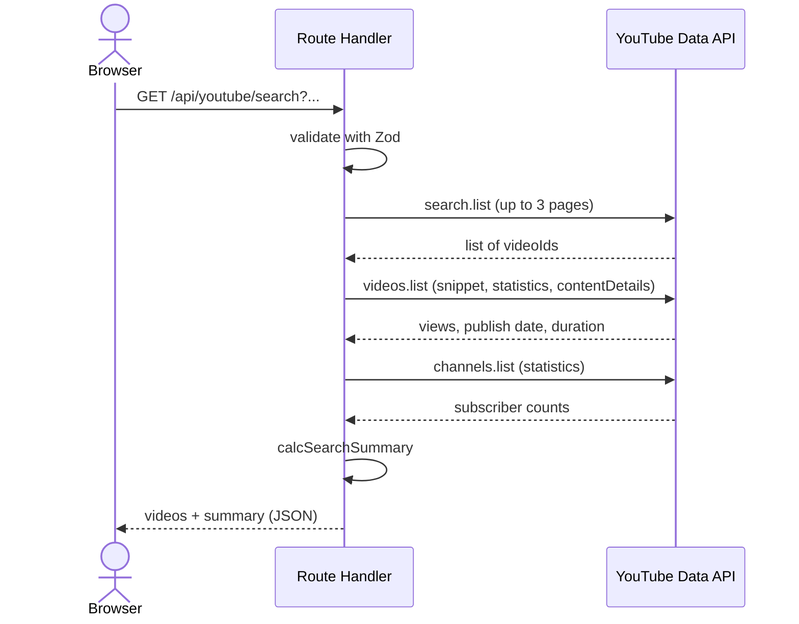

## View count alone cannot tell you what worked

When you plan YouTube content, the first number you look at is views. But the videos with the most views usually belong to the biggest channels. A hundred thousand views from a channel with a million subscribers means something very different from the same hundred thousand views on a channel with ten thousand.

**youtube-analyser** is a web app for reading that gap between reach and channel size. You narrow candidates by keyword, category, publish period, and video length, and it shows view count, engagement rate, and a viral coefficient (views divided by subscribers) in both a list and a summary. It runs on Next.js 16 (App Router) with TypeScript; the UI is shadcn/ui and Tailwind CSS, server state is TanStack Query, and input validation is Zod.

This post walks through where filters are accepted, in what order the API is called, and where aggregation happens, with excerpts from the repository.

## Architecture

The flow is one direction: input, validation, fetch, aggregate, render. The browser never calls the YouTube API directly; everything goes through `/api/youtube/search`.



Figure 1: One search request, end to end

Responsibilities are split like this:

- **Validation**: the Route Handler entry point runs a Zod schema. UI quirks are absorbed there
- **Fetch**: `src/lib/youtube/client.ts` calls three endpoints in order and normalizes them into `VideoItem`
- **Aggregate**: pure functions in `src/lib/youtube/stats.ts`. They know nothing about the API or React
- **Render**: `src/hooks/useYouTubeSearch.ts` wraps the request in TanStack Query; `StatsSummary` and `VideoList` draw it

What the browser receives is only a `{ success, data: { videos, summary } }` JSON body. Neither the API key nor the raw YouTube response crosses that boundary. Fetch failures become a 500 from the Route Handler, and validation failures become a 400 with `flatten()`ed error details. The UI just checks `body.success` and throws, so API concerns never leak into component code.

## Technology choices

| Decision | Choice | Alternative | Why |
|---|---|---|---|
| API key handling | Keep it server-side in a Route Handler | fetch from the browser | The key never ships in the bundle, and CORS stops being a concern |
| Input validation | Zod schema | hand-written if statements | Types and checks live in one place, and error shapes stay consistent |
| Server state | TanStack Query | useState + useEffect | No custom loading, refetch, or cache logic |
| Candidate collection | 3 pages × 50 | first page only | More candidates to re-rank. One page caps you at the top 50 |
| Display order | sort by viral coefficient | trust the API's order | `order` decides what you fetch, not what you should see |

## Core implementation

### 1. Funnel filters through a single schema

`src/app/api/youtube/search/route.ts` receives a query string. It fixes the types there so that everything downstream sees validated values only.

```ts
// src/app/api/youtube/search/route.ts
const searchSchema = z
  .object({
    searchMode: z.enum(['search', 'trending']).optional(),
    keyword: z.string().min(1).optional(),
    categoryId: z.string().optional(),
    publishedAfter: z.string().datetime({ offset: true }).optional(),
    publishedBefore: z.string().datetime({ offset: true }).optional(),
    videoDuration: z.enum(['short', 'medium', 'long', 'any']).optional(),
    order: z.enum(['relevance', 'viewCount', 'rating', 'date']).optional(),
    maxResults: z.coerce.number().int().min(1).max(50).optional(),
    subscriberCountMax: z.coerce.number().int().min(0).optional(),
  })
  .refine(
    (d) =>
      d.searchMode === 'trending' ||
      d.keyword ||
      d.categoryId ||
      d.publishedAfter ||
      (d.videoDuration && d.videoDuration !== 'any'),
    { message: 'キーワード、カテゴリ、投稿期間、動画の長さのいずれかを指定してください' }
  )
```

The `refine` enforces "at least one condition" so that an empty request cannot burn quota for nothing. Trending mode is exempt, because it is meaningful with no conditions at all.

UI details are absorbed at the same entry point. The select box sends `_all` as a sentinel value for "all", so it is dropped before validation.

```ts
// src/app/api/youtube/search/route.ts
// _all はフロントエンドの Select センチネル値なので除去する
if (raw.categoryId === '_all') delete raw.categoryId
```

### 2. Normalize three endpoints into one type

The YouTube Data API returns a different shape for search, video details, and channels. `src/lib/youtube/client.ts` folds them into `VideoItem`.

```ts
// src/lib/youtube/client.ts (buildVideoItems)
const subscriberCount = subscriberMap.get(item.snippet.channelId) ?? 0
const stats = calcStats(item)
const viralCoefficient =
  subscriberCount > 0 ? Math.round((stats.viewCount / subscriberCount) * 10) / 10 : 0
```

The coefficient is views divided by subscribers, rounded to one decimal. When the subscriber count is unavailable it falls back to 0; that choice has a side effect I cover later.

`search.list` does not return video statistics. The app therefore calls `videos.list` with `part=snippet,statistics,contentDetails`, then `channels.list` to fetch subscriber counts in bulk. Channel IDs are deduplicated before the call.

```ts
// src/lib/youtube/client.ts (fetchChannelSubscriberCounts)
const unique = [...new Set(channelIds)]
if (unique.length === 0) return new Map()
```

### 3. Separate fetch order from display order

`fetchSearchVideos` collects up to three pages, 150 candidates. `order` only decides which candidates are fetched; the final ranking is recomputed from the coefficient.

```ts
// src/lib/youtube/client.ts (fetchSearchVideos)
for (let page = 0; page < 3; page++) {
  const params = new URLSearchParams(baseParams)
  if (pageToken) params.set('pageToken', pageToken)

  const searchData = await fetchJson<YouTubeSearchApiResponse>(`${BASE_URL}/search?${params}`)
  const videoIds = searchData.items.map((item) => item.id.videoId).join(',')
  if (!videoIds) break

  const pageVideos = await fetchVideoDetails(videoIds, apiKey)
  allVideos.push(...pageVideos)

  if (!searchData.nextPageToken) break
  pageToken = searchData.nextPageToken
}

let filtered = allVideos
if (filters.subscriberCountMax !== undefined) {
  filtered = filtered.filter((v) => v.subscriberCount <= filters.subscriberCountMax!)
}

return filtered
  .sort((a, b) => b.viralCoefficient - a.viralCoefficient)
  .slice(0, targetCount)
```

Fetching always uses `maxResults=50`; the display count (10, 20, 50) is applied by the final `slice`. Changing the count does not change the fetch, so the ranking does not shift when you switch between 10 and 50.

### 4. Keep aggregation in pure functions

`src/lib/youtube/stats.ts` takes `VideoItem[]` and returns `SearchSummary`. A mean alone is dragged around by a single outlier, so the median comes from the same array.

```ts
// src/lib/youtube/stats.ts
const sorted = [...viewCounts].sort((a, b) => a - b)
const mid = Math.floor(sorted.length / 2)
const medianViewCount =
  sorted.length % 2 === 0 ? (sorted[mid - 1] + sorted[mid]) / 2 : sorted[mid]
```

`topPerformer` is chosen by highest coefficient, not highest view count. The view-count crown always goes to the biggest channel, so a different criterion is needed to see what overperformed its size.

## Quality and performance

Quota unit costs are documented in the README: `search.list` is 100, `videos.list` is 1, and the daily limit is 10,000. `channels.list` is not in that table, so I count it as 1, per the public spec. Applying the call counts in the code to one keyword search that fills three pages gives this.

| Call | Count | Quota |
|---|---|---|
| search.list | 3 | 300 |
| videos.list | 3 | 3 |
| channels.list | 3 | 3 |
| Total | 9 | about 306 |

The README's "about 101 quota per search" is a one-page estimate. The implementation fetches three pages and also calls `channels.list`, so the unit costs add up to roughly 306. Dividing 10,000 by 306 gives about 32, which means you can try around 30 searches a day. Trending mode only needs `videos.list` and `channels.list`, so it is far cheaper.

Caching lives entirely on the client, in TanStack Query. `staleTime` is five minutes and `retry` is 1. Repeating the same query within those five minutes does not hit the API.

```tsx
// src/components/providers/QueryProvider.tsx
new QueryClient({
  defaultOptions: {
    queries: { retry: 1, staleTime: 1000 * 60 * 5 },
  },
})
```

There is deliberately no server-side cache: aggregation should always run on fresh numbers, and keeping the Route Handler stateless is simpler. Repeated clicks are absorbed by the client's `staleTime`.

Tests use Vitest and Testing Library. Counting `it(` gives 51 cases. At the time of writing, `npm test` reports 26 passing and 25 failing; the reason is in the next section.

## Pitfalls

- **Zero-filling the coefficient**: channels with `hiddenSubscriberCount` set to true are treated as having 0 subscribers, so their coefficient is 0 and they sink to the bottom. The UI cannot distinguish "no traction" from "no data".
- **The sort label misleads**: the "sort order (at fetch time)" control only changes how candidates are collected; display is always by coefficient. The "at fetch time" qualifier helps a little, but first-time users still misread it.
- **Category count drift**: the README says 17 categories, but `VIDEO_CATEGORIES` in the implementation has 15 plus "all". The UI renders that constant directly, so the implementation wins.
- **Tests are ahead of the implementation**: the tests expect `subscriberCountMin` and `viewCountMin`, but the schema and `SearchFilters` only go as far as `subscriberCountMax`. That gap explains most of the 25 failures.

## Takeaways

- Validate at the entry point and absorb UI sentinel values there; every layer below gets simpler
- Normalize endpoints with different shapes into one type early
- Treat fetch order (the API's `order`) and display order (your own metric) as separate decisions
- Put aggregation in pure functions and show mean and median side by side
- Estimate quota as pages multiplied by unit cost; do not trust a one-page estimate

## Related posts

- [The blind spot in view-count rankings — reading trend performance in numbers](/en/post/20261115youtube-analyser-solution/)

---

**Building analytics tooling on YouTube data and need a hand?**

I take on technical consulting and development support.

[Hire me on Coconala](https://coconala.com/users/1993863)
