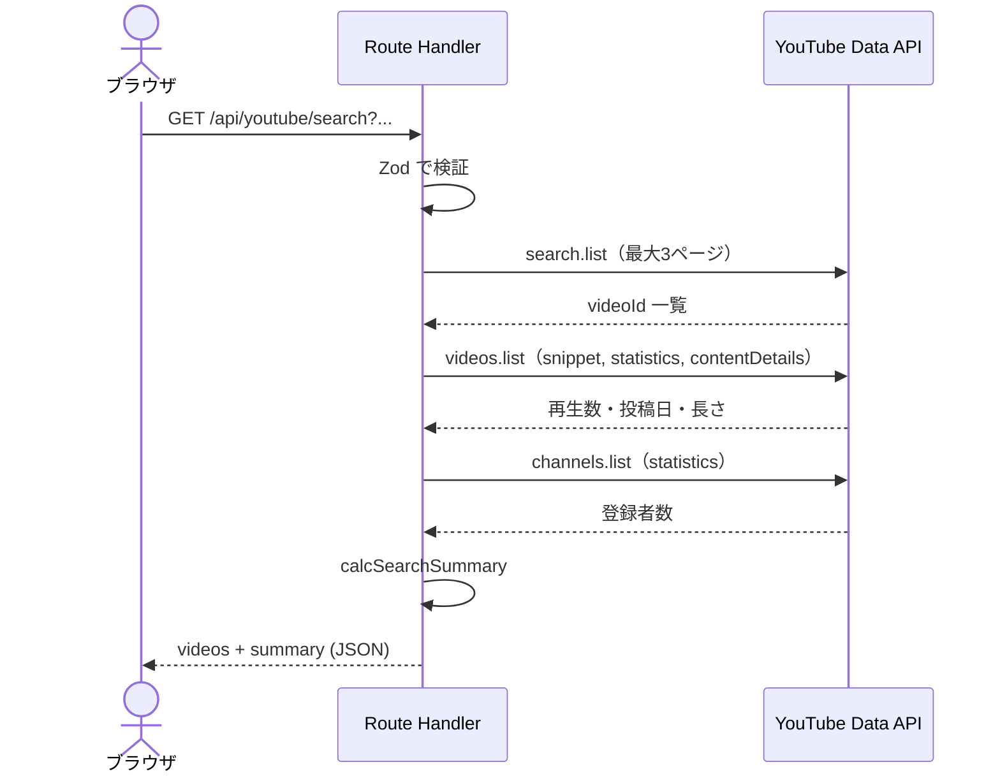

## 再生数だけでは「当たり」が判断できない

YouTube の企画を立てるとき、最初に見るのは再生数です。ただ、再生数の多い動画は大手チャンネルの動画でもあります。登録者100万人のチャンネルが10万回再生されるのと、登録者1万人のチャンネルが10万回再生されるのでは、意味がまったく違います。

**youtube-analyser** は、この「規模に対する当たり外れ」を数字で見るための Web アプリです。キーワード・カテゴリ・投稿期間・動画の長さで候補を絞り、再生数・エンゲージメント率に加えて、登録者数で割ったバイラル係数を一覧とサマリーで表示します。Next.js 16（App Router）+ TypeScript、UI は shadcn/ui と Tailwind CSS、サーバー状態は TanStack Query、入力の検証は Zod です。

この記事では、フィルタをどこで受け、どの順序で API を呼び、どこで集計するかを、実装の抜粋とともに整理します。

## 全体構成

処理は「入力 → 検証 → 取得 → 集計 → 表示」の一方向です。ブラウザは YouTube API を直接叩かず、必ず `/api/youtube/search` を通ります。



図1: 検索リクエストの流れ

責務は次のように分けています。

- **検証**: Route Handler の入口で Zod スキーマに通す。UI の都合はここで吸収する
- **取得**: `src/lib/youtube/client.ts` が3つのエンドポイントを順に呼び、`VideoItem` に正規化する
- **集計**: `src/lib/youtube/stats.ts` の純関数。API も React も知らない
- **表示**: `src/hooks/useYouTubeSearch.ts` が TanStack Query でラップし、`StatsSummary` と `VideoList` が描画する

ブラウザが受け取るのは `{ success, data: { videos, summary } }` という JSON だけで、API キーも YouTube の生のレスポンスも渡りません。取得の失敗は Route Handler が 500 に変換し、検証の失敗は 400 と `flatten()` したエラー詳細になります。UI 側は `body.success` を見て例外に変えるだけなので、画面のコードに API の事情が漏れません。

## 技術選定

| 論点 | 採用 | 代替案 | 採用理由 |
|---|---|---|---|
| API キーの扱い | Route Handler でサーバー側に閉じる | ブラウザから直接 fetch | キーをバンドルに載せない。CORS の考慮も不要 |
| 入力検証 | Zod スキーマ | 手書きの if 文 | 型と検証を1箇所に置ける。エラーの形も揃う |
| サーバー状態 | TanStack Query | useState + useEffect | ローディング・再取得・キャッシュを自前で書かない |
| 候補の収集 | 3ページ × 50件 | 1ページのみ | 並べ替えの母数を増やす。1ページでは上位50件で打ち切り |
| 表示順 | バイラル係数でソート | API の order に任せる | order は「取得時」の並び。表示には別の軸が要る |

## 実装の核

### 1. フィルタは入口のスキーマに集約する

`src/app/api/youtube/search/route.ts` が受け取るのはクエリ文字列です。ここで型を確定させ、以降の層には検証済みの値だけを渡します。

```ts
// src/app/api/youtube/search/route.ts
const searchSchema = z
  .object({
    searchMode: z.enum(['search', 'trending']).optional(),
    keyword: z.string().min(1).optional(),
    categoryId: z.string().optional(),
    publishedAfter: z.string().datetime({ offset: true }).optional(),
    publishedBefore: z.string().datetime({ offset: true }).optional(),
    videoDuration: z.enum(['short', 'medium', 'long', 'any']).optional(),
    order: z.enum(['relevance', 'viewCount', 'rating', 'date']).optional(),
    maxResults: z.coerce.number().int().min(1).max(50).optional(),
    subscriberCountMax: z.coerce.number().int().min(0).optional(),
  })
  .refine(
    (d) =>
      d.searchMode === 'trending' ||
      d.keyword ||
      d.categoryId ||
      d.publishedAfter ||
      (d.videoDuration && d.videoDuration !== 'any'),
    { message: 'キーワード、カテゴリ、投稿期間、動画の長さのいずれかを指定してください' }
  )
```

`refine` で「いずれか1つは必須」を課しています。空のリクエストでクォータだけ消費するのを防ぐためです。トレンド発掘モードは条件なしでも成立するので、`searchMode === 'trending'` を例外にしています。

UI 側の都合も入口で吸収します。セレクトボックスの「すべて」は `_all` というセンチネル値で送られてくるので、検証の前に落とします。

```ts
// src/app/api/youtube/search/route.ts
// _all はフロントエンドの Select センチネル値なので除去する
if (raw.categoryId === '_all') delete raw.categoryId
```

### 2. 3つのエンドポイントを1つの型に正規化する

YouTube Data API は、検索・動画詳細・チャンネルで返す形が違います。`src/lib/youtube/client.ts` はこれを `VideoItem` に寄せます。

```ts
// src/lib/youtube/client.ts（buildVideoItems）
const subscriberCount = subscriberMap.get(item.snippet.channelId) ?? 0
const stats = calcStats(item)
const viralCoefficient =
  subscriberCount > 0 ? Math.round((stats.viewCount / subscriberCount) * 10) / 10 : 0
```

係数の定義は「再生数 ÷ 登録者数」で、小数第1位に丸めます。登録者数が取れないときは 0 にしています（この扱いの副作用は後述します）。

`search.list` は動画の統計を返しません。そのため `videos.list` に `part=snippet,statistics,contentDetails` を指定して詳細を取り、さらに `channels.list` で登録者数をまとめて引きます。チャンネル ID は重複を除いてから渡します。

```ts
// src/lib/youtube/client.ts（fetchChannelSubscriberCounts）
const unique = [...new Set(channelIds)]
if (unique.length === 0) return new Map()
```

### 3. 取得順と表示順を分ける

`fetchSearchVideos` は最大3ページ、150件まで候補を集めます。`order` は「どの候補を取ってくるか」を決めるパラメータで、最終的な並びは係数で決め直します。

```ts
// src/lib/youtube/client.ts（fetchSearchVideos）
for (let page = 0; page < 3; page++) {
  const params = new URLSearchParams(baseParams)
  if (pageToken) params.set('pageToken', pageToken)

  const searchData = await fetchJson<YouTubeSearchApiResponse>(`${BASE_URL}/search?${params}`)
  const videoIds = searchData.items.map((item) => item.id.videoId).join(',')
  if (!videoIds) break

  const pageVideos = await fetchVideoDetails(videoIds, apiKey)
  allVideos.push(...pageVideos)

  if (!searchData.nextPageToken) break
  pageToken = searchData.nextPageToken
}

let filtered = allVideos
if (filters.subscriberCountMax !== undefined) {
  filtered = filtered.filter((v) => v.subscriberCount <= filters.subscriberCountMax!)
}

return filtered
  .sort((a, b) => b.viralCoefficient - a.viralCoefficient)
  .slice(0, targetCount)
```

取得は常に `maxResults=50` で行い、表示件数（10・20・50）は最後の `slice` で決めます。件数を変えても取得の形が変わらないので、結果の並びが件数によって揺れません。

### 4. 集計は純関数に置く

`src/lib/youtube/stats.ts` は `VideoItem[]` を受け取って `SearchSummary` を返すだけの関数です。平均だけだと1本の外れ値に引っ張られるので、中央値も同じ配列から計算します。

```ts
// src/lib/youtube/stats.ts
const sorted = [...viewCounts].sort((a, b) => a - b)
const mid = Math.floor(sorted.length / 2)
const medianViewCount =
  sorted.length % 2 === 0 ? (sorted[mid - 1] + sorted[mid]) / 2 : sorted[mid]
```

`topPerformer` は再生数ではなく係数の最大値で選びます。再生数の最大値は大手チャンネルが持っていくため、「規模に対する当たり」を見るには別の基準が要るからです。

## 品質と性能

クォータの単価は README に書かれています。`search.list` が100、`videos.list` が1、1日の上限が10,000です。`channels.list` は README の表にないため、公開仕様どおり1として数えています。ここに実装の呼び出し回数を当てはめると、3ページ分の候補がそろったキーワード検索1回は次のようになります。

| 呼び出し | 回数 | クォータ |
|---|---|---|
| search.list | 3 | 300 |
| videos.list | 3 | 3 |
| channels.list | 3 | 3 |
| 合計 | 9 | 約306 |

README の「1回の検索合計 約101」は1ページ分の見積もりです。実装は3ページ取得し、`channels.list` も呼ぶため、単価をそのまま足すと約306になります。10,000 を 306 で割ると約32回で、1日に試せる検索は30回前後という計算です。トレンド発掘モードは `videos.list` と `channels.list` の2回だけで済むため、こちらは消費が小さくなります。

キャッシュはクライアント側の TanStack Query に寄せています。`staleTime` は5分、`retry` は1回です。同じ条件を5分以内に再送しても、API は呼ばれません。サーバー側にはキャッシュを持たせていません。集計は常に最新の数値で行いたいのと、Next.js の Route Handler を状態なしに保ちたかったためです。連打はクライアントの `staleTime` で吸収する、という前提の分担です。

```tsx
// src/components/providers/QueryProvider.tsx
new QueryClient({
  defaultOptions: {
    queries: { retry: 1, staleTime: 1000 * 60 * 5 },
  },
})
```

テストは Vitest + Testing Library で、`it(` の数を数えると51件あります。ただし執筆時点で `npm test` を実行すると26件が通り、25件が失敗します。原因は後述します。

## つまずいた点

- **係数のゼロ埋め**: `hiddenSubscriberCount` が true のチャンネルは登録者数を 0 として扱うため、係数も 0 になり、係数順の末尾に落ちます。「当たりがない」のか「数字が取れない」のかが区別できません。
- **並び順の意味が伝わらない**: UI の「並び順（取得時）」は候補の集め方を変えるだけで、表示は常に係数順です。ラベルに「取得時」と補ったのはこのためですが、初見では分かりにくい部分です。
- **カテゴリ数のずれ**: README は17種と書いていますが、実装の `VIDEO_CATEGORIES` は15種＋「すべて」です。UI はこの定数をそのまま描画するので、実装が正になります。
- **テストが実装より先行している**: テストは `subscriberCountMin` や `viewCountMin` を期待していますが、スキーマと `SearchFilters` には `subscriberCountMax` までしかありません。この差分が失敗25件の主因です。

## まとめ

- 入口で Zod に通し、UI のセンチネル値もそこで吸収すると、以降の層が単純になる
- 返す形が違う3つのエンドポイントは、早い段階で1つの型に正規化する
- 取得順（API の order）と表示順（自前の指標）は分けて考える
- 集計は純関数に切り出し、平均と中央値を並べて出す
- クォータは「ページ数 × 単価」で見積もる。1ページ分の見積もりをそのまま信じない

## 関連記事

- [トレンドの当たり外れを数字で見る — 再生数ランキングの盲点を埋める](/post/20261115youtube-analyser-solution/)

---

**YouTube データを使った分析ツールの開発でお困りのことはありませんか？**

技術相談や開発サポートを承っています。お気軽にご相談ください。

[ココナラで開発相談を依頼する](https://coconala.com/users/1993863)
